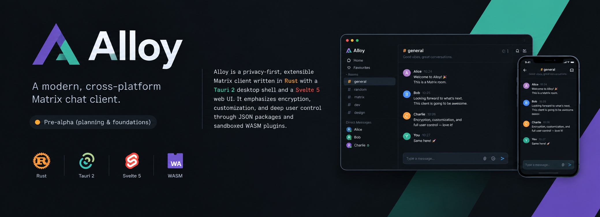
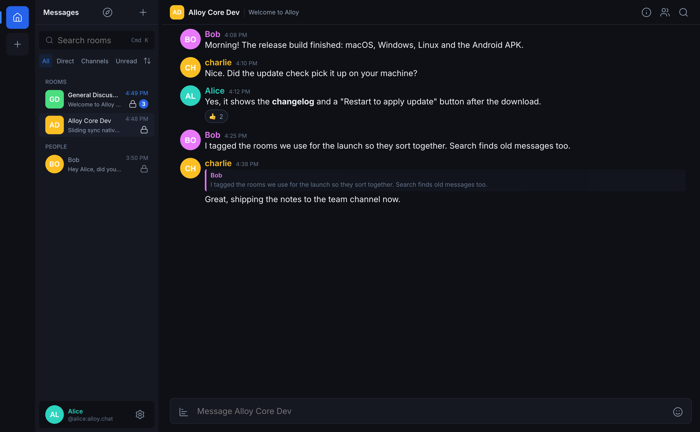
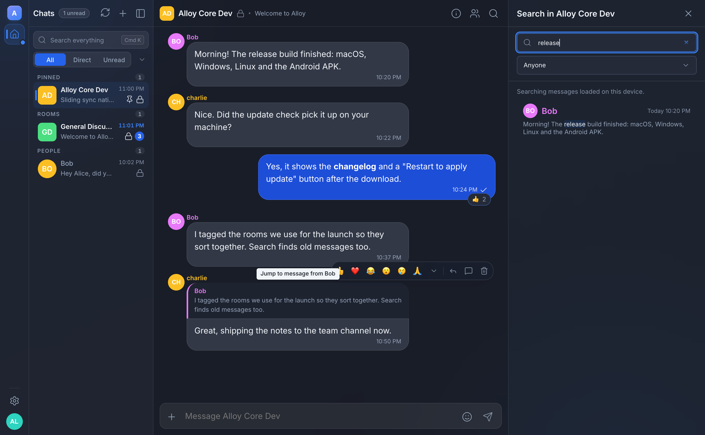
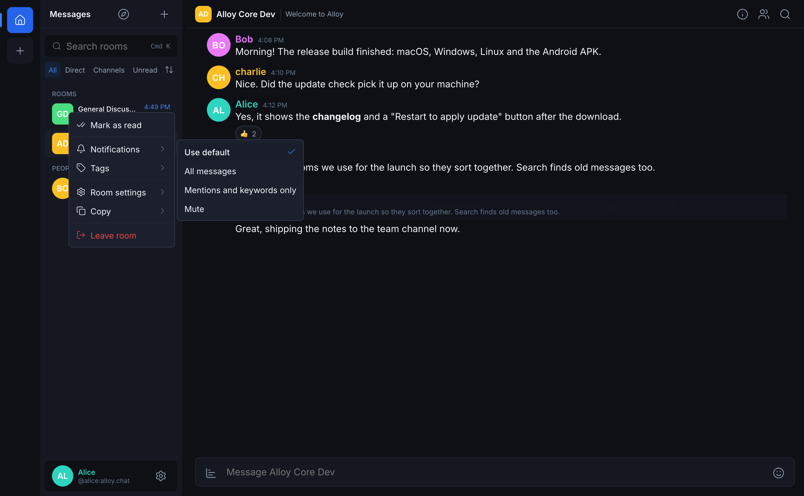
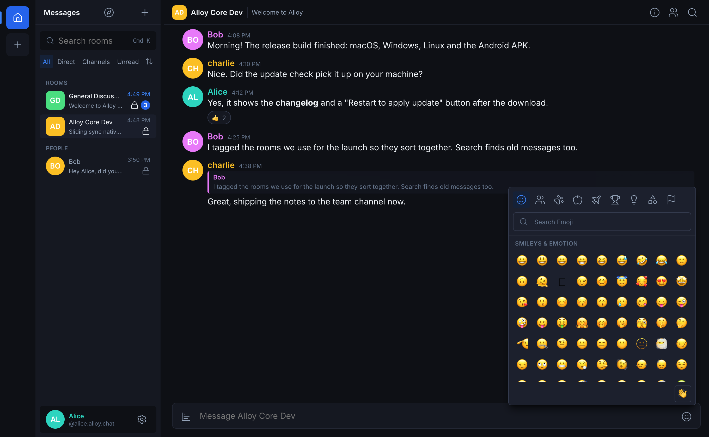
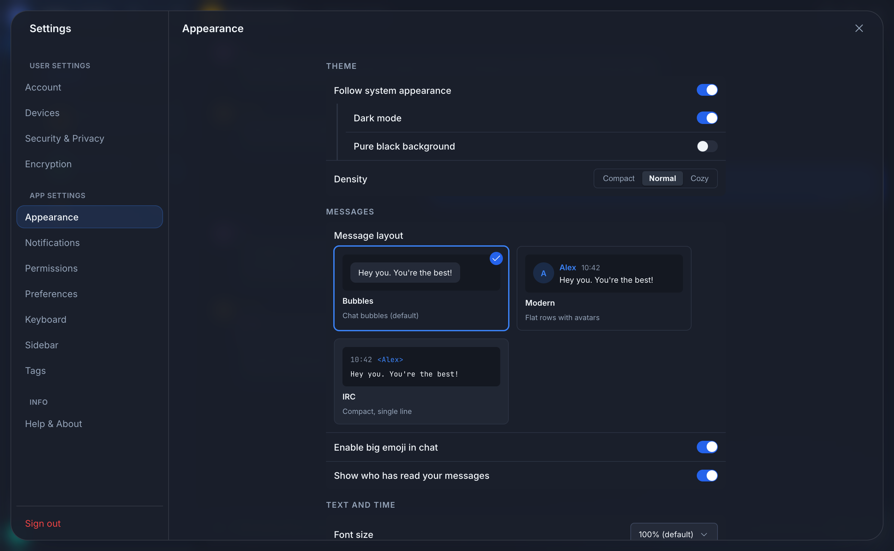
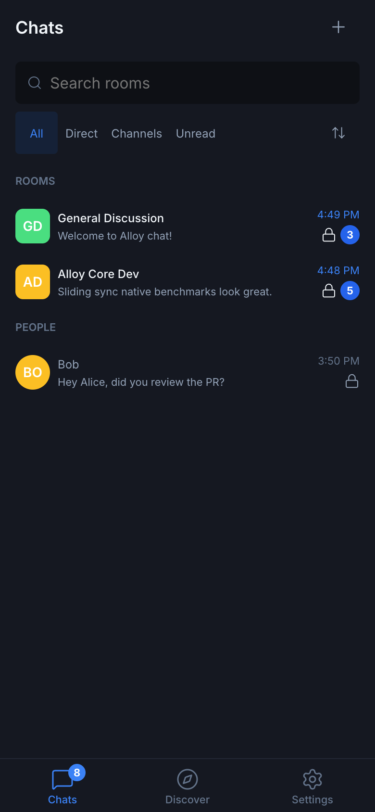
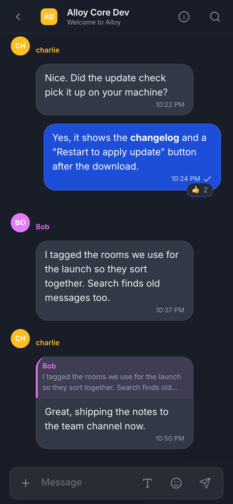

<p align="center">
  
</p>

<p align="center">
  <a href="https://github.com/centopw/alloy/releases"></a>
  <a href="https://github.com/centopw/alloy/releases"></a>
  <a href="https://github.com/centopw/alloy/stargazers"></a>
  <a href="https://github.com/centopw/alloy/network/members"></a>
  <a href="https://github.com/centopw/alloy/issues"></a>
  <a href="https://github.com/centopw/alloy/actions/workflows/ci.yml"></a>
  <a href="https://github.com/centopw/alloy/commits/main"></a>
  <a href="https://github.com/centopw/alloy/graphs/commit-activity"></a>
  <a href="LICENSE"></a>
  
</p>

# Alloy

Alloy is a chat app for [Matrix](https://matrix.org), the open network that lets you talk to people on
any server, with end-to-end encryption. It runs on **Mac, Windows, Linux and Android**, it is free and open
source, and it **never collects any data about you**: no analytics, no tracking, no ads.

Use your existing Matrix account (matrix.org, your company's server, your own) or create one on any server.

> **Early release.** Alloy already does the everyday things well, but it is young: some features are still
> missing (see [What's next](#whats-next)) and the installers are not yet signed, so your computer will ask you to confirm the first start.

<p align="center">
  
</p>

## What you can do

- **Chat with anyone on Matrix**, in private encrypted rooms, group rooms and direct messages. Reply (swipe a
  message on a phone), edit, delete, react with one tap, pin messages, forward, start threads, create polls, send
  voice messages, albums of photos, files and your location, and see when your messages have been read.
- **Find things fast.** Search your rooms from the sidebar (or with Ctrl/Cmd+K). Search *inside* a chat
  for words or for who said them, and jump straight to the message.
- **Stay organised.** Make your own tags (for example "Work", "Family"), colour them, put rooms under them,
  and filter or sort your room list by tag, unread, name or recent activity.
- **Keep chats in order.** Pin or archive a chat, mark it unread, mute it for an hour or a day, and unsent text
  waits for you as a draft.
- **Make it yours.** Dark theme, three message layouts (modern, chat bubbles or compact), text size,
  notification levels per room, and a settings page where every switch really does something.
  Your preferences follow you to your other devices.
- **Always know what's new.** Notifications on desktop and Android, unread counts that clear when you read,
  typing indicators, and an update notice that shows what changed before you install.
- **Feels right on a phone.** On Android the app turns into a proper phone app: one screen at a time, a bottom
  tab bar, big touch targets and sheets instead of tiny menus.

<table>
  <tr>
    <td width="50%"><br><sub>Search inside a chat, by words or by person</sub></td>
    <td width="50%"><br><sub>Right-click a room: notifications, tags, settings</sub></td>
  </tr>
  <tr>
    <td width="50%"><br><sub>Emoji picker with search, recents and skin tones</sub></td>
    <td width="50%"><br><sub>Settings</sub></td>
  </tr>
</table>

<p align="center">
  
  &nbsp;
  
</p>

## Privacy

- Your messages are protected with end-to-end encryption in encrypted rooms. Only you and the people in the
  room can read them.
- Alloy has **no telemetry**. It only talks to your own Matrix server.
- Link previews are built by your server, and are off in encrypted rooms unless you turn them on.
- On desktop, your login and encryption keys are kept in the system's secure storage (Keychain, Credential Manager, Secret Service).

## Install

Download the file for your system from the **[Releases page](https://github.com/centopw/alloy/releases)**.

| System | File | First start |
|---|---|---|
| **macOS** | `Alloy_…_aarch64.dmg` (Apple chips) or `…_x64.dmg` (Intel) | Drag Alloy to Applications, then right-click it and choose **Open**. If macOS says the app is "damaged", run `xattr -dr com.apple.quarantine /Applications/Alloy.app` in Terminal. |
| **Windows** | `Alloy_…_x64-setup.exe` (or `.msi`) | If SmartScreen warns, choose **More info**, then **Run anyway**. |
| **Linux** | `.AppImage`, `.deb` or `.rpm` | Make the AppImage executable, or install the package. |
| **Android** | `alloy-android.apk` | Allow installing from your browser when asked. Android 7 or newer. |

Why the warnings? Alloy is not yet signed with the paid developer certificates Apple and Microsoft ask for.
That is only a matter of paperwork; the code is open and every release lists a checksum file you can verify.

**Updates:** on desktop, Alloy checks for updates by itself, shows you the release notes and updates in place.
On Android it tells you when a new version exists and opens the download page. Because the Android file is
signed with a temporary key for now, uninstall the old version before installing a new one.

## What's next

Alloy is developed in the open and the plan is public: **[roadmap](docs/PLAN.md)** and
**[project board](https://github.com/users/centopw/projects/2)**. Coming up:

- Notifications on Android when the app is closed (without needing Google services)
- Signing in through your server's web login (needed for matrix.org-style single sign-on)
- Searching old messages in encrypted rooms, voice messages, QR code sign-in, more languages
- Your own themes and shortcuts from simple files, then plugins and a community marketplace
- Voice and video calls, web version and multiple accounts (later)

## Project activity

<p align="center">
  <a href="https://star-history.com/#centopw/alloy&Date"></a>
</p>

- [Latest releases](https://github.com/centopw/alloy/releases) and the [changelog](CHANGELOG.md)
- [Recent commits](https://github.com/centopw/alloy/commits/main) and [contributors](https://github.com/centopw/alloy/graphs/contributors)
- [Issues](https://github.com/centopw/alloy/issues) and the [project board](https://github.com/users/centopw/projects/2)

## Help and feedback

- Found a bug or want a feature? [Open an issue](https://github.com/centopw/alloy/issues).
- Security problem? Please use [GitHub Security Advisories](SECURITY.md) instead of a public issue.
- Want to help? Read [CONTRIBUTING.md](CONTRIBUTING.md). Everyone is welcome under the [Code of Conduct](CODE_OF_CONDUCT.md).

## For developers

Alloy is written in Rust (the Matrix part) with a Tauri 2 app shell and a Svelte 5 interface.

```bash
git clone https://github.com/centopw/alloy.git && cd alloy
just hooks          # commit message checks
just synapse-up     # a local test server (users alice and bob, password testpassword123!)
cd apps/alloy && pnpm install && (cd ui && pnpm install)
pnpm tauri dev      # run the desktop app
```

You need Rust 1.90+, Node 22+ with pnpm, [just](https://github.com/casey/just) and Docker (for the test server).
Android builds also need the Android SDK and NDK 27.

| | |
|---|---|
| Everything CI runs | `just ci`, plus `pnpm check && pnpm test && pnpm build` in `apps/alloy/ui` |
| Try the UI without a server | `pnpm dev` in `apps/alloy/ui` (uses demo data) |
| Refresh the screenshots above | `pnpm build && node scripts/readme-shots.mjs` in `apps/alloy/ui` |
| Master plan and decisions | [docs/PLAN.md](docs/PLAN.md), [docs/decisions/](docs/decisions/README.md) |
| How releases work | [docs/RELEASING.md](docs/RELEASING.md) |
| Changelog | [CHANGELOG.md](CHANGELOG.md) |

## License

Apache License 2.0, see [LICENSE](LICENSE).
