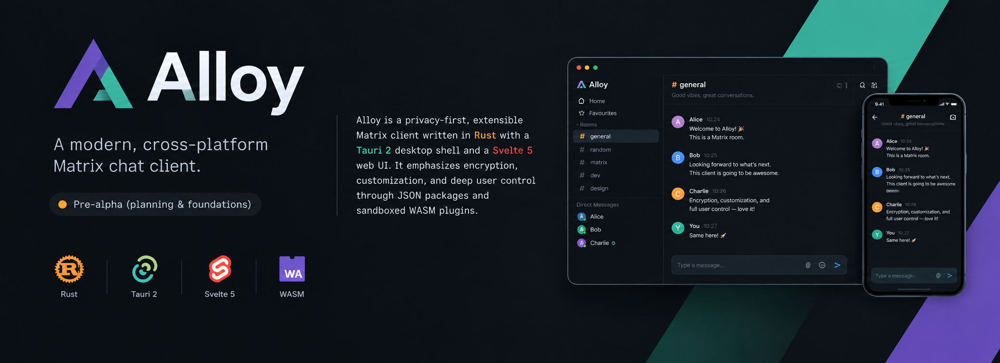
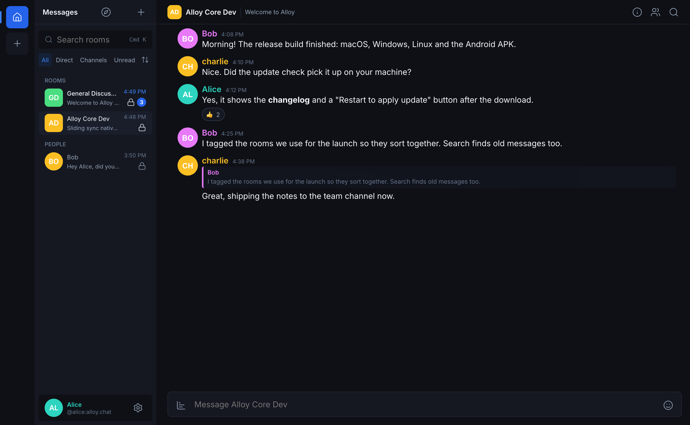
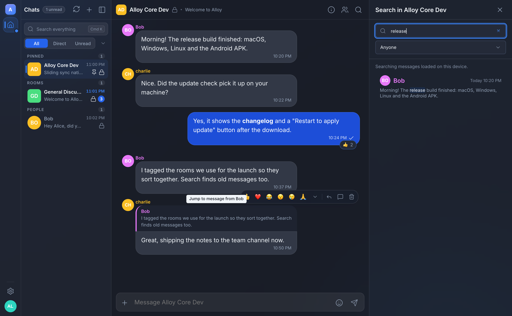
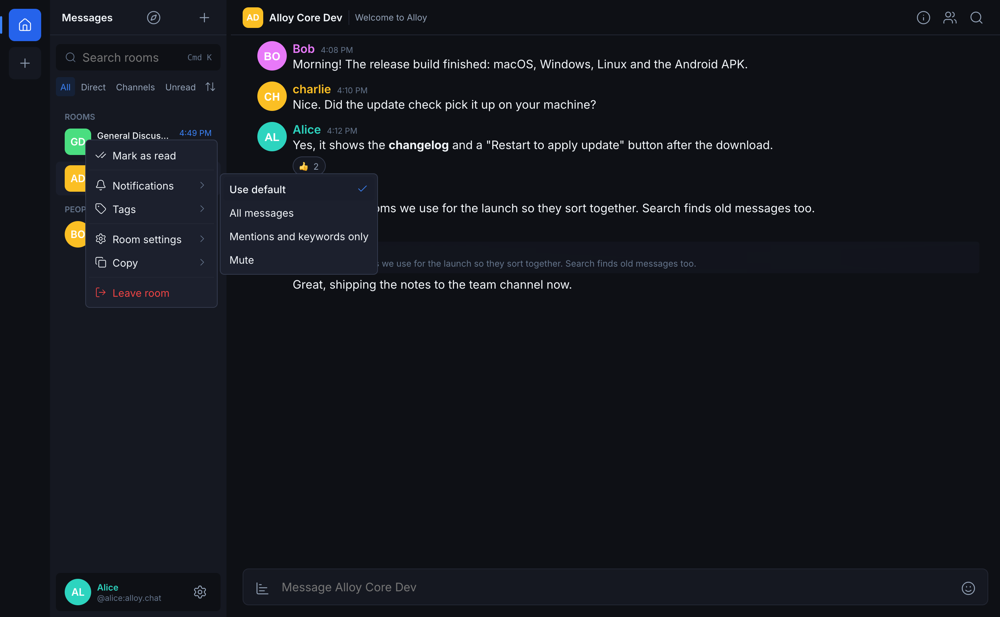
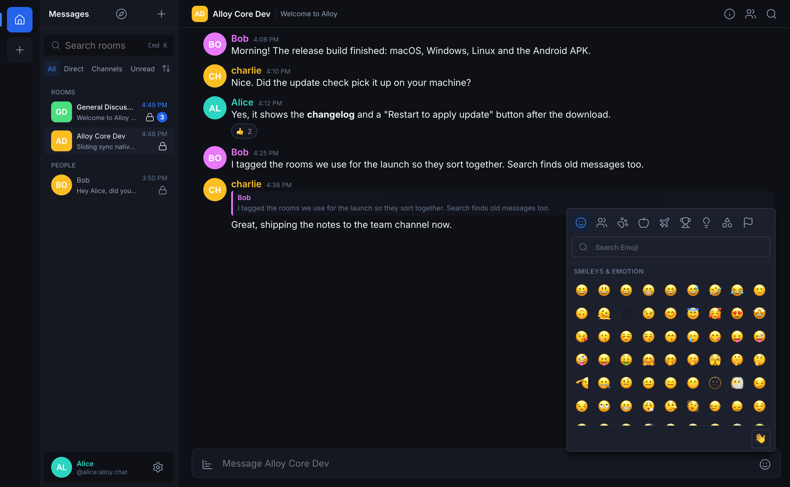
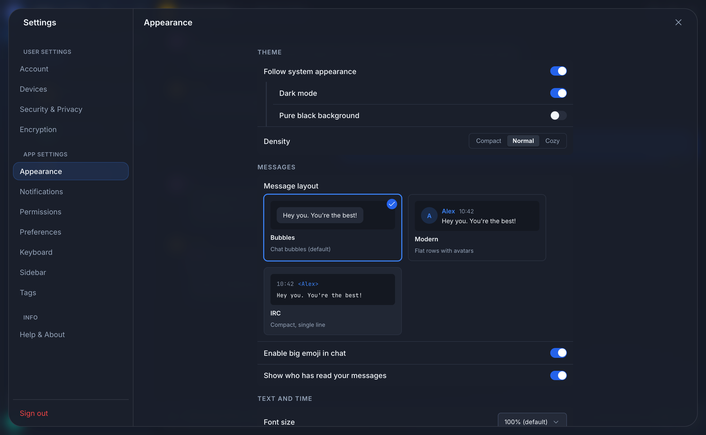
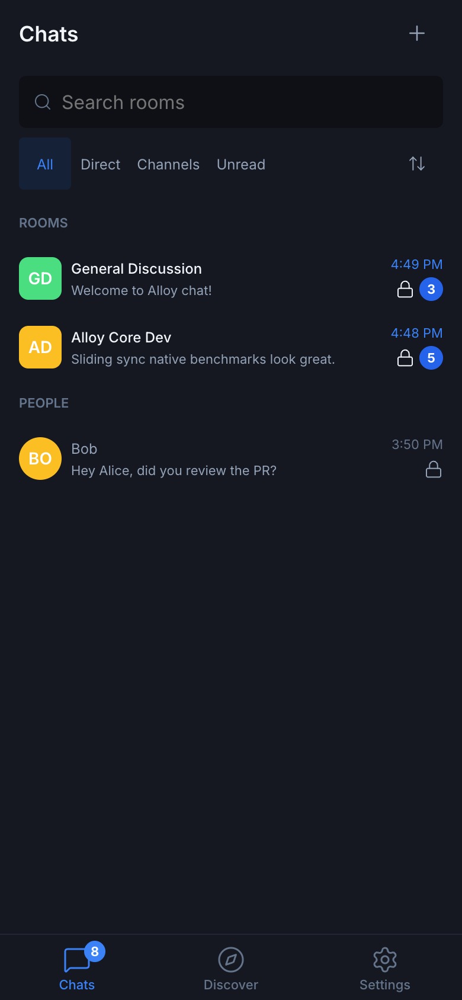
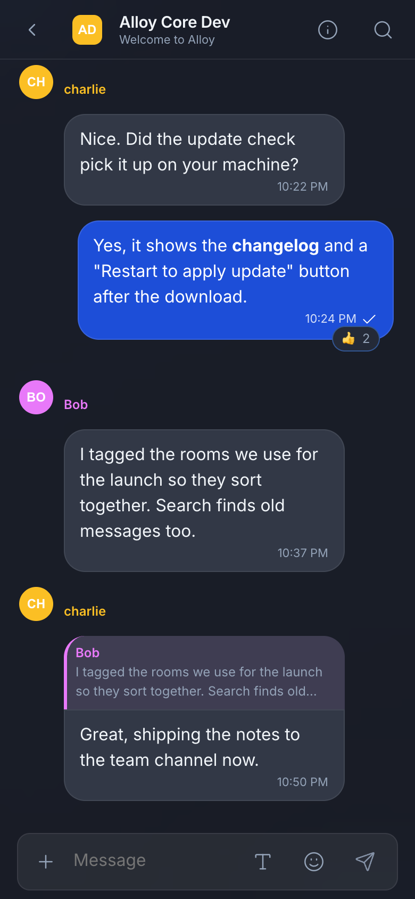

<p align="center">
  
</p>

<p align="center">
  <a href="https://github.com/centopw/alloy/releases"></a>
  <a href="https://github.com/centopw/alloy/releases"></a>
  <a href="https://github.com/centopw/alloy/stargazers"></a>
  <a href="https://github.com/centopw/alloy/network/members"></a>
  <a href="https://github.com/centopw/alloy/issues"></a>
  <a href="https://github.com/centopw/alloy/actions/workflows/ci.yml"></a>
  <a href="https://github.com/centopw/alloy/commits/main"></a>
  <a href="https://github.com/centopw/alloy/graphs/commit-activity"></a>
  <a href="LICENSE"></a>
  
</p>

# Alloy

Alloy is one app for your **Telegram** and **Facebook Messenger** chats. You sign in to your own personal
accounts and Alloy talks to each network **directly from your device**: there is no server in the middle,
and every message is stored only on your device. It runs on **Mac, Windows, Linux and Android**, it is free
and open source, and it **never collects any data about you**: no analytics, no tracking, no ads.

> **Account risk.** Neither network offers an official API for personal accounts in third-party apps.
> Telegram allows unofficial clients under its [API terms](https://core.telegram.org/api/terms) and may watch
> them closely; Alloy never hides read receipts or typing from the people you talk to. Meta has no
> personal-account API at all, and Messenger accounts used this way have been locked
> ([mautrix/meta#44](https://github.com/mautrix/meta/issues/44)). Alloy shows this risk before you connect
> Messenger; only connect an account you can afford to have restricted.

> **Early release.** Alloy already does the everyday things well, but it is young: some features are still
> missing (see [What's next](#whats-next)) and the installers are not yet signed, so your computer will ask you to confirm the first start.

<p align="center">
  
</p>

## What you can do

- **Telegram and Messenger in one list.** Connect your personal accounts and read every chat side by side.
  Reply (swipe a message on a phone), edit, delete, react, send voice messages, photos and files, and see
  when your messages have been read, wherever the network supports it: Alloy only offers what each network
  can really do.
- **Find things fast.** Search your chats from the sidebar (or with Ctrl/Cmd+K). Search *inside* a chat
  for words or for who said them, and jump straight to the message.
- **Stay organised.** Make your own tags (for example "Work", "Family"), colour them, put chats under them,
  and filter or sort your chat list by tag, unread, name or recent activity.
- **Keep chats in order.** Pin or archive a chat, mark it unread, mute it for an hour or a day, and unsent text
  waits for you as a draft.
- **Make it yours.** Dark theme, three message layouts (modern, chat bubbles or compact), text size,
  notification levels per chat, and a settings page where every switch really does something.
- **Always know what's new.** Notifications on desktop and Android, unread counts that clear when you read,
  typing indicators, and an update notice that shows what changed before you install.
- **Feels right on a phone.** On Android the app turns into a proper phone app: one screen at a time, a bottom
  tab bar, big touch targets and sheets instead of tiny menus.

<table>
  <tr>
    <td width="50%"><br><sub>Search inside a chat, by words or by person</sub></td>
    <td width="50%"><br><sub>Right-click a room: notifications, tags, settings</sub></td>
  </tr>
  <tr>
    <td width="50%"><br><sub>Emoji picker with search, recents and skin tones</sub></td>
    <td width="50%"><br><sub>Settings</sub></td>
  </tr>
</table>

<p align="center">
  
  &nbsp;
  
</p>

## Privacy

- Your messages go straight between your device and Telegram or Meta. There is no Alloy server, and no copy
  of your chats exists anywhere but on your device and at the network itself.
- Alloy has **no telemetry**. It only talks to the networks you connected.
- Your chats are kept in a local database in Alloy's app folder. Your account sign-ins are encrypted with a
  key held in the system's secure storage (Keychain, Credential Manager, Secret Service; a private app file
  on Android). Encrypting the whole message database is planned.
- Where a network encrypts chats end to end (Messenger's encrypted chats), that encryption is the network's
  own; Alloy does not add a layer of its own.

## Install

Download the file for your system from the **[Releases page](https://github.com/centopw/alloy/releases)**.

| System | File | First start |
|---|---|---|
| **macOS** | `Alloy_…_aarch64.dmg` (Apple chips) or `…_x64.dmg` (Intel) | Drag Alloy to Applications, then right-click it and choose **Open**. If macOS says the app is "damaged", run `xattr -dr com.apple.quarantine /Applications/Alloy.app` in Terminal. |
| **Windows** | `Alloy_…_x64-setup.exe` (or `.msi`) | If SmartScreen warns, choose **More info**, then **Run anyway**. |
| **Linux** | `.AppImage`, `.deb` or `.rpm` | Make the AppImage executable, or install the package. |
| **Android** | `alloy-android.apk` | Allow installing from your browser when asked. Android 7 or newer. |

Why the warnings? Alloy is not yet signed with the paid developer certificates Apple and Microsoft ask for.
That is only a matter of paperwork; the code is open and every release lists a checksum file you can verify.

**Updates:** on desktop, Alloy checks for updates by itself, shows you the release notes and updates in place.
On Android it tells you when a new version exists and opens the download page. Because the Android file is
signed with a temporary key for now, uninstall the old version before installing a new one.

## What's next

Alloy is developed in the open and the plan is public: **[roadmap](docs/PLAN.md)** and
**[project board](https://github.com/users/centopw/projects/2)**. Coming up:

- Hardening: encrypting the whole local database, steadier device sign-ins and end-to-end tests on desktop
  and Android
- An optional self-hosted gateway that keeps your accounts connected and brings notifications while the app
  is closed
- Your own themes and shortcuts from simple files, then plugins and a community marketplace
- Searching old messages, more languages, voice and video calls and a web version (later)

## Project activity

<p align="center">
  <a href="https://star-history.com/#centopw/alloy&Date"></a>
</p>

- [Latest releases](https://github.com/centopw/alloy/releases) and the [changelog](CHANGELOG.md)
- [Recent commits](https://github.com/centopw/alloy/commits/main) and [contributors](https://github.com/centopw/alloy/graphs/contributors)
- [Issues](https://github.com/centopw/alloy/issues) and the [project board](https://github.com/users/centopw/projects/2)

## Help and feedback

- Found a bug or want a feature? [Open an issue](https://github.com/centopw/alloy/issues).
- Security problem? Please use [GitHub Security Advisories](SECURITY.md) instead of a public issue.
- Want to help? Read [CONTRIBUTING.md](CONTRIBUTING.md). Everyone is welcome under the [Code of Conduct](CODE_OF_CONDUCT.md).

## For developers

Alloy is written in Rust (engine, local store and the Telegram connector), with a Tauri 2 app shell and a
Svelte 5 interface. Messenger runs through `sidecars/alloy-meta`, a separate Go program (AGPL-3.0, built on
[mautrix-meta](https://github.com/mautrix/meta)) that the app starts and talks to over stdio. The design is
recorded in [ADR 0016](docs/decisions/0016-on-device-connectors.md).

```bash
git clone https://github.com/centopw/alloy.git && cd alloy
just hooks          # commit message checks
just sidecar        # build the Messenger sidecar; every app build needs it
cd apps/alloy && pnpm install && (cd ui && pnpm install)
pnpm tauri dev      # run the desktop app
```

You need Rust 1.90+, Go (the version in `sidecars/alloy-meta/go.mod`), Node 22+ with pnpm and
[just](https://github.com/casey/just). Android builds also need the Android SDK and NDK 27 and JDK 17; then
run `just android-debug` (it builds the Android sidecar first).

Telegram asks for the application `api_id`/`api_hash` pair once, in Settings -> Networks -> Telegram
application, and seals it in the OS keyring; nothing is compiled into the build. For headless work you can
export `ALLOY_TELEGRAM_API_ID`/`ALLOY_TELEGRAM_API_HASH` instead (a developer override — see
[CONTRIBUTING.md](CONTRIBUTING.md)).

| | |
|---|---|
| Everything CI runs | `just ci`, plus `pnpm check && pnpm test && pnpm build` in `apps/alloy/ui` and `go vet ./... && go test ./...` in `sidecars/alloy-meta` |
| Connector tests | `cargo test -p alloy-connector --features testing`, `-p alloy-engine --features testing`, `-p alloy-sidecar --features fake-sidecar` |
| Try the UI without an account | `pnpm dev` in `apps/alloy/ui` (uses demo data) |
| Refresh the screenshots above | `pnpm build && node scripts/readme-shots.mjs` in `apps/alloy/ui` |
| Master plan and decisions | [docs/PLAN.md](docs/PLAN.md), [docs/decisions/](docs/decisions/README.md) |
| How releases work | [docs/RELEASING.md](docs/RELEASING.md) |
| Changelog | [CHANGELOG.md](CHANGELOG.md) |

## License

Apache License 2.0, see [LICENSE](LICENSE). The Messenger sidecar in `sidecars/alloy-meta` is AGPL-3.0 (see
its [LICENSE](sidecars/alloy-meta/LICENSE)) and ships as a separate program.
