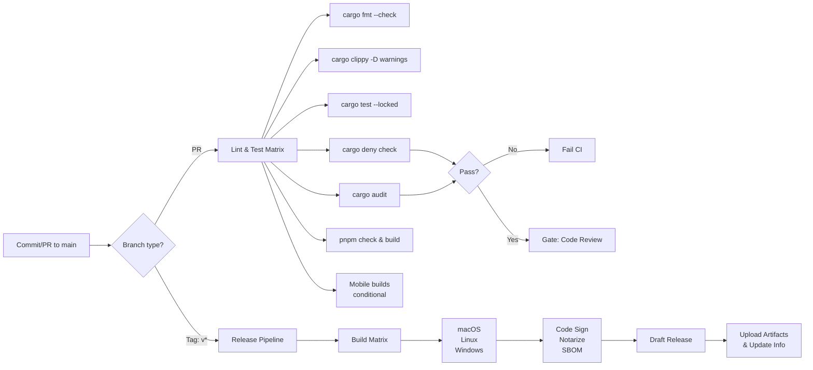

# CI/CD Pipeline Documentation

**Status:** P0 Implementation  
**Last Updated:** 2026-10-16

---

## Overview

Alloy uses **GitHub Actions** for continuous integration, automated testing, security checks, and binary releases. The pipeline enforces code quality, dependency hygiene, and security best practices across macOS, Windows, and Linux.

### Architecture



---

## Workflow Files

### 1. `.github/workflows/ci.yml`

**Trigger:** Every push to `main` + all PRs to `main`

**Jobs:**

| Job | Runs On | Purpose |
|-----|---------|---------|
| `fmt` | `ubuntu-latest` | Verify Rust code formatting (`rustfmt`) |
| `clippy-test` | Ubuntu, macOS, Windows | Lint + unit/integration tests (matrix) |
| `cargo-deny` | `ubuntu-latest` | License audit + banned crates check |
| `ui` | `ubuntu-latest` | SvelteKit type-check + Vite build |
| `mobile-ios` | `macos-latest` | iOS app bundle (gated: only if `apps/alloy/src-tauri/gen/apple/` exists) |
| `mobile-android` | `ubuntu-latest` | Android APK build (gated: only if `apps/alloy/src-tauri/gen/android/` exists) |

**Key Features:**
- Caches `.cargo` registry & targets across runs (Swatinem/rust-cache)
- Caches pnpm dependencies
- Mobile jobs run conditionally: check for generated platform directories before installing SDKs
- No secrets required

**Duration:** ~15–25 minutes per OS

### 2. `.github/workflows/audit.yml`

**Trigger:**
- Daily scheduled run (midnight UTC)
- Manual dispatch via `workflow_dispatch`
- Push to `main` when `Cargo.lock`, `Cargo.toml`, or `deny.toml` change

**Jobs:**

| Job | Purpose |
|-----|---------|
| `audit` | Run `cargo-audit` (RustSec advisory DB) + `cargo deny` (licenses, bans, sources) |

**Key Features:**
- Uses `rustsec/audit-check@v2` action for convenient GitHub integration
- Fails on known CVEs but allows warnings for unmaintained transitive deps
- Runs independently from PR checks to catch new vulnerabilities post-merge

### 3. `.github/workflows/release.yml`

**Trigger:** Git push with tag matching `v*` (e.g., `v0.1.0`)

**Jobs:**

| Job | Platforms | Purpose |
|-----|-----------|---------|
| `build-tauri` | macOS, Linux, Windows | Build signed desktop bundles + SBOM |

**Key Features:**
- Builds UI assets in advance (single `pnpm build` per matrix)
- Generates CycloneDX SBOM per platform (JSON format)
- Uses `tauri-apps/tauri-action@v0` to orchestrate platform-specific builds
- Creates **draft release** (manual publish in GitHub UI)
- Uploads SBOM + bundles as release assets

**Code Signing & Notarization:**

| Platform | Secret | Purpose | Status |
|----------|--------|---------|--------|
| **macOS** | `APPLE_CERTIFICATE` (Base64 P12) | Code signing certificate | TODO: Deploy in repo settings |
| | `APPLE_CERTIFICATE_PASSWORD` | P12 password | TODO |
| | `APPLE_SIGNING_IDENTITY` | Team ID + code-signing identity string | TODO |
| | `APPLE_ID` | Apple Developer account email | TODO |
| | `APPLE_PASSWORD` | App-specific password (not general account password) | TODO |
| | `APPLE_TEAM_ID` | Apple Developer Team ID (10 alphanumeric) | TODO |
| **Windows** | `WINDOWS_CERTIFICATE` (Base64 PFX) | Code signing certificate | TODO |
| | `WINDOWS_CERTIFICATE_PASSWORD` | PFX password | TODO |
| **All** | `TAURI_SIGNING_PRIVATE_KEY` (Base64 PEM) | Ed25519 private key for updater manifest signing | TODO |
| | `TAURI_SIGNING_PRIVATE_KEY_PASSWORD` | Passphrase for private key | TODO |
| | `GITHUB_TOKEN` | Auto-supplied by GitHub Actions | Already available |

---

## Local Development

Use **`justfile`** recipes to run CI checks locally:

```bash
just fmt              # Format code
just lint             # Check formatting + clippy (zero warnings)
just test             # Run all tests
just deny             # License + advisory checks
just audit            # Vulnerability scan
just ui-check         # SvelteKit type check
just ui-build         # Build UI assets
just synapse-up       # Start test Synapse homeserver (Docker)
just synapse-down     # Stop Synapse
just ci               # Run full pipeline (all checks + tests + audit + UI)
```

### Running the Full CI Locally

```bash
just ci
```

This executes:
1. `cargo fmt --all -- --check` (formatting)
2. `cargo clippy --workspace -- -D warnings` (linting)
3. `cargo test --workspace --locked` (tests)
4. `cargo deny check` (licenses & bans)
5. `cargo audit` (security advisories)
6. `pnpm install`, `pnpm check`, `pnpm build` (UI)

Expected result: **0 errors, 4 warnings (from transitive deps in audit)**.

---

## Security Policy

### Deny Checks (`cargo-deny`)

**Configuration:** `deny.toml`

**Checks:**

1. **Advisories**
   - Blocks: Yanked crates (production versions)
   - Warns: Unmaintained crates (e.g., `anymap2`, `derivative`, `proc-macro-error` from upstream deps)
   - Action: None (warnings allowed; new CVEs fail)

2. **Licenses**
   - Allowed: Apache-2.0, Apache-2.0 WITH LLVM-exception, MIT, BSD-2/3-Clause, ISC, Unicode-3.0/DFS-2016, MPL-2.0, Zlib, CC0-1.0, OpenSSL, BSL-1.0, CDLA-Permissive-2.0
   - Action: Denies unlicensed or incompatible licenses
   - Workspace members: Ignored (not checked)

3. **Bans**
   - Multiple versions: Warns (e.g., `tokio v1.0` + `tokio v1.40` in tree)
   - Highlight: All paths (simplest + lowest-version)

4. **Sources**
   - Only crates.io allowed (rejects git, custom registries)
   - Fails on unknown sources

### Audit Checks (`cargo-audit`)

- Scans `Cargo.lock` against RustSec advisory database
- **Fails** on known CVEs (CRITICAL, HIGH, MEDIUM)
- **Warns** on unmaintained crate notices (allowed in CI)
- **Does not** block low-severity advisories by default

### Coverage

- **Rust crates:** Workspace + all transitive dependencies
- **Frontend:** pnpm dependency tree (via Node.js package.json)
- **Mobile platforms:** Gated; only run if Tauri iOS/Android directories exist

---

## Release Process

### Prerequisites

1. **Secrets configured** in GitHub repo settings (see table above)
2. **Git tags** created locally: `git tag v0.1.0`
3. **Changelog** prepared (manually added to release draft post-CI)

### Steps

1. **Local verification:**
   ```bash
   just ci
   git tag -a v0.1.0 -m "Release v0.1.0"
   git push origin main --tags
   ```

2. **GitHub Actions runs:** `release.yml` is triggered
   - Builds all three platforms in parallel
   - Signs & notarizes binaries (requires secrets)
   - Generates SBOM per platform
   - Creates draft release with all artifacts

3. **Manual steps:**
   - Review draft release in GitHub UI
   - Add detailed release notes & changelog
   - Click "Publish release"

### Artifacts

**Each release contains:**
- macOS `.app` bundle (code-signed, notarized)
- macOS `.dmg` (installer)
- Windows `.exe` / `.msi` (signed)
- Linux AppImage + tarball
- `alloy-sbom-{macos,linux,windows}.json` (SBOM per platform)
- `update.json` (Tauri updater manifest, auto-generated)

---

## TODO & Open Items

### Pre-Production (Before v1.0)

- [ ] **macOS Secrets**
  - [ ] Obtain Apple Developer ID certificate (yearly ~$99)
  - [ ] Generate app-specific password (not general account password)
  - [ ] Add `APPLE_CERTIFICATE` (P12 → Base64), `APPLE_CERTIFICATE_PASSWORD`, `APPLE_SIGNING_IDENTITY`, `APPLE_ID`, `APPLE_PASSWORD`, `APPLE_TEAM_ID` to GitHub repo secrets

- [ ] **Windows Secrets**
  - [ ] Obtain code-signing certificate (DigiCert, GoDaddy, or similar; ~$200/year)
  - [ ] Generate PFX file: `openssl pkcs12 -export -in cert.crt -inkey key.key -out cert.pfx`
  - [ ] Add `WINDOWS_CERTIFICATE` (PFX → Base64), `WINDOWS_CERTIFICATE_PASSWORD` to secrets

- [ ] **Tauri Updater Keys**
  - [ ] Generate Ed25519 keypair: `cargo tauri signer generate`
  - [ ] Store private key as Base64 in `TAURI_SIGNING_PRIVATE_KEY` secret
  - [ ] Publish public key in app or docs

- [ ] **Verify mobile build gating:** Test that iOS/Android jobs skip when directories don't exist

- [ ] **Synapse test setup:** Confirm `tests/synapse/docker-compose.yml` exists (owned by another agent)

### Post-v1.0 Enhancements

- [ ] **Device certificate pinning:** TLS pin Synapse homeserver certs in app
- [ ] **Signed APK builds:** Enable APK signing in Android release CI
- [ ] **F-Droid submission:** Build & sign Flatpak/APK for F-Droid distribution
- [ ] **Formal security audit:** Third-party audit pre-App Store / Play Store launch
- [ ] **Attestation:** GitHub release artifact attestation (SLSA 3+)

---

## Performance & Costs

### GitHub Actions

- **macOS runners:** $0.10/minute (most expensive)
- **Linux runners:** $0.004/minute (cheapest)
- **Windows runners:** $0.006/minute

**Estimated cost per PR:** ~$0.10–0.30 (depending on concurrent runs)  
**Free tier:** 2,000 minutes/month (sufficient for personal/small teams)

---

## Troubleshooting

### CI Fails: "cargo deny check"

**Cause:** Unlicensed or incompatible license in new dependency  
**Fix:**
1. Check the error message for the crate name & license
2. If legitimate, add to `deny.toml` `[licenses] allow` list
3. Re-run `cargo deny check` locally to verify

### CI Fails: "cargo audit"

**Cause:** New CVE published in RustSec DB  
**Fix:**
1. Run `cargo audit` locally to see details
2. If dependency is unmaintained, file issue / report to crate maintainer
3. Upgrade to patched version if available
4. Or ignore in `[advisories] ignore` if false positive / low-risk

### Mobile builds don't run

**Check:** Do directories exist?
```bash
test -d apps/alloy/src-tauri/gen/apple && echo "iOS configured"
test -d apps/alloy/src-tauri/gen/android && echo "Android configured"
```

If missing, mobile jobs are skipped (expected during development).

### macOS notarization fails

**Common cause:** Apple ID password is not an app-specific password  
**Fix:** Generate app-specific password in [Apple ID settings](https://appleid.apple.com/account/manage)

---

## References

- **Tauri CLI:** https://tauri.app/
- **GitHub Actions:** https://docs.github.com/en/actions
- **cargo-deny:** https://embarkstudios.github.io/cargo-deny/
- **cargo-audit:** https://rustsec.org/
- **ActionLint:** https://github.com/rhysd/actionlint (YAML validation)
- **CycloneDX:** https://cyclonedx.org/ (SBOM standard)
