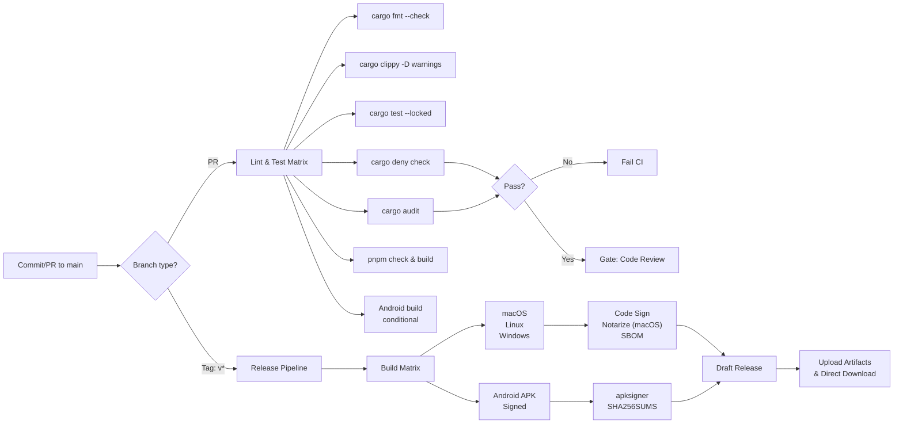

# CI/CD Pipeline Documentation

**Status:** P0 Implementation  
**Last Updated:** 2026-10-16

---

## Overview

Alloy targets **desktop (macOS, Windows, Linux) and Android** via **direct-install distribution** (no app stores).
Continuous integration, automated testing, security checks, and binary releases are orchestrated with **GitHub Actions**.

### Architecture



---

## Workflow Files

### 1. `.github/workflows/ci.yml`

**Trigger:** Every push to `main` + all PRs to `main`

**Jobs:**

| Job | Runs On | Purpose |
|-----|---------|---------|
| `commits` | `ubuntu-latest` | Validate Conventional Commits format |
| `fmt` | `ubuntu-latest` | Verify Rust code formatting (`rustfmt`) |
| `clippy-test` | Ubuntu, macOS, Windows | Lint + unit/integration tests with `wasm32-wasip2` target |
| `cargo-deny` | `ubuntu-latest` | License audit + banned crates check |
| `ui` | `ubuntu-latest` | SvelteKit type-check + Vite build |
| `mobile-android` | `ubuntu-latest` | Android APK build (gated: only if `apps/alloy/src-tauri/gen/android/` exists) |

**Key Features:**
- Caches `.cargo` registry & targets across runs (`Swatinem/rust-cache@v2`)
- Caches pnpm dependencies
- Android build job runs conditionally: gates execution on presence of generated project directory before installing SDKs
- No secrets required for CI PR validation

**Duration:** ~7–11 minutes per OS with a warm dependency cache; 25–35 minutes
from a cold cache (see [Build time and the cache budget](#build-time-and-the-cache-budget)).

### 2. `.github/workflows/audit.yml`

**Trigger:**
- Daily scheduled run (midnight UTC)
- Manual dispatch via `workflow_dispatch`
- Push to `main` when `Cargo.lock`, `Cargo.toml`, or `deny.toml` change

**Jobs:**

| Job | Purpose |
|-----|---------|
| `audit` | Run `cargo-audit` (RustSec advisory DB) + `cargo deny` (licenses, bans, sources) |

**Key Features:**
- Uses `rustsec/audit-check@v2` action for GitHub integration
- Fails on known CVEs but allows warnings for unmaintained transitive dependencies
- Runs independently from PR checks to catch new vulnerabilities post-merge

### 3. `.github/workflows/nightly.yml`

**Trigger:**
- Daily scheduled run at 02:00 UTC
- Manual dispatch via `workflow_dispatch` (input `perf_gate`, default `false`)

**Jobs:**

| Job | Runs On | Purpose |
|-----|---------|---------|
| `gate` | `ubuntu-latest` | Skips scheduled runs when nothing landed in the last 25 h |
| `build-nightly-desktop` | macOS arm64/x64, Linux, Windows | Build unsigned desktop bundles, measure cold start and idle memory |
| `build-nightly-android` | `ubuntu-latest` | Build and sign the arm64 release APK |

**Key Features:**
- Publishes a rolling `nightly` prerelease with unsigned desktop bundles and a signed APK
- Updater artifacts are disabled: nightlies have no signing key
- Desktop performance measurement runs on the bundle each leg just built; see [Desktop Performance Measurement](#desktop-performance-measurement)

### 4. `.github/workflows/release.yml`

**Trigger:** Git push with tag matching `v*` (e.g., `v0.1.0`)

**Jobs:**

| Job | Platforms | Purpose |
|-----|-----------|---------|
| `build-tauri` | macOS, Linux, Windows | Build signed desktop bundles + CycloneDX SBOM |
| `build-android` | Android (Ubuntu runner) | Build signed Android APK via `apksigner` + `SHA256SUMS` |

**Key Features:**
- Desktop bundles built via `tauri-apps/tauri-action@v0`
- Android APK built via `cargo tauri android build --apk` and signed with `apksigner`
- Computes `SHA256SUMS` checksums
- Generates CycloneDX SBOM per platform (JSON format)
- Creates **draft release** on GitHub Releases for direct-install downloads
- Uploads SBOM, desktop bundles, signed APK, and `SHA256SUMS` as release assets

**Code Signing Secrets:**

| Platform | Secret | Purpose | Status |
|----------|--------|---------|--------|
| **macOS** | `APPLE_CERTIFICATE` (Base64 P12) | Developer ID application certificate for macOS desktop DMG/App | TODO: Deploy in repo settings |
| | `APPLE_CERTIFICATE_PASSWORD` | P12 password | TODO |
| | `APPLE_SIGNING_IDENTITY` | Team ID + Developer ID application identity string | TODO |
| | `APPLE_ID` | Apple Developer account email (for desktop notarytool) | TODO |
| | `APPLE_PASSWORD` | App-specific password for desktop notarytool | TODO |
| | `APPLE_TEAM_ID` | Apple Developer Team ID (10 alphanumeric) | TODO |
| **Windows** | `WINDOWS_CERTIFICATE` (Base64 PFX) | Authenticode code signing certificate | TODO |
| | `WINDOWS_CERTIFICATE_PASSWORD` | PFX password | TODO |
| **Android** | `ANDROID_KEYSTORE_BASE64` | Base64-encoded Java release keystore (`.keystore`/`.jks`) | TODO |
| | `ANDROID_KEYSTORE_PASSWORD` | Keystore password | TODO |
| | `ANDROID_KEY_ALIAS` | Key alias in keystore | TODO |
| | `ANDROID_KEY_PASSWORD` | Key password | TODO |
| **All Desktop** | `TAURI_SIGNING_PRIVATE_KEY` (Base64 PEM) | Ed25519 private key for direct Tauri updater manifest signing | TODO |
| | `TAURI_SIGNING_PRIVATE_KEY_PASSWORD` | Passphrase for private key | TODO |
| | `GITHUB_TOKEN` | Auto-supplied by GitHub Actions | Already available |

---

## Desktop Performance Measurement

Implemented by `scripts/perf-desktop.mjs` (`just perf-desktop`), wired into the nightly desktop build for macOS arm64/x64, Linux and Windows. Budgets come from `docs/plan/08-delivery-p1.md`; this section records how they are measured and enforced.

### What is measured

| Metric | Budget | Verdict statistic |
|---|---|---|
| Cold start: spawn to first window | < 2000 ms | p95 |
| Idle memory: process-tree memory 10 s after ready | < 150 MB | p95 |

Per run the script spawns the app binary from the release bundle the job just built, waits for the first window, then samples process-tree memory five times at 1 s intervals starting 10 s after ready; the run's idle value is the median of those samples. With the default 5 runs, nearest-rank p95 equals the maximum, so one outlier decides the verdict.

Window detection per platform:

| Platform | Probe | Fallback |
|---|---|---|
| macOS | `System Events` window count via `osascript` | spawn to stable memory |
| Linux | `xdotool search --onlyvisible --pid` on the X display (`xvfb-run` in CI) | spawn to stable memory |
| Windows | `MainWindowHandle` via one PowerShell polling loop | spawn to stable memory |

The fallback applies when there is no display, `xdotool` is missing, or macOS automation permission is denied. In that mode the cold-start budget cannot be judged (`budgetMs: null`), so the report never claims a cold-start verdict it did not measure. On GitHub macOS runners the automation permission is normally denied, so macOS legs report the fallback metric; Linux and Windows report real window timing.

Idle memory is per-process and avoids double counting where the OS offers it:

| Platform | Metric | Fallback |
|---|---|---|
| macOS | `footprint` (physical footprint) | `ps` RSS |
| Linux | `/proc/<pid>/smaps_rollup` `Pss` | `ps` RSS |
| Windows | `Win32_Process.PageFileUsage` (private committed bytes) | working set |

The tree is the app PID, its descendants, and WebView helpers started by this launch (WebKit XPC on macOS, `msedgewebview2` on Windows, WebKitGTK children on Linux). Helpers already running before the launch are excluded. The report records which method produced each number, so an RSS fallback is never mistaken for footprint/PSS.

### Report-only first, gated after #70

The recorded 2026-10-17 baseline on macOS arm64 release builds is 204.5 MB idle median (p95 207.8 MB) and 3.4 s cold-start p95 — both above budget, tracked by #70. An enforced gate today would therefore be red on arrival:

- Scheduled nightly runs are **report-only**: numbers are always reported, budget breaches are annotated as warnings, and the step does not fail the build.
- Manual dispatch with `perf_gate: true` **enforces** the budgets: a breach fails the step (and the job).
- A broken measurement (no window, unchanged memory, spawn failure) fails the step in both modes; only budget verdicts are softened by report-only.

Enable the scheduled gate only after #70 lands or the coordinator agrees the scope, then flip the default (or add a scheduled `perf_gate`).

Results appear in the run's job summary, in the `perf-<platform>` workflow artifact, and as JSON on stdout. Where the numbers live beyond that run: this section and the issue (#69, #70).

### Time-to-first-room-list

Not measured here. Nothing in the repo emits it (`docs/plan/08-delivery-p1.md`: "not measured on release builds yet") and instrumenting it needs an app-side hook, which #69's contract excludes. It moves to #70 (Backend with FE) and the P2 exit checklist records the deferral.

### Local runs

```bash
# Release build of the desktop app, then the harness against the release binary
CARGO_TARGET_DIR=/tmp/alloy-target cargo build --release -p alloy-app
node scripts/perf-desktop.mjs /tmp/alloy-target/release/alloy-app --runs 5 --report-only --json /tmp/perf.json

# Same through the justfile recipe (binary and run count are arguments)
just perf-desktop /tmp/alloy-target/release/alloy-app 5

# Timeline scroll benchmark (headless Chrome)
just perf-ui

# Linux without a display: window timing needs an X server and xdotool
xvfb-run -a node scripts/perf-desktop.mjs apps/alloy/src-tauri/target/release/alloy-app --runs 5
```

`--max-cold-start-ms` and `--max-idle-mb` override the budgets for calibration or for a deliberate gate check.

---

## Local Development

Use **`justfile`** recipes to run CI checks locally:

```bash
just fmt              # Format code
just lint             # Check formatting + clippy (zero warnings)
just test             # Run all tests
just deny             # License + advisory checks
just audit            # Vulnerability scan
just ui-check         # SvelteKit type check
just ui-build         # Build UI assets
just synapse-up       # Start test Synapse homeserver (Docker)
just synapse-down     # Stop Synapse
just ci               # Run full pipeline (all checks + tests + audit + UI)
```

### Running the Full CI Locally

```bash
just ci
```

This executes:
1. `cargo fmt --all -- --check` (formatting)
2. `cargo clippy --workspace -- -D warnings` (linting)
3. `cargo test --workspace --locked` (tests)
4. `cargo deny check` (licenses & bans)
5. `cargo audit` (security advisories)
6. `pnpm install`, `pnpm check`, `pnpm build` (UI)

---

## Security Policy

### Deny Checks (`cargo-deny`)

**Configuration:** `deny.toml`

**Checks:**

1. **Advisories**
   - Blocks: Yanked crates (production versions)
   - Warns: Unmaintained crates (e.g., `anymap2`, `derivative`, `proc-macro-error` from upstream dependencies)
   - Action: Known vulnerabilities are denied; unmaintained transitive warnings are permitted.

2. **Licenses**
   - Allowed: Apache-2.0, Apache-2.0 WITH LLVM-exception, MIT, BSD-2/3-Clause, ISC, Unicode-3.0/DFS-2016, MPL-2.0, Zlib, CC0-1.0, OpenSSL, BSL-1.0, CDLA-Permissive-2.0
   - Action: Denies unlicensed or incompatible licenses
   - Workspace members: Ignored (not checked)

3. **Bans**
   - Multiple versions: Warns
   - Highlight: All paths (simplest + lowest-version)

4. **Sources**
   - Only crates.io allowed (rejects git, custom registries)
   - Fails on unknown sources

### Audit Checks (`cargo-audit`)

- Scans `Cargo.lock` against RustSec advisory database
- **Fails** on known CVEs
- **Warns** on unmaintained crate notices (allowed in CI)

### Coverage

- **Rust crates:** Workspace + all transitive dependencies
- **Frontend:** pnpm dependency tree (`apps/alloy`)
- **Android platform:** Gated; runs when Tauri Android directory exists

---

## Release Process

### Direct Distribution (No App Stores)

Alloy binaries are distributed directly to users via GitHub Releases and direct downloads:
- **macOS:** Notarized `.dmg` / `.app` disk image
- **Windows:** Authenticode-signed `.exe` / `.msi` installer
- **Linux:** AppImage + `.tar.gz` bundle
- **Android:** Sideloadable signed `.apk`

### Steps

1. **Local verification:**
   ```bash
   just ci
   git tag -a v0.1.0 -m "Release v0.1.0"
   git push origin main --tags
   ```

2. **GitHub Actions runs:** `release.yml` is triggered
   - Builds all three desktop platforms + Android APK in parallel/sequence
   - Signs desktop binaries & signs Android APK with `apksigner`
   - Generates SBOM per platform and `SHA256SUMS`
   - Creates draft release with all artifacts

3. **Publishing:**
   - Review draft release in GitHub UI
   - Add release notes & changelog
   - Click "Publish release"

### Artifacts

**Each release contains:**
- macOS `.app` bundle / `.dmg` (code-signed, notarized for desktop gatekeeper)
- Windows `.exe` / `.msi` (signed)
- Linux AppImage + tarball
- Android `.apk` (signed with release keystore)
- `alloy-sbom-{macos,linux,windows}.json` (CycloneDX SBOMs)
- `SHA256SUMS` (checksum file for integrity verification)
- `update.json` (Tauri direct updater manifest)

---

## Build time and the cache budget

Almost all of the wall time in CI and in a release is **cold Rust compilation** of a ~900-crate
dependency graph (Tauri/wry, matrix-sdk plus its crypto and SQLite stack, Ruma, and the plugin
host's Wasmtime in workspace jobs), not the tests themselves. Measured on 2026-11-02/03:

| Job | Warm cache | Cold cache |
|---|---|---|
| CI · Clippy & Tests (ubuntu) | ~7–11 min | 25–35 min |
| CI · Clippy & Tests (macOS) | ~12 min | 30+ min |
| CI · Engine integration test shard | ~5–9 min | 20+ min |
| Release · macOS x64 bundle | ~5–8 min | **27 min** (`Finished `release` profile … in 25m 01s`; bundling + signing takes under a minute) |
| Release · macOS arm64 bundle | — | 20 min |
| Release · Windows bundle | — | 19 min |
| Release · Linux bundle | — | 13 min |

`cargo clippy --workspace --all-targets` and `cargo test --workspace` are two separate compiles of
the workspace crates; on a warm Ubuntu runner they cost about 2 min and 4 min respectively, so
~6 minutes of the 7–11 minute job is unavoidable workspace work, and everything beyond that is a
cache miss.

### Why a build sometimes takes 30+ minutes

1. **GitHub allows 10 GB of Actions cache per repository.** The debug matrix (three OSes plus
   Android) needs ~1.3–1.6 GB per OS and the release profile ~0.7 GB per desktop platform. Every
   dependency change writes a new cache key; old entries are only evicted at the budget cap, so
   superseded debug caches can push the release caches out. When that happens the tag build finds
   `No cache found` in its `Swatinem/rust-cache` step and recompiles everything.
2. **A tag run cannot write a cache it will read again.** Its entries are scoped to
   `refs/tags/vX.Y.Z`. Tag runs *can* read caches written on `main` (default-branch caches are
   readable by every run in the repository), which is why the nightly build on `main` is what
   actually warms a release.
3. **Cache keys include the lockfile and a hash of the workflow environment.** A dependency bump
   makes the primary key miss, but rust-cache's prefix restore key still restores the previous
   target directory, so only the changed crates rebuild — a release with a warm cache stays fast
   even across the version-bump commit.
4. **Local `pnpm`/`cargo`/Gradle caches** are separate layers: the UI leg is ~2 min, the Android
   leg ~9 min, and `setup-java` restores Gradle caches; those are not the bottleneck.

### Keeping builds fast

- **Prune the cache budget.** `just prune-caches` is a dry run; `just prune-caches --apply`
  deletes tag-scoped caches and superseded entries of a family, keeping the newest of each. The
  `Cache Maintenance` workflow (`.github/workflows/cache-maintenance.yml`) runs it weekly, after
  the nightly build.
- **Warm the release profile before a release.** Dispatch the `Nightly Builds` workflow once (or
  let the nightly schedule do it) so the four `tauri-release-*` caches for the current lockfile
  exist; then the tag build restores instead of recompiling. The announcement of "No cache found"
  in a release job log means a ~25 minute cold build.
- **Do not change cache-affecting inputs casually.** The rust-cache `prefix-key`, the workflow
  `env` block (`CARGO_INCREMENTAL`, `CARGO_PROFILE_*`), the Rust version and the lockfile are all
  part of the key. Changing them invalidates 1–1.6 GB of artifacts per OS.
- **Local builds.** Reuse one `CARGO_TARGET_DIR` per checkout (the repo convention for shared
  worktrees), build only what changed (`cargo build -p alloy-app` for the shell, `cargo check -p
  <crate>` for a core crate), and run `cargo test -p <crate>` rather than `cargo test --workspace`
  when iterating: the workspace's plugin host alone pulls Wasmtime into the test build.

---

## Troubleshooting

### Engine integration test times out on the shared Synapse account

**Symptom:** `forward_events_text_and_reply_and_strip_quotes` (or another parity test) panics with
`timed out waiting for: both messages forwarded to B`, usually after ~150 s, while the other tests
in the shard pass. Rerunning the job sometimes goes green, which makes it look random.

**Cause:** every parity test logs in as `alice` and runs in parallel inside one test binary. On a
loaded runner the six concurrent sliding-sync streams for the same account starve each other; the
forward command itself succeeded (`failed` is empty) but the sync copy of one message is not
delivered inside the test's 150 s budget.

**Fix:** the `Engine integration tests` step runs with `--test-threads=1`, so the parity tests
serialize on the account. Keep that flag when changing the shard script or the test invocation; if
a single test still times out, capture the mirror dump it prints and treat it as an engine bug, not
a flake.

### Android APK build fails

**Check:** Does Android project directory exist?
```bash
test -d apps/alloy/src-tauri/gen/android && echo "Android configured"
```

If missing, the Android CI job is safely skipped until generated.

### macOS desktop notarization fails

**Common cause:** Apple ID password is not an app-specific password.  
**Fix:** Generate app-specific password in Apple ID settings for desktop notarytool submission.

---

## References

- **Tauri CLI:** https://tauri.app/
- **GitHub Actions:** https://docs.github.com/en/actions
- **cargo-deny:** https://embarkstudios.github.io/cargo-deny/
- **cargo-audit:** https://rustsec.org/
- **ActionLint:** https://github.com/rhysd/actionlint
- **CycloneDX:** https://cyclonedx.org/
