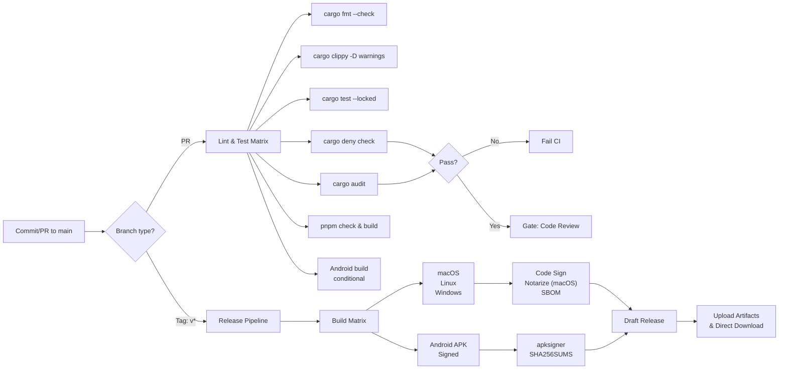

# CI/CD Pipeline Documentation

**Status:** P0 Implementation  
**Last Updated:** 2026-10-16

---

## Overview

Alloy targets **desktop (macOS, Windows, Linux) and Android** via **direct-install distribution** (no app stores).
Continuous integration, automated testing, security checks, and binary releases are orchestrated with **GitHub Actions**.

### Architecture



---

## Workflow Files

### 1. `.github/workflows/ci.yml`

**Trigger:** Every push to `main` + all PRs to `main`

**Jobs:**

| Job | Runs On | Purpose |
|-----|---------|---------|
| `commits` | `ubuntu-latest` | Validate Conventional Commits format |
| `fmt` | `ubuntu-latest` | Verify Rust code formatting (`rustfmt`) |
| `clippy-test` | Ubuntu, macOS, Windows | Lint + unit/integration tests with `wasm32-wasip2` target |
| `cargo-deny` | `ubuntu-latest` | License audit + banned crates check |
| `ui` | `ubuntu-latest` | SvelteKit type-check + Vite build |
| `mobile-android` | `ubuntu-latest` | Android APK build (gated: only if `apps/alloy/src-tauri/gen/android/` exists) |

**Key Features:**
- Caches `.cargo` registry & targets across runs (`Swatinem/rust-cache@v2`)
- Caches pnpm dependencies
- Android build job runs conditionally: gates execution on presence of generated project directory before installing SDKs
- No secrets required for CI PR validation

**Duration:** ~15–25 minutes per OS

### 2. `.github/workflows/audit.yml`

**Trigger:**
- Daily scheduled run (midnight UTC)
- Manual dispatch via `workflow_dispatch`
- Push to `main` when `Cargo.lock`, `Cargo.toml`, or `deny.toml` change

**Jobs:**

| Job | Purpose |
|-----|---------|
| `audit` | Run `cargo-audit` (RustSec advisory DB) + `cargo deny` (licenses, bans, sources) |

**Key Features:**
- Uses `rustsec/audit-check@v2` action for GitHub integration
- Fails on known CVEs but allows warnings for unmaintained transitive dependencies
- Runs independently from PR checks to catch new vulnerabilities post-merge

### 3. `.github/workflows/release.yml`

**Trigger:** Git push with tag matching `v*` (e.g., `v0.1.0`)

**Jobs:**

| Job | Platforms | Purpose |
|-----|-----------|---------|
| `build-tauri` | macOS, Linux, Windows | Build signed desktop bundles + CycloneDX SBOM |
| `build-android` | Android (Ubuntu runner) | Build signed Android APK via `apksigner` + `SHA256SUMS` |

**Key Features:**
- Desktop bundles built via `tauri-apps/tauri-action@v0`
- Android APK built via `cargo tauri android build --apk` and signed with `apksigner`
- Computes `SHA256SUMS` checksums
- Generates CycloneDX SBOM per platform (JSON format)
- Creates **draft release** on GitHub Releases for direct-install downloads
- Uploads SBOM, desktop bundles, signed APK, and `SHA256SUMS` as release assets

**Code Signing Secrets:**

| Platform | Secret | Purpose | Status |
|----------|--------|---------|--------|
| **macOS** | `APPLE_CERTIFICATE` (Base64 P12) | Developer ID application certificate for macOS desktop DMG/App | TODO: Deploy in repo settings |
| | `APPLE_CERTIFICATE_PASSWORD` | P12 password | TODO |
| | `APPLE_SIGNING_IDENTITY` | Team ID + Developer ID application identity string | TODO |
| | `APPLE_ID` | Apple Developer account email (for desktop notarytool) | TODO |
| | `APPLE_PASSWORD` | App-specific password for desktop notarytool | TODO |
| | `APPLE_TEAM_ID` | Apple Developer Team ID (10 alphanumeric) | TODO |
| **Windows** | `WINDOWS_CERTIFICATE` (Base64 PFX) | Authenticode code signing certificate | TODO |
| | `WINDOWS_CERTIFICATE_PASSWORD` | PFX password | TODO |
| **Android** | `ANDROID_KEYSTORE_BASE64` | Base64-encoded Java release keystore (`.keystore`/`.jks`) | TODO |
| | `ANDROID_KEYSTORE_PASSWORD` | Keystore password | TODO |
| | `ANDROID_KEY_ALIAS` | Key alias in keystore | TODO |
| | `ANDROID_KEY_PASSWORD` | Key password | TODO |
| **All Desktop** | `TAURI_SIGNING_PRIVATE_KEY` (Base64 PEM) | Ed25519 private key for direct Tauri updater manifest signing | TODO |
| | `TAURI_SIGNING_PRIVATE_KEY_PASSWORD` | Passphrase for private key | TODO |
| | `GITHUB_TOKEN` | Auto-supplied by GitHub Actions | Already available |

---

## Local Development

Use **`justfile`** recipes to run CI checks locally:

```bash
just fmt              # Format code
just lint             # Check formatting + clippy (zero warnings)
just test             # Run all tests
just deny             # License + advisory checks
just audit            # Vulnerability scan
just ui-check         # SvelteKit type check
just ui-build         # Build UI assets
just synapse-up       # Start test Synapse homeserver (Docker)
just synapse-down     # Stop Synapse
just ci               # Run full pipeline (all checks + tests + audit + UI)
```

### Running the Full CI Locally

```bash
just ci
```

This executes:
1. `cargo fmt --all -- --check` (formatting)
2. `cargo clippy --workspace -- -D warnings` (linting)
3. `cargo test --workspace --locked` (tests)
4. `cargo deny check` (licenses & bans)
5. `cargo audit` (security advisories)
6. `pnpm install`, `pnpm check`, `pnpm build` (UI)

---

## Security Policy

### Deny Checks (`cargo-deny`)

**Configuration:** `deny.toml`

**Checks:**

1. **Advisories**
   - Blocks: Yanked crates (production versions)
   - Warns: Unmaintained crates (e.g., `anymap2`, `derivative`, `proc-macro-error` from upstream dependencies)
   - Action: Known vulnerabilities are denied; unmaintained transitive warnings are permitted.

2. **Licenses**
   - Allowed: Apache-2.0, Apache-2.0 WITH LLVM-exception, MIT, BSD-2/3-Clause, ISC, Unicode-3.0/DFS-2016, MPL-2.0, Zlib, CC0-1.0, OpenSSL, BSL-1.0, CDLA-Permissive-2.0
   - Action: Denies unlicensed or incompatible licenses
   - Workspace members: Ignored (not checked)

3. **Bans**
   - Multiple versions: Warns
   - Highlight: All paths (simplest + lowest-version)

4. **Sources**
   - Only crates.io allowed (rejects git, custom registries)
   - Fails on unknown sources

### Audit Checks (`cargo-audit`)

- Scans `Cargo.lock` against RustSec advisory database
- **Fails** on known CVEs
- **Warns** on unmaintained crate notices (allowed in CI)

### Coverage

- **Rust crates:** Workspace + all transitive dependencies
- **Frontend:** pnpm dependency tree (`apps/alloy`)
- **Android platform:** Gated; runs when Tauri Android directory exists

---

## Release Process

### Direct Distribution (No App Stores)

Alloy binaries are distributed directly to users via GitHub Releases and direct downloads:
- **macOS:** Notarized `.dmg` / `.app` disk image
- **Windows:** Authenticode-signed `.exe` / `.msi` installer
- **Linux:** AppImage + `.tar.gz` bundle
- **Android:** Sideloadable signed `.apk`

### Steps

1. **Local verification:**
   ```bash
   just ci
   git tag -a v0.1.0 -m "Release v0.1.0"
   git push origin main --tags
   ```

2. **GitHub Actions runs:** `release.yml` is triggered
   - Builds all three desktop platforms + Android APK in parallel/sequence
   - Signs desktop binaries & signs Android APK with `apksigner`
   - Generates SBOM per platform and `SHA256SUMS`
   - Creates draft release with all artifacts

3. **Publishing:**
   - Review draft release in GitHub UI
   - Add release notes & changelog
   - Click "Publish release"

### Artifacts

**Each release contains:**
- macOS `.app` bundle / `.dmg` (code-signed, notarized for desktop gatekeeper)
- Windows `.exe` / `.msi` (signed)
- Linux AppImage + tarball
- Android `.apk` (signed with release keystore)
- `alloy-sbom-{macos,linux,windows}.json` (CycloneDX SBOMs)
- `SHA256SUMS` (checksum file for integrity verification)
- `update.json` (Tauri direct updater manifest)

---

## Troubleshooting

### Android APK build fails

**Check:** Does Android project directory exist?
```bash
test -d apps/alloy/src-tauri/gen/android && echo "Android configured"
```

If missing, the Android CI job is safely skipped until generated.

### macOS desktop notarization fails

**Common cause:** Apple ID password is not an app-specific password.  
**Fix:** Generate app-specific password in Apple ID settings for desktop notarytool submission.

---

## References

- **Tauri CLI:** https://tauri.app/
- **GitHub Actions:** https://docs.github.com/en/actions
- **cargo-deny:** https://embarkstudios.github.io/cargo-deny/
- **cargo-audit:** https://rustsec.org/
- **ActionLint:** https://github.com/rhysd/actionlint
- **CycloneDX:** https://cyclonedx.org/
