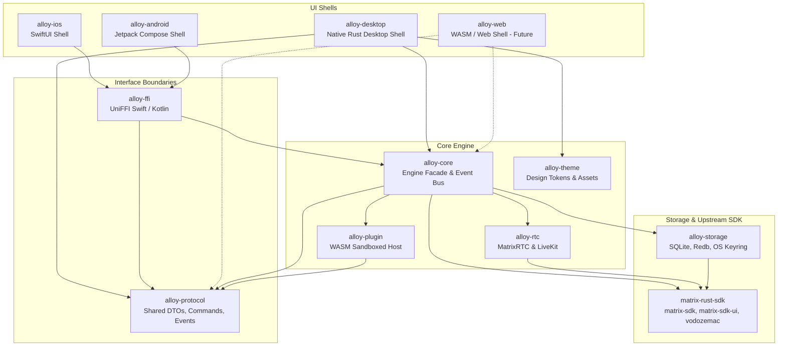
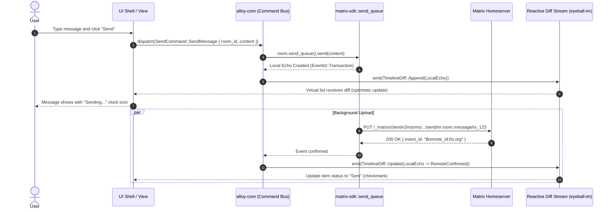

# Core Architecture & Matrix Engine Specification (alloy-core)

## 1. Summary & Recommendation

Alloy is structured as a modular Rust Cargo workspace centered around a headless, UI-agnostic engine crate (`alloy-core`). `alloy-core` wraps the official **`matrix-rust-sdk`** ecosystem, leveraging **Matrix 2.0** primitives:
- **Sliding Sync** (MSC4186 Simplified Sliding Sync with MSC3575 proxy fallback) for instantaneous room list and timeline hydration.
- **`matrix-sdk-ui`** high-level abstractions (`RoomListService`, `Timeline`, `SyncService`, and `NotificationClient`).
- **`vodozemac`** for memory-safe, formally verified Olm/Megolm E2EE, cross-signing, and server-side key backup with local secret storage.
- **Unidirectional Reactive Architecture** powered by `eyeball` and `eyeball-im` diff streams (`VectorDiff`), translating Matrix internal state updates into zero-copy, framework-agnostic observable streams consumed by platform UI shells.
- **Native OIDC** (MSC3861 / MSC2964 / MSC2965 via Matrix Authentication Service) with legacy password-login fallback for older homeservers.
- **MatrixRTC / LiveKit** (MSC3401, MSC4143, MSC4354) via `matrix-rust-rtc` for scalable spatial VoIP and group video calling.

### Key Recommendation
Adopt **Tokio** as the core async runtime for Desktop (macOS, Windows, Linux) and Mobile (iOS, Android via UniFFI FFI bindings), while architecting an isolated, single-threaded executor abstraction using **`wasm-bindgen-futures`** and IndexedDB for the post-v1 Web target. Decouple UI state completely from UI rendering frameworks via a command-event reactive bus to enable seamless plugin interception and multi-shell deployment.

---

## 2. Options Compared

| Dimension | Option A: Direct `matrix-rust-sdk` in UI | Option B: Hand-rolled Ruma Client | Option C: Recommended `alloy-core` Facade over `matrix-sdk` + `matrix-sdk-ui` |
| :--- | :--- | :--- | :--- |
| **Abstractions** | Leaks internal Matrix types into UI shells | Requires writing custom E2EE, sync loops, caches, and crypto state machine from scratch | Strict facade providing clean domain models, unified reactive streams (`VectorDiff`), and command handlers |
| **E2EE / Crypto** | Uses `vodozemac` via `matrix-sdk-crypto` | Massive security risk; rolling custom Megolm / Olm bindings | Leverages battle-tested `vodozemac` + `matrix-sdk-crypto` with automated session management |
| **Sync Protocol** | Sliding Sync via raw `RoomListService` | Custom sync loop implementation | Managed `SyncService` / `RoomListService` lifecycle with auto-reconnect and MSC4186/MSC3575 negotiation |
| **Cross-Platform UI** | Tight coupling to one UI framework | Framework agnostic but impractical maintenance burden | Completely UI-agnostic; clean FFI boundary for Swift/Kotlin and direct in-memory channels for Rust desktop |
| **Plugin Extensibility**| Hard to intercept events without SDK hooks | Custom interceptors possible but tedious | Event bus in `alloy-core` intercepts inbound/outbound events before UI rendering or dispatch |
| **Maintenance Cost** | Medium-High (API churn in `matrix-rust-sdk`) | Extremely High (reimplementing spec proposals) | Low-Medium (isolation layer absorbs upstream SDK breaking changes) |

---

## 3. Evidence & Ecosystem Status (2026)

- **`matrix-rust-sdk` & `matrix-sdk-ui` (v0.19+)**: Maintained directly by Element and the Matrix.org Foundation. Provides high-level UI components: `RoomListService` for dynamic room lists, `Timeline` for virtualized, paginated event histories, and `SyncService` for unified sync state ([Docs.rs matrix-sdk-ui](https://docs.rs/matrix-sdk-ui/latest/matrix_sdk_ui/), [matrix-rust-sdk GitHub](https://github.com/matrix-org/matrix-rust-sdk)).
- **Sliding Sync & MSC4186**: MSC4186 ("Simplified Sliding Sync") is accepted in the Matrix specification, streamlining sliding sync to avoid complex proxy-side state management while preserving instant room switching ([MSC4186 Proposal](https://github.com/matrix-org/matrix-spec-proposals/pull/4186), [Matrix Sliding Sync Blog](https://matrix.org/blog/2024/11/14/moving-to-native-sliding-sync)).
- **E2EE via `vodozemac`**: Pure-Rust, memory-safe cryptographic library replacing libolm. Audited and formally verified, backing `matrix-sdk-crypto` for Megolm group ratchets, Olm 1:1 sessions, and cross-signing ([vodozemac GitHub](https://github.com/matrix-org/vodozemac)).
- **Key Backup & Secret Storage**: `matrix_sdk::encryption::recovery::Recovery` handles recovery keys, secret storage (`m.secret_storage`), and server-side Megolm key backup (`m.megolm_backup.v1`) with client verification ([Docs.rs Recovery API](https://docs.rs/matrix-sdk/latest/matrix_sdk/encryption/recovery/struct.Recovery.html)).
- **Offline Send Queue**: First-class `matrix_sdk::send_queue::SendQueue` manages per-room send queues, transaction IDs, optimistic local echoes, and automatic retry backoff ([matrix-sdk send_queue API](https://matrix-org.github.io/matrix-rust-sdk/matrix_sdk/send_queue/index.html)).
- **Native OIDC & MAS (MSC3861 / MSC2964 / MSC2965)**: Matrix Authentication Service (MAS) decouples auth from homeserver cores using OAuth 2.0 / OIDC. `matrix_sdk::authentication::oidc` supports authorization code flow with PKCE ([Matrix Authentication Service](https://github.com/matrix-org/matrix-authentication-service)).
- **Element Call & MatrixRTC**: Real-time calling in Matrix 2.0 leverages MatrixRTC (MSC3401, MSC4143, MSC4354) with LiveKit SFUs via `matrix-rust-rtc` ([matrix-rust-rtc GitHub](https://github.com/element-hq/matrix-rust-rtc)).
- **Mobile FFI / UniFFI**: Element X iOS and Element X Android share 100% of their networking, storage, and E2EE logic via `matrix-sdk-ffi` and Mozilla UniFFI ([Element X iOS](https://github.com/element-hq/element-x-ios), [Element X Android](https://github.com/element-hq/element-x-android)).
- **Authenticated Media (MSC3916)**: Matrix deprecates unauthenticated `/_matrix/media/*` endpoints in favor of authenticated media endpoints (`/_matrix/client/v1/media/*`) requiring access tokens or media download tokens ([Matrix Authenticated Media Specification](https://matrix.org/blog/2024/06/25/authenticated-media/)).
- **WASM Support**: `matrix-sdk` compiles to `wasm32-unknown-unknown` with the `indexeddb` feature (`matrix-sdk-indexeddb`). However, WebCrypto performance and single-threaded WASM event loop constraints make Web a secondary target behind native desktop/mobile ([matrix-sdk-indexeddb Docs](https://docs.rs/matrix-sdk-indexeddb/latest)).

---

## 4. Target Homeserver Compatibility Matrix

| Homeserver | Minimum Version | Sliding Sync Support | Native OIDC (MAS) | Authenticated Media (MSC3916) | Target Status |
| :--- | :--- | :--- | :--- | :--- | :--- |
| **Synapse** | >= 1.115+ | Native MSC4186 experimental / MSC3575 proxy | First-class via MAS | Supported (enforced by default) | **Tier 1 (Primary reference)** |
| **Continuwuity** | >= 0.5.0+ | Native MSC4186 built-in | Planned / OIDC bridge | Supported | **Tier 1 (Lightweight Rust target)** |
| **Tuwunel** | >= 1.9.0+ | Native MSC4186 built-in | Planned / Legacy tokens | Supported | **Tier 2 (High-perf Rust target)** |
| **Conduit / Conduwuit** | Conduwuit >= 0.5 | MSC3575 via proxy / partial MSC4186 | Legacy fallback only | Partial | **Tier 2 (Community self-hosted)** |
| **Dendrite** | >= 0.14+ | MSC3575 via proxy | In development | Partial | **Tier 3 (Experimental compatibility)** |

---

## 5. Cargo Workspace Architecture & Crate Boundaries

The Alloy workspace strictly separates concerns. Core networking, encryption, storage, and plugin sandboxing have zero UI dependencies.

```
alloy/
├── Cargo.toml                      # Workspace manifest (virtual workspace)
├── crates/
│   ├── alloy-core/                 # Main Matrix engine facade (wraps matrix-rust-sdk)
│   ├── alloy-storage/              # Database wrappers, session state, secure keyrings
│   ├── alloy-protocol/             # Shared IPC/FFI message types, events, and command DTOs
│   ├── alloy-plugin/               # Plugin host, WASM runtime (Wasmtime), manifest parser
│   ├── alloy-theme/                # Design tokens, CSS/theme definitions, icon packs
│   ├── alloy-rtc/                  # MatrixRTC & LiveKit calling bindings
│   └── alloy-ffi/                  # UniFFI bindings for iOS (Swift) & Android (Kotlin)
├── apps/
│   ├── alloy-desktop/              # Native desktop UI shell (macOS, Windows, Linux)
│   └── alloy-mobile/               # Native mobile shell wrappers (Xcode / Android Studio)
└── tests/
    └── integration/                # Docker-based end-to-end test suite against Synapse
```

### Crate Roles & Dependencies

1. **`alloy-core`**:
   - Manages Matrix client lifecycles, active account pool, encryption keys, and sync engines.
   - Depends on `matrix-sdk` (with `e2e-encryption`, `sqlite`, `experimental-sliding-sync`, `send-queue`, `markdown`), `matrix-sdk-ui`, `eyeball`, `eyeball-im`, `tokio`, `tracing`.
   - Exposes clean command channels (`CommandSender`) and reactive state streams (`EventReceiver`).
2. **`alloy-storage`**:
   - Encapsulates `matrix-sdk-sqlite`, app-level settings (via `redb` or `rusqlite`), and OS secure keyring integration (via `keyring-rs` on macOS Keychain, Windows Credential Manager, Secret Service on Linux).
3. **`alloy-protocol`**:
   - Pure data types with `serde` serialization. Contains all events, UI diffs, command payloads, and errors crossing the core-to-UI and core-to-plugin boundaries.
4. **`alloy-plugin`**:
   - Loads plugin manifests (`plugin.json`), enforces capability permissions, and executes UI extensions or bots inside a secure WASM sandbox (Wasmtime for desktop/mobile, JS worker on web).
5. **`alloy-theme`**:
   - Standalone crate containing design tokens (colors, spacing, typography, theme variants) serializable to JSON/CSS, allowing runtime theme reloading and user customization.
6. **`alloy-rtc`**:
   - Manages call state machines, MSC4143 call membership, and WebRTC / LiveKit media streams.

---

## 6. Mermaid Architecture & Dataflow Diagrams

### Crate Layout & Layer Boundaries



### Unidirectional Reactive Dataflow



---

## 7. Async Runtime & Platform Target Strategy

### Runtime Selection

1. **Desktop & Mobile (macOS, Linux, Windows, iOS, Android)**:
   - **Tokio Multi-threaded Runtime** (`tokio` with `features = ["rt-multi-thread", "macros", "sync", "time", "net"]`).
   - On iOS and Android, Tokio runs within the native process background threads spawned by the UniFFI bridge.
   - High throughput for cryptographic key operations (Megolm session ratchet updates) and concurrent thumbnail generation.
2. **Web Target (WASM / WebAssembly)**:
   - `matrix-rust-sdk` supports `wasm32-unknown-unknown` using `wasm-bindgen-futures`.
   - Web workers and `indexeddb` store backend (`matrix-sdk-indexeddb`).
   - *Architecture Isolation*: `alloy-core` uses generic async spawning via an internal `alloy_spawn` abstraction that maps to `tokio::spawn` on native platforms and `wasm_bindgen_futures::spawn_local` on WASM.

```rust
// Internal async task spawning abstraction in alloy-core
#[cfg(not(target_arch = "wasm32"))]
pub fn spawn_task<F>(future: F) -> tokio::task::JoinHandle<F::Output>
where
    F: std::future::Future + Send + 'static,
    F::Output: Send + 'static,
{
    tokio::spawn(future)
}

#[cfg(target_arch = "wasm32")]
pub fn spawn_task<F>(future: F)
where
    F: std::future::Future<Output = ()> + 'static,
{
    wasm_bindgen_futures::spawn_local(future);
}
```

---

## 8. Core-to-UI Reactive Stream & Command API Shape

To maintain strict framework independence, `alloy-core` never exposes Matrix internal lifetimes or mutable references. Communication follows an **Actor-style CQRS pattern**:
1. **Commands (UI -> Core)**: Asynchronous commands sent over a bounded mpsc channel (`tokio::sync::mpsc`).
2. **Reactive State Streams (Core -> UI)**: Continuous diff streams driven by `eyeball` and `eyeball-im`. The UI subscribes to streams for:
   - `RoomListDiff`: Add, remove, move (sorting by recent activity), and update room metadata.
   - `TimelineDiff`: Append, prepend (pagination), replace, remove, or clear timeline items.
   - `ConnectionState`: Syncing, offline, reconnecting, error status.
   - `UserPresence`: Typing indicators, read receipts, active voice states.

### Why `eyeball-im` `VectorDiff`?
Modern chat interfaces require virtualized lists (recycling DOM nodes or UI cells). Emitting entire arrays on every sync tick destroys performance. `VectorDiff` emits surgical batch mutations (`Append`, `InsertAt(index)`, `Set(index)`, `RemoveAt(index)`, `Clear`, `Reset`), allowing the UI to mutate its local observable collections with $O(1)$ overhead.

---

## 9. Concrete Core API Sketch (Types & Traits Only)

```rust
// =========================================================================
// alloy-protocol: Common Types, Enums & Events
// =========================================================================

pub struct AccountId(pub String);
pub struct RoomId(pub String);
pub struct EventId(pub String);
pub struct UserId(pub String);

#[derive(Debug, Clone, PartialEq, Eq)]
pub enum ConnectionStatus {
    Disconnected,
    Connecting,
    Syncing,
    Reconnecting { attempt: u32, next_retry_millis: u64 },
    Terminated,
}

#[derive(Debug, Clone)]
pub struct RoomSummary {
    pub id: RoomId,
    pub name: Option<String>,
    pub avatar_url: Option<String>,
    pub unread_notifications: NotificationCount,
    pub latest_event: Option<TimelineItemPreview>,
    pub is_direct: bool,
    pub is_space: bool,
    pub membership: RoomMembership,
}

#[derive(Debug, Clone)]
pub struct NotificationCount {
    pub highlight_count: u64,
    pub notification_count: u64,
}

#[derive(Debug, Clone, PartialEq, Eq)]
pub enum RoomMembership {
    Joined,
    Invited,
    Left,
    Banned,
}

#[derive(Debug, Clone)]
pub enum TimelineItemContent {
    TextMessage { body: String, formatted_body: Option<String> },
    Media { uri: String, mime_type: String, size_bytes: u64, thumbnail_uri: Option<String> },
    Reaction { key: String, count: usize, senders: Vec<UserId> },
    Poll { question: String, answers: Vec<String>, end_time: Option<u64> },
    CallInvite { call_id: String, is_video: bool },
    Redacted,
}

#[derive(Debug, Clone)]
pub struct TimelineItem {
    pub internal_id: String,
    pub event_id: Option<EventId>,
    pub sender: UserId,
    pub timestamp_millis: u64,
    pub content: TimelineItemContent,
    pub send_state: EventSendState,
    pub is_own: bool,
    pub thread_summary: Option<ThreadSummary>,
}

#[derive(Debug, Clone)]
pub enum EventSendState {
    Sending { transaction_id: String },
    Sent { event_id: EventId },
    Failed { error: String, can_retry: bool },
}

#[derive(Debug, Clone)]
pub struct ThreadSummary {
    pub root_event_id: EventId,
    pub reply_count: u32,
    pub latest_reply_timestamp: u64,
}

// VectorDiff mirroring eyeball-im for UI updates
#[derive(Debug, Clone)]
pub enum VectorDiff<T> {
    Append { values: Vec<T> },
    Clear,
    PushFront { value: T },
    PushBack { value: T },
    PopFront,
    PopBack,
    Insert { index: usize, value: T },
    Set { index: usize, value: T },
    Remove { index: usize },
    Truncate { length: usize },
    Reset { values: Vec<T> },
}

// =========================================================================
// alloy-core: Commands & Client Traits
// =========================================================================

pub enum EngineCommand {
    // Auth & Session
    LoginOidc { homeserver_url: String },
    CompleteOidcFlow { redirect_url: String },
    LoginPassword { homeserver_url: String, username: String, password: String },
    Logout { account_id: AccountId },

    // Room Actions
    JoinRoom { room_id_or_alias: String },
    LeaveRoom { room_id: RoomId },
    SelectRoom { room_id: RoomId },
    PaginateBackwards { room_id: RoomId, count: usize },

    // Messages & Queuing
    SendMessage { room_id: RoomId, content: String, reply_to: Option<EventId> },
    SendMedia { room_id: RoomId, file_path: String, mime_type: String },
    SendReaction { room_id: RoomId, event_id: EventId, reaction_key: String },
    CancelPendingMessage { room_id: RoomId, transaction_id: String },

    // Encryption & Verification
    VerifyDeviceSasAccept { user_id: UserId, device_id: String },
    ConfirmSasMatch { flow_id: String },
    RestoreKeyBackup { recovery_key: String },

    // RTC
    JoinCall { room_id: RoomId, is_video: bool },
    LeaveCall { room_id: RoomId },
}

pub trait AlloyEngine: Send + Sync + 'static {
    fn account_manager(&self) -> &dyn AccountManager;
    fn room_service(&self) -> &dyn RoomService;
    fn rtc_service(&self) -> &dyn RtcService;
    fn plugin_service(&self) -> &dyn PluginService;
    fn dispatch(&self, command: EngineCommand) -> Result<(), EngineError>;
}

pub trait RoomService: Send + Sync {
    fn subscribe_room_list(&self) -> futures_core::Stream<Item = VectorDiff<RoomSummary>>;
    fn subscribe_timeline(&self, room_id: &RoomId) -> Result<futures_core::Stream<Item = VectorDiff<TimelineItem>>, EngineError>;
    fn subscribe_typing(&self, room_id: &RoomId) -> futures_core::Stream<Item = Vec<UserId>>;
}

pub trait AccountManager: Send + Sync {
    fn active_accounts(&self) -> Vec<AccountId>;
    fn subscribe_connection_status(&self, account_id: &AccountId) -> futures_core::Stream<Item = ConnectionStatus>;
}

pub trait RtcService: Send + Sync {
    fn active_call(&self) -> Option<RoomId>;
    fn subscribe_call_members(&self, room_id: &RoomId) -> futures_core::Stream<Item = Vec<UserId>>;
}

pub trait PluginService: Send + Sync {
    fn list_plugins(&self) -> Vec<PluginManifest>;
    fn enable_plugin(&self, plugin_id: &str) -> Result<(), PluginError>;
    fn disable_plugin(&self, plugin_id: &str) -> Result<(), PluginError>;
}

#[derive(Debug, thiserror::Error)]
pub enum EngineError {
    #[error("Matrix Client Error: {0}")]
    Matrix(String),
    #[error("Authentication Required")]
    Unauthenticated,
    #[error("Storage Error: {0}")]
    Storage(String),
    #[error("Room Not Found: {0}")]
    RoomNotFound(String),
    #[error("Internal Channel Error")]
    ChannelClosed,
}

#[derive(Debug, thiserror::Error)]
pub enum PluginError {
    #[error("Manifest Invalid: {0}")]
    InvalidManifest(String),
    #[error("Sandboxed Execution Trapped: {0}")]
    RuntimeError(String),
}
```

---

## 10. Offline Caching, Storage, & Send Queue Strategy

1. **Storage Tiering**:
   - **`matrix-sdk-sqlite`**: Handles client state, filter checkpoints, encrypted Megolm inbound/outbound session ratchets, Olm 1:1 sessions, and account data in an encrypted/passphrase-protected SQLite file.
   - **Local Metadata DB (`alloy-storage`)**: Embedded `redb` or SQLite table storing application preferences, account registries, pinned rooms, unread counts, and custom user labels.
   - **File Cache**: Local file storage for decrypted media, cached thumbnails, and downloaded avatars keyed by sha256 of media URI.
2. **Sliding Sync Cache & Fast Startup**:
   - `matrix-sdk-ui` caches the sliding sync state locally. On application boot, the room list and last 20 cached events per room render immediately from SQLite cache *before* any network handshake completes.
3. **Optimistic Send Queue (`matrix_sdk::send_queue`)**:
   - When the user sends a message while offline or on high latency:
     1. The message receives a client-generated local `TransactionId`.
     2. An optimistic `TimelineItem` is immediately inserted into the local timeline with `EventSendState::Sending`.
     3. The send queue stores the pending event in SQLite.
     4. On connectivity restoration, the queue flushes in FIFO order per room, with exponential backoff on server errors (HTTP 502/503/429).
     5. If a message permanently fails (e.g., room permissions revoked), status transitions to `EventSendState::Failed { can_retry: true }`.

---

## 11. Mobile Push Notifications & Background Sync Architecture

### Notification Pipeline

Mobile OS environments restrict background execution. Alloy uses UnifiedPush (Android) with `matrix-sdk-ui::NotificationClient`:

```
[Matrix Homeserver] ──┬─→ [UnifiedPush Distributor / ntfy]
                      │         ↓
                      │   [Android BroadcastReceiver]
                      │         ↓
                      ├──→ [alloy-ffi JNI: fetchNotification()]
                           ├─→ restore_active_account() from data_dir
                           ├─→ NotificationClient (MultipleProcesses)
                           ├─→ decrypt & fetch event (≤20s timeout)
                           ├─→ map NotificationStatus → JSON
                           └─→ Android system notification
```

1. **UnifiedPush Integration**:
   - No Google Firebase Cloud Messaging (FCM); uses community-run distributors (ntfy, Nextcloud, etc.).
   - Endpoint registration: `PushNative.setPusher(dataDir, config)` calls `matrix_sdk::pusher().set()` with HTTP pusher, gateway=event_id_only format.
   - Payload arrives on Android service, Kotlin calls `PushNative.fetchNotification(dataDir, rawJson)`.
2. **Background Notification Fetch (alloy-ffi/JNI)**:
   - `Java_chat_alloy_PushNative_fetchNotification(dataDir, payload)`:
     - Parses push ref (room_id, event_id, unread count).
     - Calls `restore_active_account(dataDir, None)` from `alloy-core` (matches engine's active-account logic; reuses `accounts.json` + FileSecretStore at `secrets.json`).
     - Initializes tokio runtime and `NotificationClient` in `MultipleProcesses` mode (no main sync running; avoids lock contention).
     - Enforces total timeout ≤20s; falls back to generic notification on timeout.
     - Returns JSON: `{"status":"event","title":"...","body":"...","room_id":"...","..."}` or `{"status":"generic"}` or `{"status":"skip"}` or `{"status":"error","error":"..."}`.
   - `Java_chat_alloy_PushNative_setPusher(dataDir, configJson)` and `removePusher()`: CRUD for pushers via `alloy-core` client.
3. **Crypto & Decryption**:
   - Account data dir (`/data/user/0/chat.alloy/files`) shared between app and background service.
   - SQLite state store at `accounts/<store_id>/matrix/` encrypted with passphrase from `secrets.json`.
   - Megolm keys are persisted; NotificationClient decrypts events in-memory without starting sync.
4. **Android Permissions**:
   - `android.permission.POST_NOTIFICATIONS` (API 33+) for system notification display.
   - None for push; UnifiedPush handle registration in Kotlin.

---

## 12. Authenticated Media & Search Strategy

### Authenticated Media (MSC3916)
- Homeservers are deprecating unauthenticated access to `/_matrix/media/*` to prevent media scraping and quota bypasses.
- `alloy-core` uses authenticated endpoints (`/_matrix/client/v1/media/*`).
- Download and thumbnail requests pass Bearer tokens automatically via `matrix_sdk::media::Media`.
- Streamed media decoding: Media files are streamed directly to disk/cache with cryptographic hashing; large attachments are not buffered into RAM.

### Client-Side Encrypted Search
- Homeservers cannot index E2EE room messages.
- `alloy-core` integrates **`matrix-sdk-search`** (built on Tantivy or SQLite FTS5).
- Messages are indexed locally upon decryption in background idle tasks.
- Queries execute locally on device with sub-10ms response times across 100,000+ messages without leaking plaintext search queries to the homeserver.

---

## 13. Multi-Account Management

Alloy supports multiple concurrent Matrix accounts (e.g., Personal, Work, Community):
1. **Isolated Storage**: Each account maintains its own isolated database instance:
   - `~/.local/share/alloy/accounts/<user_id_hash>/matrix_sdk.sqlite`
   - `~/.local/share/alloy/accounts/<user_id_hash>/search_index/`
2. **Concurrent Engines**: The `AccountManager` maintains a `HashMap<AccountId, Arc<AlloyEngineInstance>>`.
3. **Unified Notification Aggregator**: Background sync ticks run independently for all active accounts, feeding a unified global unread counter to the UI tray/dock.

---

## 14. Testing & Verification Strategy (Synapse Docker Harness)

All integration tests for `alloy-core` run against a containerized Matrix homeserver to guarantee specification compliance and regression protection.

### Docker Testing Topology

```
┌────────────────────────────────────────────────────────┐
│ Docker Network: alloy-test-net                         │
│                                                        │
│  ┌───────────────────────┐   ┌──────────────────────┐  │
│  │ Synapse Homeserver    │   │ Sliding Sync Proxy   │  │
│  │ (matrixdotorg/synapse)│◄──┤ (matrix-org/sliding) │  │
│  │ Port: 8008            │   │ Port: 8009           │  │
│  └───────────────────────┘   └──────────────────────┘  │
│             ▲                            ▲             │
└─────────────┼────────────────────────────┼─────────────┘
              │                            │
   cargo test -p alloy-core --test integration_suite
```

### Test Suite Structure
1. **Harness (`tests/common/docker.rs`)**:
   - Launches a local Synapse container with a pre-configured shared registration secret (`registration_shared_secret: "alloy_test_secret"`).
   - Generates ephemeral test users (`@alice_test_123:localhost`, `@bob_test_123:localhost`) on demand.
2. **Automated Verification Scenarios**:
   - `test_oidc_and_password_auth_matrix2`: Tests login, token refresh, and logout.
   - `test_e2ee_vodozemac_exchange`: Spins up two client engines; Alice creates an encrypted room, invites Bob; verifies Megolm key sharing and message decryption.
   - `test_cross_signing_and_backup`: Tests bootstrapping cross-signing keys, uploading to homeserver, and restoring keys from recovery phrase.
   - `test_sliding_sync_virtual_list`: Populates 100 test rooms, verifies `RoomListService` delivers exact differential updates with window scrolling.
   - `test_offline_send_queue`: Simulates network drop (pausing Synapse container), sends messages to `SendQueue`, verifies local echo, unpauses container, verifies confirmation.

---

## 15. Concrete Technical Decisions

1. **Adopt `matrix-sdk-ui` natively**: Build `alloy-core` directly on `matrix-sdk-ui` rather than reimplementing timeline pagination or sliding sync room sorting.
2. **Primary Sync: MSC4186 with Proxy Fallback**: Default to MSC4186 Simplified Sliding Sync. If homeserver reports 404 or unsupported MSC, fall back to sliding-sync proxy (MSC3575).
3. **Runtime: Tokio for Native, Generic Abstraction for WASM**: Keep all core modules standard Rust on Tokio multi-thread; isolate WASM futures in platform-specific build targets.
4. **Reactive Streams via `eyeball-im`**: Standardize on `VectorDiff` as the canonical diff structure emitted to UI shells.
5. **Storage: `matrix-sdk-sqlite` with Bundled SQLite**: Ensure reproducible builds on all desktop and mobile platforms without external C library dependency issues.
6. **E2EE: Formally Verified `vodozemac`**: Enforce zero legacy Olm C-library dependencies.

---

## 16. Risks & Mitigations

| Risk | Impact | Probability | Mitigation Strategy |
| :--- | :--- | :--- | :--- |
| **Sliding Sync Spec Churn (MSC4186 vs MSC3575)** | High | Medium | `matrix-sdk-ui` abstracts the underlying sync endpoint; client code talks to `RoomListService` and `Timeline` which handle protocol variations internally. |
| **WASM Single-Thread & Crypto Performance** | Medium | High | Target Native Desktop (macOS/Win/Linux) and Native Mobile first. Defer Web target to Phase 3; explore Web Workers + SharedArrayBuffer for WASM threading. |
| **iOS Background Execution Limits (30s NSE budget)** | High | Medium | Use `matrix_sdk_ui::notification_client::NotificationClient` to perform targeted event-specific key recovery without running full sliding sync or parsing room history. |
| **Database Lock Contention on SQLite** | Medium | Medium | Configure WAL mode (`PRAGMA journal_mode=WAL`) and use dedicated connection pools for background sync vs search indexing. |
| **Out-of-order Events during Network Transitions** | Medium | Low | `matrix-sdk::send_queue` handles transaction ID correlation and state deduplication deterministically. |

---

## 17. Open Questions for the User

1. **Calling / VoIP Priority**: Is Element Call / MatrixRTC (LiveKit audio/video calls) required for the v1.0 Desktop MVP, or should MVP focus strictly on text, media, reactions, and threads?
2. **WASM / Web Client Target Window**: User requirements state Web is planned "LATER in the lifecycle". Is Web target planned for post-v1.0 (Q3/Q4)? (This allows using Tokio without WASM compromises for desktop/mobile).
3. **Plugin Sandboxing Constraints**: Will plugins run strictly in WASM (Wasmtime) on desktop, or do plugins need FFI access to native OS windows?

---

## 18. Phased Feature Roadmap

```
MVP (Phase 1: Foundation)        Parity (Phase 2: Modern Chat)     Beyond (Phase 3: Ecosystem)
┌─────────────────────────┐     ┌─────────────────────────┐      ┌─────────────────────────┐
│ • Matrix 2.0 Auth       │     │ • Threads (MSC3440)     │      │ • WebAssembly (Web)     │
│ • Sliding Sync          │     │ • Spaces & Hierarchy    │      │ • MatrixRTC LiveKit Calls│
│ • E2EE (vodozemac)      │───► │ • Reactions & Polls     │────► │ • Multi-Account Switch  │
│ • Timeline & Pagination │     │ • Encrypted Search      │      │ • Plugin Host & WASM    │
│ • Send Queue & Offline  │     │ • UnifiedPush / APNs    │      │ • Custom Sticker Packs  │
│ • Authenticated Media   │     │ • Cross-Signing SAS/QR  │      │ • Decentralized Call SFU│
└─────────────────────────┘     └─────────────────────────┘      └─────────────────────────┘
```

- **Phase 1: MVP Core (Desktop First)**
  - OIDC / Password authentication.
  - Sliding Sync room list with unread markers.
  - Timeline view with virtualized scroll, pagination, and redactions.
  - E2EE 1:1 and group encryption with `vodozemac`.
  - Offline send queue with local echo.
  - Authenticated media viewer (images, videos, attachments).
- **Phase 2: Feature Parity (Modern Chat)**
  - Thread list service and side-panel thread timelines.
  - Space hierarchies, child rooms, and room directory.
  - Reaction aggregation and interactive polls (MSC3381).
  - Client-side encrypted search via `matrix-sdk-search`.
  - Device verification via QR code and emoji SAS.
  - Mobile background sync and push notifications via Sygnal / UnifiedPush / APNs.
- **Phase 3: Ecosystem & Advanced**
  - Full MatrixRTC spatial audio/video calling with LiveKit SFU.
  - Complete WASM browser build with IndexedDB persistence.
  - Concurrent multi-account management.
  - WASM plugin execution engine with permission gating.

---

## 19. Work Breakdown & Task Estimates

| ID | Task Description | Scope | Size | Dependencies | Parallelizable |
| :--- | :--- | :--- | :---: | :--- | :---: |
| **CORE-01** | Setup workspace Cargo.toml, `alloy-core`, `alloy-protocol`, `alloy-storage` | Workspace | **S** | None | No |
| **CORE-02** | Configure Docker integration test harness with Synapse & Sliding Sync | Testing | **M** | CORE-01 | Yes |
| **CORE-03** | Implement Matrix client session bootstrap & OIDC / Password authentication | Auth | **M** | CORE-01 | Yes |
| **CORE-04** | Setup `matrix-sdk-sqlite` storage backend & secure OS keyring integration | Storage | **M** | CORE-01 | Yes |
| **CORE-05** | Implement `RoomListService` binding and `eyeball-im` `VectorDiff` stream | Sync | **L** | CORE-03, CORE-04 | No |
| **CORE-06** | Implement `Timeline` service with pagination, local echo & redaction | Timeline | **L** | CORE-05 | No |
| **CORE-07** | Integrate `vodozemac` E2EE, Megolm session management & key backup | Crypto | **L** | CORE-04, CORE-05 | Yes |
| **CORE-08** | Implement `matrix-sdk::send_queue` offline message queue & retries | Messaging| **M** | CORE-06 | Yes |
| **CORE-09** | Build Authenticated Media client (MSC3916) with streaming disk cache | Media | **M** | CORE-03 | Yes |
| **CORE-10** | Implement Reactions (aggregation) and Polls (MSC3381) handlers | Features | **M** | CORE-06 | Yes |
| **CORE-11** | Implement Thread list service and threaded timeline dispatch | Features | **M** | CORE-06 | Yes |
| **CORE-12** | Implement Spaces hierarchy parser and room filter service | Features | **M** | CORE-05 | Yes |
| **CORE-13** | Integrate `matrix-sdk-search` local encrypted full-text indexing | Search | **L** | CORE-06, CORE-07 | No |
| **CORE-14** | Mobile FFI crate (`alloy-ffi`) with UniFFI for iOS & Android | Mobile | **L** | CORE-05, CORE-06 | No |
| **CORE-15** | Mobile notification client (NSE on iOS / UnifiedPush on Android) | Push | **L** | CORE-14, CORE-07 | No |
| **CORE-16** | MatrixRTC & LiveKit calling integration (`alloy-rtc`) | RTC | **L** | CORE-05 | Yes |
