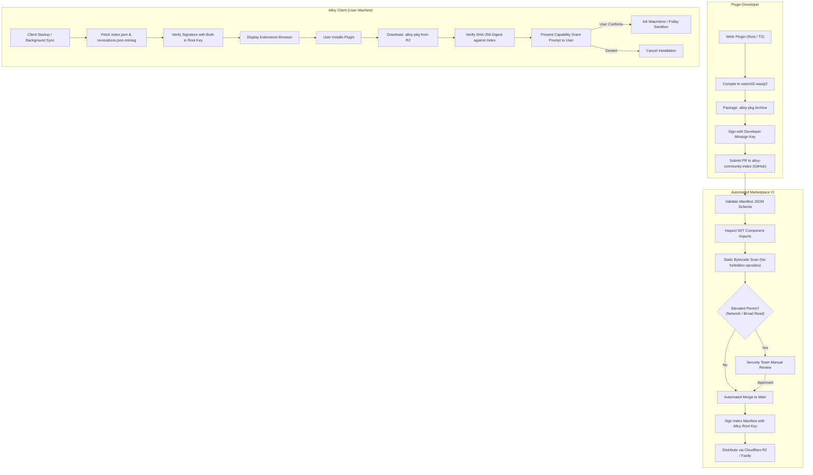

# Extensibility & Customization Architecture Plan

## 1. Summary & Recommendation

Alloy requires a multi-tiered customization system that balances deep user expression (the Discord/Vencord/Obsidian appeal) with enterprise-grade security and strict App Store compliance across desktop, mobile, and web.

### Core Recommendations
1. **Tier 1: Declarative Packages (Zero Code)**
   - Schema-driven JSONC/TOML packages for themes, design tokens, typography, layout presets, custom message-rendering rules, keybindings, and declarative slash commands/automations.
   - Evaluated statically in the host with zero executable code, guaranteeing 100% platform portability (including iOS App Store and Web) and zero attack surface for token theft.
2. **Tier 2: Sandboxed Code Plugins (WASM Component Model / WIT)**
   - Sandbox engine: **Wasmtime** using the **WASM Component Model (`wasm32-wasip2`)** and strongly typed WIT interfaces (`alloy-plugin` crate).
   - Desktop & Android: JIT/AOT execution via Cranelift for near-native performance.
   - iOS: JIT-free execution via Wasmtime's **Pulley interpreter** (or fallback to **Wasmi** pure-Rust interpreter) to strictly comply with iOS W^X restrictions and App Store Guideline 2.5.2.
   - Web: Direct execution via browser-native `WebAssembly.instantiate` inside Web Workers.
   - Developer DX: Rust PDK native; TypeScript/JavaScript PDK via `componentize-js` / Javy ahead-of-time bytecode compilation into standard WASM components, offering Obsidian/Raycast-grade authoring ergonomics without JS engine vulnerabilities on the host.
3. **Capability-Based Security Model**
   - Explicit, fine-grained capability manifests (`alloy-plugin.json`).
   - Granular permissions: `room:read` (with scope: `active`, `mentioned`, or explicit room IDs), `room:send`, `network:fetch` (strict host allowlist, loopback/private IP ranges blocked), `storage:kv` (scoped storage quota), and `ui:slot` (strictly sandboxed render slots).
   - Zero access to Matrix encryption keys (`megolm`), account access tokens, or OS filesystems.
4. **Decentralized Static Marketplace**
   - Git-based static index repository (patterned after Zed extensions and Homebrew) distributed via global CDN edge caches.
   - Packages distributed as `.alloy-pkg` (compressed tarball/zip) signed via **Minisign / Ed25519** and verified by client root trust.
   - Real-time signed revocation lists (`revocations.json.minisig`) polled on client startup.

---

## 2. Options Compared

### WASM & Scripting Runtimes for Plugin Host

| Criterion | Wasmtime + Component Model (WIT) (Recommended) | Extism (Wasmtime-based PDK) | Wasmer | Wasmi (Pure Interpreter) | QuickJS / rquickjs (JS Interpreter) |
| :--- | :--- | :--- | :--- | :--- | :--- |
| **Desktop Perf (macOS/Win/Linux)** | Near native (Cranelift JIT) | Near native (Cranelift) | Near native (Cranelift/Singlepass) | Slow (5x–15x interpreter overhead) | Moderate (interpreted JS, 10x slower than V8) |
| **iOS Viability (JIT-free / W^X)** | Yes, via Pulley interpreter backend | Challenging on mobile without custom builds | Experimental (Wasmi backend or WKWebView bridge) | Native (pure Rust interpreter, zero unsafe JIT) | Native (pure C interpreter, zero JIT, iOS safe) |
| **Web Viability (In-Browser)** | Via browser `WebAssembly` worker | Supported via `@extism/extism` | Requires heavy web polyfills | Possible, but redundant over browser WASM | Compiles to WASM or runs natively in JS |
| **Binary Size Overhead** | ~6–12 MB (desktop), ~3 MB (Pulley-only) | ~8–14 MB | ~15–25 MB (complex multi-backend) | **~1.2 MB** (extremely lightweight) | **~1.5 MB** |
| **Type-Safe Contract** | WIT (language-neutral IDL, canonical ABI) | Extism JSON/byte buffer protocol | Custom imports or WASI preview 1 | Manual byte packing / linear memory | Dynamic JS runtime bindings |
| **Polyglot Developer Support** | Rust, C/C++, Go, Zig, TS/JS (via `componentize-js`) | Rust, Go, TS, Python, Zig, C | Rust, C, AssemblyScript | Low-level Wasm only | JS / TypeScript only |
| **Security Isolation** | Hardware-grade memory bounds, fuel metering | Memory bounds, fuel metering | Memory bounds, metering | Software bounds, step-counting | JS realm isolation (susceptible to prototype pollution) |

### Marketplace & Registry Architectures

| Architecture | Static Git-Based Registry (Recommended) | Hosted Centralized API Service | Decentralized Matrix Room Index |
| :--- | :--- | :--- | :--- |
| **Operational Overhead** | Near zero (GitHub/GitLab Actions + Cloudflare R2 / Fastly) | High (Database, Auth, API servers, DDoS protection) | Medium (Matrix homeserver load, sync complexity) |
| **Auditability & PR Workflow** | High: Every version bump is a public git commit/PR with CI verification | Opaque: Database entries, requires custom dashboard | Medium: Public event DAG, but unstructured metadata |
| **Offline / Resilient Caching** | High: Git tree or flat JSON index cached locally and at edge | Vulnerable to service downtime or API deprecation | Tied to Matrix homeserver availability |
| **App Store Compliance Risk** | Low: Index is curated, static, versioned, transparently auditable | Medium: Dynamic server endpoints invite App Store scrutiny | High: Unmoderated dynamic peer-to-peer distribution |

---

## 3. Evidence & Prior Art

### Primary Source Evidence
- **Wasmtime & Pulley Interpreter**: Wasmtime includes [Pulley](https://docs.wasmtime.dev/examples-pulley.html), an optimizing bytecode interpreter designed for platforms where JIT compilation is prohibited by OS policy (such as iOS App Store). Wasmtime's [Component Model documentation](https://docs.wasmtime.dev/api/wasmtime/component) confirms full async WIT binding generation for Rust host/guest targets.
- **Wasmi Benchmark & Mobile Readiness**: [Wasmi](https://github.com/wasmi-labs/wasmi) is an established deterministic Wasm interpreter in pure Rust. Benchmarks show Wasmi provides predictable execution with a sub-2MB binary footprint, serving as a reliable fallback for iOS if Pulley encounters target-specific toolchain frictions.
- **Apple App Store Review Guidelines & Developer Agreement**:
  - *Guideline 2.5.2*: "Apps should be self-contained and look to create a unified experience... An app may permit downloading of interpreted code (e.g. JavaScript, WebAssembly) provided that the code is not used for primary features or functionality of the app, and is sandboxed to prevent access to unauthorized device features."
  - *Developer Program License Agreement Section 3.3.2*: Interpreted code may be downloaded to an application provided it does not alter the primary purpose, does not create an external application store, and runs in an isolated sandbox.
- **Extism Universal SDK**: [Extism](https://extism.org) standardizes the plugin invocation model across runtimes, proving the demand for clean guest PDK abstractions.

### Prior Art & Lessons Learned
1. **Obsidian (Electron + Node.js Plugins)**
   - *Advantage*: Massive community developer adoption due to plain JavaScript/TypeScript.
   - *Fatal Flaw*: Plugins run with full unrestricted Node.js process privileges. Malicious plugins can read the user's entire filesystem, SSH keys, and vault documents.
   - *Alloy Lesson*: Never allow raw host OS or unmetered memory access.
2. **VS Code (Out-of-Process Extension Host)**
   - *Advantage*: Separates the UI render thread from extension code; crash in extension does not kill the window.
   - *Fatal Flaw*: High memory overhead per extension host process; complex multi-process management that fails on mobile platforms.
   - *Alloy Lesson*: Use in-process WebAssembly instances with strict fuel limits instead of separate OS processes for cross-platform portability.
3. **Zed (Rust + WASM / WASI)**
   - *Advantage*: Extensions compile to `wasm32-wasip2`, registered via a public GitHub repository index (`zed-extensions`), using `extension.toml` manifests.
   - *Alloy Lesson*: Adopt Zed's Git-based index and WASI component model pattern as our baseline.
4. **Discord / BetterDiscord / Vencord Pitfalls**
   - *Advantage*: Demonstrates intense user desire for CSS customization, custom themes, custom soundpacks, and visual density tweaks.
   - *Fatal Flaw*: Relies on monkey-patching webpack modules and injecting arbitrary JS into the main Electron bundle. Results in rampant Discord token stealers, frequent breakages on app updates, and account bans.
   - *Alloy Lesson*: Make themes, design tokens, and UI layout slots first-class declarative primitives so users never need unsafe client injectors.
5. **Element Widgets (MSC1236 / Matrix Widget API)**
   - *Advantage*: Cross-client standard for embedded web tools (Jitsi conferences, Etherpad, polls) using `iframe` + `postMessage`.
   - *Fatal Flaw*: Heavyweight; poor mobile performance; awkward UI integration outside an isolated rectangular frame.
   - *Alloy Lesson*: Support Matrix Widgets (MSC1236) strictly for interoperable room embeds, but keep client extensibility native via WASM and design tokens.
6. **Raycast (Node / React / QuickJS)**
   - *Advantage*: Clean manifest schemas with declarative command arguments and structured UI layouts (List, Form, Detail).
   - *Alloy Lesson*: Restrict plugin UI to declarative slots and high-level component primitives rather than raw DOM or unbounded GPU rendering.

---

## 4. Risks & Mitigations

| Risk | Severity | Root Cause | Technical Mitigation |
| :--- | :--- | :--- | :--- |
| **Token / Message Exfiltration** | Critical | Malicious plugin reads timeline events and posts them to external HTTP endpoint. | Strict capability separation: plugins with `room:read` cannot obtain `network:fetch` unless explicitly permitted with an unmistakable dual-warning UI. Network access is restricted to an immutable domain allowlist; private/loopback IP blocks are hard-coded in the host runtime. |
| **iOS App Store Rejection** | High | Apple reviewer flags downloaded WASM bytecode under Guideline 2.5.2 or 3.3.2. | Run exclusively in non-JIT interpreter mode (Wasmtime Pulley / Wasmi). iOS builds disable arbitrary third-party URL plugin downloads; iOS only loads official catalog-vetted plugins or declarative JSON themes. Sideloading enabled only on macOS/Linux/Windows and Android. |
| **UI Freezing / Infinite Loops** | High | Poorly written plugin runs heavy computation or loop inside an event handler. | Fuel metering enabled on all WASM executions (`wasmtime::Store::set_fuel`). Synchronous UI hooks enforce a 16ms (1-frame) fuel budget; async workers enforce a 5,000ms wall-clock and fuel ceiling. When fuel is exhausted, the instance traps immediately. |
| **Supply-Chain Dependency Poisoning** | High | Attacker acquires a popular plugin repo and pushes a malicious minor version update. | Package signing via Minisign/Ed25519. Static index pins exact SHA-256 binary digests. Capability elevations require explicit user re-authorization on upgrade. Registry automated CI scans for prohibited WIT imports. |
| **Matrix E2EE Secret Compromise** | Critical | Plugin attempts to intercept Olm/Megolm session keys or cross-signing passphrases. | Complete architectural firewall: `alloy-plugin` interacts only with sanitized public DTOs from `alloy-core`. Crypto keys and raw session storage exist behind unexported host boundaries with zero WIT bindings. |
| **API Drift & Plugin Bitrot** | Medium | Host client updates internal UI or event types, breaking older plugins. | Semver-versioned WIT interfaces (`alloy:plugin/events@0.1.0`). Breaking API revisions publish new namespaces while maintaining host shims for older versions for a minimum 12-month deprecation window. |

---

## 5. Concrete Decisions

### 5.1 Declarative Package System (Zero Code)

Declarative packages require no compilation and run natively in all environments. They are packaged as `.alloy-theme` or included inside `.alloy-pkg`.

#### Theme & Styling Schema
Themes modify design tokens defined in `alloy-theme`:
- **Colors**: Base semantic palette (surfaces, accents, borders, text primary/muted, status indicators).
- **Typography**: Font family preferences (system, custom web fonts), line heights, font scale.
- **Density**: `compact`, `comfortable`, `spacious` (affects message padding, avatar sizes, gutter widths).
- **Layout Presets**: Sidebar styling, message group styles (`discord` compact header, `slack` indentation, `telegram` bubble alignment).
- **Safe CSS-Like Overrides**: Scoped token overrides only. Arbitrary stylesheet injection (`<style>` or raw CSS selectors) is strictly prohibited to prevent layout breaking and clickjacking.

#### Message Rendering & Text Rules
- Custom regex transformations (e.g. converting `JIRA-1234` into safe markdown links).
- Custom spoiler syntax, math/LaTeX formatting flags, syntax highlighter color mapping.
- Custom emoji pack mappings and sticker pack manifests.

#### Slash Commands & Automations
- Declarative slash command definitions (e.g. `/shrug`, `/flip`, `/poll "Question" "Option A" "Option B"`).
- Static template expansions or dispatch to built-in Matrix room actions without executing code.

---

### 5.2 Code Plugin Host Architecture (`alloy-plugin`)

```
+-----------------------------------------------------------------------------------+
|                                 Alloy Client Host                                  |
|                                                                                   |
|  +--------------------+    +--------------------+    +-------------------------+  |
|  |     alloy-core     |    |    alloy-theme     |    |   Platform UI Shell     |  |
|  |  (Matrix SDK/E2EE) |    |  (Design Tokens)   |    | (Slint / GPUI / Iced)   |  |
|  +---------+----------+    +---------+----------+    +------------+------------+  |
|            | Sanitized Events        | Tokens                     | UI Slots      |
|            v                         v                            v               |
|  +-----------------------------------------------------------------------------+  |
|  |                        alloy-plugin Host Manager                            |  |
|  |  +-----------------------------------------------------------------------+  |  |
|  |  | Capability Router & Permission Firewall                                |  |  |
|  |  | - Enforce Room Scopes     - Fuel Counter        - Block Localhost/SSRF|  |  |
|  |  +-----------------------------------+-----------------------------------+  |  |
|  |                                      | WIT Interface (Typed ABI)           |  |
|  |  +-----------------------------------v-----------------------------------+  |  |
|  |  | WASM Engine Sandbox:                                                  |  |  |
|  |  |   * Desktop (macOS/Win/Linux): Wasmtime (Cranelift JIT)                |  |  |
|  |  |   * iOS: Wasmtime (Pulley Interpreter) / Wasmi pure-Rust fallback     |  |  |
|  |  |   * Web: Web Worker WebAssembly.instantiate                            |  |  |
|  |  +-----------------------------------------------------------------------+  |  |
+--+--------------------------------------|-----------------------------------------+--+
                                          |
                               +----------v----------+
                               |    plugin.wasm      |
                               | (Guest Component)   |
                               | - Linear Memory     |
                               | - Isolated Heap     |
                               | - Zero Syscalls     |
                               +---------------------+
```

#### WASM Engine Selection & Mobile Strategy
1. **Desktop & Linux/Android**: Wasmtime with Cranelift JIT compiler enabled. Compilation happens either ahead of time during plugin installation (producing cached AOT artifacts) or JIT at startup.
2. **iOS**: Cranelift JIT is compiled out (`default-features = false`). Wasmtime runs with the **Pulley** interpreter ISA target. If Pulley compatibility faces toolchain issues on specific iOS SDK builds, the engine swaps transparently to **Wasmi** via our `WasmEngine` trait abstraction:
   ```rust
   pub trait WasmEngine: Send + Sync {
       fn instantiate(&self, bytes: &[u8], caps: &PluginCapabilities) -> Result<Box<dyn PluginInstance>>;
   }
   ```
3. **Web**: When Alloy is compiled for WebAssembly, plugins run as sibling Web Workers utilizing the browser's native `WebAssembly` engine via postMessage IPC.

#### WIT Interface Definition (`alloy-plugin.wit`)
Plugins communicate exclusively through versioned Wasm Interface Type (WIT) specifications:

```wit
package alloy:plugin@0.1.0;

interface types {
    record room-info {
        id: string,
        name: option<string>,
        topic: option<string>,
        is-direct: bool,
    }

    record message-event {
        event-id: string,
        room-id: string,
        sender: string,
        body: string,
        timestamp: u64,
    }

    enum log-level {
        debug,
        info,
        warn,
        error,
    }
}

interface host {
    use types.{room-info, message-event, log-level};

    // Logging & telemetry (scoped)
    log: func(level: log-level, message: string);

    // Matrix Room Actions (Capability guarded)
    send-message: func(room-id: string, body: string) -> result<string, string>;
    get-room: func(room-id: string) -> result<room-info, string>;

    // Network (Capability guarded with strict domain whitelist)
    http-fetch: func(url: string, method: string, headers: list<tuple<string, string>>, body: option<list<u8>>) -> result<list<u8>, string>;

    // Scoped Key-Value Storage
    kv-get: func(key: string) -> result<option<list<u8>>, string>;
    kv-set: func(key: string, value: list<u8>) -> result<_, string>;
}

interface guest {
    use types.{message-event};

    // Lifecycle
    init: func() -> result<_, string>;
    shutdown: func();

    // Event hooks
    on-message: func(event: message-event) -> result<option<string>, string>;
    
    // Slash commands
    execute-command: func(command: string, args: list<string>) -> result<string, string>;
}

world alloy-extension {
    import host;
    export guest;
}
```

---

### 5.3 Capability-Based Permission Model

Permissions are declared in the manifest and approved by the user at install time.

```
+-----------------------------------------------------------------------------+
|                            Permission Capabilities                          |
+----------------------+--------------------+---------------------------------+
| Capability           | Scope / Parameters | Description                     |
+----------------------+--------------------+---------------------------------+
| room:read            | active | all       | Read timeline messages.         |
|                      | explicit-rooms     | Active room only by default.    |
+----------------------+--------------------+---------------------------------+
| room:send            | active | all       | Send text, reactions, or edits. |
+----------------------+--------------------+---------------------------------+
| network:fetch        | host-whitelist     | Outbound HTTP(S) requests.      |
|                      | (e.g. *.github.com)| Loopback/RFC1918 IPs blocked.   |
+----------------------+--------------------+---------------------------------+
| storage:kv           | quota-bytes (5MB)  | Scoped key-value storage.       |
+----------------------+--------------------+---------------------------------+
| ui:slot              | panel:right_sidebar| Render into dedicated UI slots. |
|                      | status_bar:item    | Declarative components only.    |
|                      | message:action     |                                 |
+----------------------+--------------------+---------------------------------+
| clipboard:write      | boolean            | Copy text/links to clipboard.   |
+----------------------+--------------------+---------------------------------+
| notifications:send   | boolean            | Dispatch local desktop alerts.  |
+----------------------+--------------------+---------------------------------+
```

#### Security Enforcement Rules
1. **SSRF & Private Network Defense**: The host network dispatcher explicitly rejects requests to `localhost`, `127.0.0.1`, `::1`, `10.0.0.0/8`, `172.16.0.0/12`, `192.168.0.0/16`, `169.254.0.0/16` (cloud metadata), and `.local` domains, preventing intranet scanning.
2. **Storage Quotas**: Storage is isolated to a SQLite or RocksDB namespace keyed by `plugin_id`. Quota is hard-capped (default 5 MB; maximum configurable 20 MB). Over-quota writes fail with an explicit trap.
3. **Execution Budgets (Fuel & Timeouts)**:
   - Synchronous UI callbacks (`on-message`, custom formatting): Max 100,000 instructions (~16 ms limit).
   - Async command executions: Max 10,000,000 instructions or 5,000 ms wall-clock time.
   - Total memory footprint: Capped at 32 MB per plugin instance.

---

### 5.4 Manifest Schema (`alloy-plugin.json`)

```json
{
  "$schema": "https://alloy.chat/schemas/v1/plugin.json",
  "id": "org.alloy.github-notifier",
  "name": "GitHub Notifications & Issue Linker",
  "version": "1.2.0",
  "api_version": "0.1.0",
  "min_client_version": "0.5.0",
  "description": "Unfurls GitHub issue links and posts room alerts for subscribed repositories.",
  "author": {
    "name": "Alloy Core Contributors",
    "email": "dev@alloy.chat",
    "url": "https://github.com/alloy-chat"
  },
  "license": "Apache-2.0",
  "entrypoint": "plugin.wasm",
  "permissions": [
    {
      "name": "room:read",
      "scope": "active",
      "reason": "Scans message text in the active room for #1234 issue references."
    },
    {
      "name": "room:send",
      "scope": "active",
      "reason": "Sends unfurled issue summaries upon user request."
    },
    {
      "name": "network:fetch",
      "hosts": ["api.github.com"],
      "reason": "Fetches issue metadata from the public GitHub REST API."
    },
    {
      "name": "storage:kv",
      "quota_kb": 2048,
      "reason": "Caches repository and issue metadata locally."
    },
    {
      "name": "ui:slot",
      "slots": ["panel:right_sidebar", "message:action"],
      "reason": "Displays a GitHub PR sidebar tab."
    }
  ],
  "contributes": {
    "commands": [
      {
        "id": "gh-issue",
        "title": "Lookup GitHub Issue",
        "description": "Fetch details for an owner/repo#issue",
        "arguments": [
          {
            "name": "reference",
            "type": "string",
            "description": "e.g. matrix-org/matrix-rust-sdk#123",
            "required": true
          }
        ]
      }
    ],
    "panels": [
      {
        "id": "gh-sidebar",
        "title": "GitHub",
        "icon": "assets/github.svg",
        "slot": "panel:right_sidebar"
      }
    ]
  }
}
```

---

### 5.5 Example Declarative Theme (`catppuccin-mocha.alloy-theme.json`)

```json
{
  "$schema": "https://alloy.chat/schemas/v1/theme.json",
  "id": "org.alloy.theme.catppuccin-mocha",
  "name": "Catppuccin Mocha",
  "version": "1.0.0",
  "appearance": "dark",
  "author": "Catppuccin Org",
  "tokens": {
    "colors": {
      "surface_base": "#1e1e2e",
      "surface_mantle": "#181825",
      "surface_crust": "#11111b",
      "surface_elevated": "#313244",
      "surface_hover": "#45475a",
      
      "text_primary": "#cdd6f4",
      "text_secondary": "#a6adc8",
      "text_muted": "#6c7086",
      "text_link": "#89b4fa",
      
      "accent_primary": "#cba6f7",
      "accent_secondary": "#f5c2e7",
      "border_subtle": "#313244",
      "border_prominent": "#585b70",
      
      "status_online": "#a6e3a1",
      "status_away": "#f9e2af",
      "status_busy": "#f38ba8",
      "status_mention": "#fab387"
    },
    "typography": {
      "font_family_ui": "Inter, -apple-system, BlinkMacSystemFont, sans-serif",
      "font_family_mono": "'JetBrains Mono', 'Fira Code', monospace",
      "base_size_pt": 13,
      "scale_ratio": 1.2
    },
    "density": {
      "preset": "comfortable",
      "message_spacing_px": 6,
      "avatar_size_px": 36,
      "sidebar_row_height_px": 32
    },
    "layout": {
      "style": "modern_chat",
      "show_avatars": true,
      "compact_headers": false,
      "message_grouping_window_secs": 300
    }
  }
}
```

---

### 5.6 Marketplace & Distribution Architecture



#### Package & Verification Format
- **Distribution Archive**: `.alloy-pkg` (tarball compressed with zstd: `tar.zst`). Contains:
  - `alloy-plugin.json` (canonical manifest)
  - `plugin.wasm` (compiled WASM component)
  - `assets/` (icons, preview screenshots, theme assets)
  - `signature.minisig` (developer signature)
- **Registry Index**: Static JSON tree hosted on GitHub Pages / Cloudflare R2:
  ```json
  {
    "schema_version": 1,
    "last_updated": 1776345600,
    "plugins": {
      "org.alloy.github-notifier": {
        "version": "1.2.0",
        "api_version": "0.1.0",
        "download_url": "https://cdn.alloy.chat/packages/org.alloy.github-notifier-1.2.0.alloy-pkg",
        "sha256": "e3b0c44298fc1c149afbf4c8996fb92427ae41e4649b934ca495991b7852b855",
        "min_client_version": "0.5.0",
        "capabilities": ["room:read", "room:send", "network:fetch", "storage:kv", "ui:slot"],
        "developer_pubkey": "RWQf6L..."
      }
    }
  }
  ```
- **Revocation Engine**: The client fetches `revocations.json.minisig` on startup. If a plugin ID + version is listed in the CRL (Certificate Revocation List), the host unloads the plugin immediately and marks it disabled with an explanation banner to the user.

---

### 5.7 Supply-Chain Threat Model

| Threat Actor & Vector | Potential Impact | In-Depth Defense Strategy |
| :--- | :--- | :--- |
| **Malicious Plugin Author (Trojan)** | Exfiltrate private message content or E2EE keys to an attacker-controlled server. | 1. Zero access to crypto engine (`alloy-core`).<br>2. `network:fetch` requires strict, static host allowlist approved by user.<br>3. CI prevents plugins requesting wildcard network access.<br>4. Automatic rate-limiting on outgoing requests. |
| **Compromised Registry CDN** | Attacker serves altered `.alloy-pkg` payloads to users. | 1. The client verifies the SHA-256 hash of the payload against `index.json`.<br>2. `index.json` is signed offline using the Alloy Foundation Minisign Root Key.<br>3. Compromise of CDN without the private offline key results in immediate signature mismatch rejection. |
| **Typosquatting** | Attacker publishes `matrix-gif-search` pretending to be `matrix-gifs`. | 1. Automated name similarity distance check (Levenshtein) in index CI.<br>2. Verified author namespace badges for approved organizations (`org.alloy.*`). |
| **Dependency Hijacking (PDK crates)** | Upstream dependency in Rust PDK contains an obfuscated backdoor. | 1. `cargo-vet` and `cargo-audit` mandated on PDK repos.<br>2. Sandboxed WASM execution prevents syscalls (`wasm32-wasip2` stripped of filesystem and raw socket capabilities; only Alloy WIT imports are bound). |
| **Host Resource Exhaustion (DoS)** | Plugin allocates gigabytes of memory or spawns infinite computations. | 1. Strict memory limit (32 MB) enforced by Wasmtime memory bounds.<br>2. Fuel counter halts execution when instruction limit is exceeded. |
| **UI Spoofing / Clickjacking** | Plugin paints an authentic-looking password dialog over the screen. | 1. Plugins cannot render arbitrary canvas or HTML.<br>2. UI slots only accept structured, declarative UI widgets from `alloy-ui-components`.<br>3. Slot boundaries have visual indicators identifying extension ownership. |

---

## 6. Phased Implementation Roadmap

### Phase A: Declarative Themes & Zero-Code Customization (Target: v0.2)
- [ ] Implement `alloy-theme` crate: token definitions, JSON/TOML parser, and fallback hierarchy.
- [ ] Implement color, density, typography, and layout preset switches.
- [ ] Implement custom keyboard shortcut mapping parser.
- [ ] Support local file loading of `.alloy-theme.json` packages.
- [ ] Implement declarative slash command registry (client-side text expansions).

### Phase B: WASM Plugin Sandbox (`alloy-plugin`) (Target: v0.5)
- [ ] Define WIT specifications (`alloy-plugin.wit`) covering core lifecycle, room events, commands, and scoped KV storage.
- [ ] Implement `WasmEngine` trait abstraction wrapping `wasmtime` (with Cranelift for desktop and Pulley interpreter for iOS) and `wasmi` as fallback.
- [ ] Build capability verification engine and permission prompt dialog.
- [ ] Implement fuel metering, memory limits, and timeouts.
- [ ] Publish `alloy-pdk-rust` (Rust SDK with cargo-component generator).
- [ ] Provide initial TypeScript PDK compiling via `componentize-js`.
- [ ] Enable local sideloading of unpacked `.alloy-pkg` archives for development.

### Phase C: Verified Marketplace & Ecosystem (Target: v1.0)
- [ ] Create `alloy-community-index` GitHub repository with automated PR validation workflows.
- [ ] Implement package packager CLI (`alloy-pack`) and Minisign verification in `alloy-plugin`.
- [ ] Build in-app extension manager UI (browse, search, install, permissions review, update).
- [ ] Deploy CDN distribution infrastructure (Cloudflare R2 edge caching for packages and index).
- [ ] Implement signed revocation list checker (`revocations.json.minisig`).
- [ ] App Store compliance review: curate iOS-safe catalog subset and verify compliance with Guideline 2.5.2.

---

## 7. Open Questions for the User

1. **TypeScript/JavaScript PDK Priority**: Should direct JS/TS plugin development (via `componentize-js` ahead-of-time WASM compilation) be a day-one priority in Phase B alongside Rust, or should Phase B focus exclusively on Rust/WASM to streamline host stabilization?
2. **Matrix Widgets (MSC1236) Integration**: Do you envision supporting traditional web-based Matrix Widgets (e.g. embedded Jitsi video calls or Etherpad) alongside native WASM plugins, or should all room integrations adhere exclusively to native WASM components?
3. **iOS Marketplace Policy**: For iOS App Store distribution, do you prefer:
   - *Option A (Conservative)*: iOS supports 100% of declarative themes and styling, but WASM code plugins are restricted to pre-bundled core features and enterprise sideloading.
   - *Option B (Curated Catalog)*: Provide an App Store-vetted catalog of interpreted Pulley-WASM plugins with Apple Guideline 2.5.2 compliance legal review.
4. **Local Sideloading on Desktop**: Should desktop builds (macOS/Linux/Windows) allow a "Developer Mode" toggle that permits unverified/unsigned `.alloy-pkg` loading directly from local disk? (Recommended: Yes).

---

## 8. Work Breakdown Structure

| ID | Task | Component / Subsystem | Size | Dependencies | Parallelizable |
| :--- | :--- | :--- | :--- | :--- | :--- |
| **EXT-01** | Define `alloy-theme` token schema & JSON/JSONC deserializer | `alloy-theme` | **S** | None | Yes |
| **EXT-02** | Implement theme hot-reloading file watcher | `alloy-theme` | **S** | EXT-01 | Yes |
| **EXT-03** | Declarative slash-command and keybinding schema | `alloy-core` / `alloy-plugin` | **M** | None | Yes |
| **EXT-04** | Author WIT interface specification (`alloy-plugin.wit`) | `alloy-plugin` | **M** | Core API stabilized | No |
| **EXT-05** | Implement `WasmEngine` host with Wasmtime (Cranelift + Pulley) | `alloy-plugin` | **L** | EXT-04 | No |
| **EXT-06** | Implement Wasmi pure-Rust interpreter backend fallback | `alloy-plugin` | **M** | EXT-05 | Yes |
| **EXT-07** | Build Capability Manager (permission enforcement & prompts) | `alloy-plugin` | **M** | EXT-04 | Yes |
| **EXT-08** | Implement Resource Limiting (fuel metering & 32MB memory cap) | `alloy-plugin` | **S** | EXT-05 | No |
| **EXT-09** | Build Scoped Key-Value Storage host provider (SQLite backing) | `alloy-plugin` | **S** | EXT-04 | Yes |
| **EXT-10** | Develop `alloy-pdk-rust` crate with macro helpers | Tools / SDK | **M** | EXT-04 | Yes |
| **EXT-11** | Package format `.alloy-pkg` packager & unpacker | `alloy-plugin` | **S** | EXT-04 | Yes |
| **EXT-12** | Minisign / Ed25519 signature validation engine | `alloy-plugin` | **S** | EXT-11 | Yes |
| **EXT-13** | Static Index parser & CDN client fetcher | `alloy-plugin` | **M** | EXT-11, EXT-12 | No |
| **EXT-14** | In-app Extensions Browser & Settings UI | UI Shell | **L** | EXT-07, EXT-13 | No |
| **EXT-15** | Signed Revocation Checker (`revocations.json.minisig`) | `alloy-plugin` | **S** | EXT-12, EXT-13 | Yes |
| **EXT-16** | TypeScript PDK prototype using `componentize-js` | Tools / SDK | **L** | EXT-10 | Yes |
