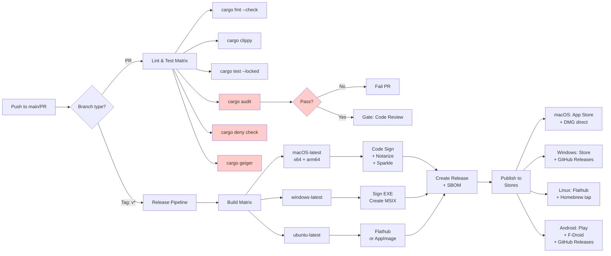

# 04: Security & Delivery Architecture

**Status:** Planning  
**Audience:** Architecture Review, Delivery  
**Last Updated:** 2026-10-16

---

## Summary & Recommendation

Alloy's security posture and delivery pipeline must reflect the sensitivity of encrypted messaging and cryptographic keys. **Recommended approach:**

- **Unsafe code:** Forbid at workspace level via `#![forbid(unsafe_code)]` except where FFI/platform code forces exceptions; audit via `cargo-geiger` in CI.
- **Supply chain:** `cargo-audit` + `cargo-deny` in CI (mandatory); `cargo-vet` for significant new dependencies; SBOM generation via `cargo-auditable` or `cargo-cyclonedx`.
- **Secrets at rest:** Use `keyring` crate (v4.2+) for OS keychains (macOS/Linux); `apple-native-keyring-store` for iOS; for Android, use `tauri-plugin-secure-keystore` or direct Keystore JNI bindings. All database secrets/keys encrypted with **SQLCipher** (via `rusqlcipher` or `rusqlite` with `bundled-sqlcipher`).
- **Memory safety:** `zeroize` and `secrecy` crates for all crypto secrets; zero on drop.
- **Update mechanism:** Tauri's built-in updater with code-signed manifests and delta compression (not Sparkle for Windows/Linux); Sparkle 2.x for macOS + notarization via GitHub Actions; app-signing CI for all platforms.
- **Telemetry:** Zero by default; opt-in analytics only via explicit user consent with no collection of message content or contacts.
- **Licensing:** **Apache 2.0** (compatible with `matrix-rust-sdk` Apache-2.0); dual-license option possible (Apache 2.0 + MIT) for ecosystem compatibility.
- **Governance:** Clear CONTRIBUTOR.md, CODE_OF_CONDUCT.md; SECURITY.md for vulnerability reporting; maintainer council model post-v1.

---

## Options Compared

| **Aspect** | **Option A: Choose Now** | **Alt. / Tradeoffs** |
|---|---|---|
| **Unsafe code policy** | `#![forbid(unsafe_code)]` workspace-wide | Allow unsafe in specific crates; less strict but complex auditing |
| **Supply chain audit** | `cargo-audit` + `cargo-deny` (mandatory CI) | `cargo-vet` alone (more manual, slower) |
| **Secrets backend** | Platform keychains (keyring crate) | Hardcoded/file-based (insecure, rejected) |
| **Database encryption** | SQLCipher + `rusqlcipher` or `rusqlite bundled-sqlcipher` | Unencrypted SQLite (no-go for sensitive data) |
| **Memory zeroization** | `zeroize` + `secrecy` wrappers | Manual memset (error-prone, incomplete) |
| **Updates** | Tauri updater + Sparkle (macOS) | Each platform separate tool (maintenance burden) |
| **License** | Apache 2.0 | AGPL 3.0 (restrictive, incompatible with SDK) |
| **Telemetry** | Opt-in, privacy-first | Telemetry by default (breaks trust, privacy concern) |

---

## Evidence & Technical Details

### Unsafe Code & `#![forbid(unsafe_code)]`

[Rust workspace lints docs](https://github.com/rust-lang/cargo/blob/master/src/doc/src/reference/workspaces.md) support `[workspace.lints.rust] unsafe_code = "forbid"` at root `Cargo.toml`. This prevents all unsafe blocks unless explicitly allowed per-crate with `#![allow(unsafe_code)]` with justification.

- **cargo-geiger** (v0.10.2+, [GitHub](https://github.com/geiger-rs/cargo-geiger)) detects unsafe usage in deps and your code; integrated into CI warnings.
- **Platform exceptions:** FFI for iOS (Objective-C keychain), Android (JNI), and potentially Tauri's native code will require unsafe blocks in thin wrapper crates (`alloy-ios-ffi`, `alloy-android-ffi`) — acceptable with inline documentation.

### Supply Chain Security

Three-layer approach (2026 standard practice):

1. **`cargo-audit`** (v0.22.2, [RustSec Advisory DB](https://github.com/rustsec/advisory-db)) — mandatory, runs on every commit. Blocks on known CVEs.
2. **`cargo-deny`** (v0.15+, Embark) — policy enforcement: bans licenses, checks for unmaintained crates, detects typosquatting patterns.
3. **`cargo-vet`** (Mozilla, v0.10.2+) — for new high-risk dependencies; audits performed and recorded in `supply-chain/audits.toml`.

**SBOM generation:**
- `cargo-auditable` (v0.7.7) embeds dependency metadata in binaries, allowing post-release auditing.
- `cargo-cyclonedx` (v0.5.9, CycloneDX spec) generates machine-readable SBOM for compliance/transparency.

### Secrets Management

**Cross-platform solution using `keyring` crate (v4.2.0):**

| Platform | Backend | Crate | Storage |
|---|---|---|---|
| macOS | Security.framework | `keyring` + `apple-native-keyring-store` (v1.0.2) | Keychain |
| Linux | SecretService / KWallet | `keyring` (DBus) | System daemon |
| Windows | Credential Manager | `keyring` | DPAPI |
| iOS | Keychain.framework | `apple-native-keyring-store` (v1.0.2) | Secure Enclave (if available) |
| Android | KeyStore + SharedPreferences | `tauri-plugin-secure-keystore` (v0.0.2) or JNI | Hardware/software KeyStore |

**Database encryption:**
- **`rusqlcipher` (v0.14.9)** — maintained wrapper for SQLCipher; AES-256 encryption of SQLite files.
- **Alternative:** `rusqlite` with `bundled-sqlcipher` feature (same SQLCipher, different binding).
- **Key derivation:** PBKDF2 with SQLCipher defaults (secure); use `secrecy::SecretString` for password in memory.

**Memory safety for crypto:**
- **`zeroize` (v1.9.0, RustCrypto)** — volatile overwrites of secrets on drop; compiler-guaranteed no optimization away.
- **`secrecy` (latest)** — wraps secrets in `SecretBox<T>` with zeroize on drop; prevents accidental logging/debug output.
- **Pattern:** `use secrecy::{SecretString, ExposeSecret}; let pass = SecretString::new("...".to_string());`

**References:**
- https://docs.rs/keyring/4.2.0/keyring/
- https://docs.rs/zeroize/latest/zeroize/
- https://docs.rs/secrecy/latest/secrecy/

### Local Data Protection

- **macOS/iOS:** Leverage file-level encryption via APFS or Keychain; no additional layer needed if using SQLCipher.
- **Android:** SQLCipher + device encryption; consider requesting `WRITE_SECURE_SETTINGS` for app-level secrets (use sparingly).
- **Linux/Windows:** Rely on SQLCipher + OS user isolation; consider per-profile encryption directories.
- **CSP/IPC hardening (WebView):** Alloy runs in the Tauri 2 WebView, so the CSP is enforced. The configured policy sets `default-src 'none'`, `script-src 'self'`, `frame-src 'none'`, `base-uri 'none'`, `form-action 'none'`, and `object-src 'none'`; `app.security.freezePrototype` is enabled. Capabilities are minimal (`core:default` plus `opener:allow-open-url` and `opener:allow-default-urls`, limited to http/https/mailto/tel). Message HTML goes through a DOMPurify allowlist with `data-*`/`aria-*` attributes disabled. Avoid inline scripts and widen the CSP only with a reviewed reason.

### Update & Code Signing

**macOS:**
- **Sparkle 2.x** (de facto standard, [docs](https://sparkle-project.org/documentation/)) — auto-updates with DSA/EdDSA signatures.
- **Notarization:** `tauri-macos-sign` (v2.0.1) in GitHub Actions; requires Apple Developer ID certificate and requires explicit notarization API calls to Apple's servers.
- **Workflow:** Sign binary → notarize → staple ticket → create DMG.

**Windows:**
- Tauri updater with signed manifest (PKCS#7 or Ed25519).
- **MSIX optional** for Microsoft Store distribution; self-signed for direct download.
- Code sign EXE/MSI with Authenticode certificate (DigiCert, GoDaddy, or Windows Crypto APIs in CI).

**Linux:**
- **Flathub:** AppImage or Flatpak bundle; distributions handle signing/verification.
- **Direct:** GPG-signed tarballs or signed GitHub releases.

**CI Integration:**
- GitHub Actions secrets store private keys (`APPLE_CERTIFICATE_BASE64`, `WINDOWS_CERT_PASSWORD`).
- Skip notarization in PR runs; do only on tag/release.

### Telemetry & Privacy

**Default: zero telemetry.** If analytics are added:
- Explicit opt-in at first launch; surveyable in settings.
- **No collection of:**
  - Message content, Room names, User IDs, Contact lists, Encryption keys.
  - Network metadata (IP addresses logged locally only).
  - Keystroke patterns or timing.
- **What can be collected (with consent):**
  - Feature usage (e.g., "Viewed settings", "Used markdown editor").
  - Crash reports (stack traces, OS/version).
  - Session duration, app version, locale.
- **Compliance:** GDPR (consent-first), CCPA (deletion right on request).
- **Transport:** TLS 1.3, no third-party trackers (own analytics endpoint if used).

**Recommended approach:** Use `libtelemetry` or Tauri's built-in event system with a local flag toggle. Post-v1 feature.

### Licensing

**Primary: Apache License 2.0** ([apache.org](https://www.apache.org/licenses/LICENSE-2.0.html))

- ✅ Compatible with `matrix-rust-sdk` (Apache-2.0).
- ✅ Permissive; allows proprietary forks (optional, aligns with open-source goals but doesn't force it).
- ✅ Explicit patent grant.
- ✅ Adopted by Rust ecosystem (tokio, serde, etc.).

**Alternative considered: AGPL 3.0**
- ❌ Network clause forces open-sourcing of derivative services; incompatible with `matrix-rust-sdk` (Apache-2.0 ⊄ AGPL-3.0 compatibility).
- ❌ Stricter; may deter proprietary contributions/support.
- Rejected unless explicit governance decision to fork SDK separately.

**Optional dual-license (Apache-2.0 + MIT):** Post-v1, for maximum ecosystem compatibility (e.g., if embedded in MIT-licensed projects).

**File headers:**
```rust
// Copyright (c) 2026 Alloy Contributors
// Licensed under the Apache License, Version 2.0 (see LICENSE.txt).
// SPDX-License-Identifier: Apache-2.0
```

**SECURITY.md:** Pledge responsible disclosure; link to `security@alloy.chat` or GitHub Advisory (if set up).

---

## CI/CD Pipeline Architecture



**GitHub Actions Workflow Structure:**

```yaml
# .github/workflows/ci.yml
name: CI & Security

on: [push, pull_request]

jobs:
  lint-test:
    runs-on: ${{ matrix.os }}
    strategy:
      matrix:
        os: [macos-latest, windows-latest, ubuntu-latest]
        rust: [stable]
    steps:
      - uses: actions/checkout@v4
      - uses: dtolnay/rust-toolchain@stable
      - uses: Swatinem/rust-cache@v2
      
      - run: cargo fmt --check
      - run: cargo clippy -- -D warnings
      - run: cargo test --locked --all-features
      - run: cargo audit --deny warnings
      - run: cargo deny check licenses
      - run: cargo geiger --output Markdown
      
      - name: Upload audit results
        if: always()
        uses: actions/upload-artifact@v4
        with:
          name: audit-${{ matrix.os }}
          path: |
            **/*.adv
            geiger.md

  # macOS signing (release only)
  macos-release:
    if: startsWith(github.ref, 'refs/tags/v')
    runs-on: macos-latest
    steps:
      - uses: actions/checkout@v4
      - name: Import Code Signing Certificate
        uses: apple-actions/import-codesign-certs@v3
        with:
          p12-file-base64: ${{ secrets.APPLE_CERTIFICATE_BASE64 }}
          p12-password: ${{ secrets.APPLE_CERTIFICATE_PASSWORD }}
      
      - name: Build & sign
        run: |
          cargo build --release
          codesign --deep --force --verify --verbose \
            --sign "${{ secrets.APPLE_TEAM_ID }}" \
            target/release/alloy.app
      
      - name: Notarize
        run: |
          xcrun notarytool submit target/release/alloy.dmg \
            --apple-id ${{ secrets.APPLE_ID }} \
            --password ${{ secrets.APPLE_APP_SPECIFIC_PASSWORD }} \
            --team-id ${{ secrets.APPLE_TEAM_ID }} \
            --wait
      
      - name: Generate SBOM
        run: cargo cyclonedx --output sbom.xml
      
      - name: Create Release
        uses: softprops/action-gh-release@v2
        with:
          files: |
            target/release/alloy.dmg
            sbom.xml

  # Windows release
  windows-release:
    if: startsWith(github.ref, 'refs/tags/v')
    runs-on: windows-latest
    steps:
      - uses: actions/checkout@v4
      - uses: dtolnay/rust-toolchain@stable
      
      - name: Build
        run: cargo build --release
      
      - name: Sign executable
        run: |
          signtool sign /f ${{ secrets.WINDOWS_CERT_PATH }} \
            /p ${{ secrets.WINDOWS_CERT_PASSWORD }} \
            /t http://timestamp.comodoca.com \
            target/release/alloy.exe
      
      - name: Create MSIX (optional)
        run: |
          makemsix.exe -pack -d . -o alloy.msix
      
      - uses: softprops/action-gh-release@v2
        with:
          files: |
            target/release/alloy.exe
            alloy.msix

  # Android CI (signing in Play Console only)
  android-test:
    runs-on: ubuntu-latest
    steps:
      - uses: actions/checkout@v4
      - uses: dtolnay/rust-toolchain@stable
        with:
          targets: aarch64-linux-android,armv7-linux-android
      
      - name: Build (unsigned APK for testing)
        run: |
          cargo build --release --target aarch64-linux-android
          # Placeholder: actual APK build via cargo-ndk or gradle
```

---

## Performance Budgets & Profiling

| **Metric** | **Target** | **Tool** | **CI Gate** |
|---|---|---|---|
| **Cold start** | <2.0 s (desktop), <3.5 s (mobile) | `tokio-console`, samply, Instruments | Nightly benchmark |
| **First room list** | <500 ms after sync | `criterion` bench suite | PR gate (5% regression) |
| **Scroll frame time** | ≥60 FPS at 10k events | `samply` profiler, Chrome DevTools | Manual testing, weekly |
| **Memory (idle)** | <150 MB (desktop), <80 MB (mobile) | `cargo-flamegraph`, heap dumps | Nightly monitoring |
| **Binary size** | <60 MB (macOS DMG), <40 MB (APK) | `cargo-bloat`, `twiggy` | Release checklist |

**Profiling setup:**

```bash
# CPU profiling (with frame times)
cargo install samply
samply record cargo run --release

# Async task profiling
TOKIO_CONSOLE=1 cargo run --release

# Memory profiling (Valgrind on Linux)
valgrind --tool=massif --massif-out-file=massif.out target/release/alloy

# Flamegraph
cargo install flamegraph
cargo flamegraph --release

# Benchmark suite (CI)
cargo bench --bench=* -- --verbose
```

**Benchmark CI (weekly):**
- Run on stable hardware (GitHub Actions large runner).
- Compare against baseline (last stable release).
- Fail if >5% regression on cold start or frame time.

---

## Distribution & Store Requirements

### macOS
- **App Store:** Notarization mandatory; sandbox entitlements approved by Apple.
- **DMG (direct):** Notarization recommended; signed + stapled ticket.
- **Homebrew Cask:** Formulae in `homebrew-cask`; requires livecheck URL and SHA256.

### Windows
- **Microsoft Store:** MSIX package, signing certificate, privacy policy, content rating board submission.
- **Direct (GitHub Releases):** Signed EXE with Authenticode; MSIX optional.
- **Winget:** Community package in `microsoft/winget-pkgs`; requires checksum verification.

### iOS
- **App Store:** TestFlight for beta; Xcode + provisioning profiles required; iOS 14+ minimum.
- **Signing:** Done via Xcode/GitHub Actions secret (Apple Developer credentials).

### Android
- **Play Store:** AAB (Android App Bundle) signed with Play Store key; app review, privacy policy, API permissions review.
- **F-Droid:** Reproducible build requirement; source submission to `fdroiddata` repo; F-Droid signs final APK.
- **Direct (GitHub Releases):** Signed APK; users enable "unknown sources" (high friction, security UX concern).

### Linux
- **Flathub:** Flatpak with JSON manifest; source must be verifiable; auto-updates via OTA.
- **Homebrew (tap):** Self-hosted `alloy-homebrew-tap` repo; bottle (binary) provides faster install.
- **Package managers:** Debian (`.deb`), Fedora (`.rpm`) via distribution packaging (handled by distro maintainers post-v1).
- **AppImage:** Self-contained; portable; works across distros.

---

## Testing Pyramid

```
         ┌─────────────────────┐
         │  E2E (UI Test Farm) │  ← 10% (5–10 tests)
         │  Physical devices   │
         └──────────┬──────────┘
         ┌──────────┴──────────┐
         │  Integration Tests  │  ← 25% (30–50 tests)
         │  Synapse+SDK        │
         └──────────┬──────────┘
         ┌──────────┴──────────────────────┐
         │   Unit + Property Tests         │  ← 65% (500+ tests)
         │ (quickcheck/proptest for logic) │
         └─────────────────────────────────┘
```

**Unit tests:** `#[cfg(test)]` in source files; cargo test.
**Property tests:** `proptest` or `quickcheck` for crypto, sync, encryption edge cases.
**Snapshot UI tests:** `insta` crate for verifying rendered layouts match baseline (desktop/mobile).
**Integration:** `tokio::test` with embedded Synapse server (via `sytest`); test E2E encryption, key rotation, backups.
**E2E on device farms:** BrowserStack or similar; iOS/Android; 5–10 critical user flows.

**CI gate:** All must pass on PR; allow manual skip of device-farm E2E.

---

## Risks & Mitigations

| **Risk** | **Likelihood** | **Impact** | **Mitigation** |
|---|---|---|---|
| Supply chain attack (compromised dep) | Medium | Critical (RCE) | `cargo-audit`, `cargo-deny`, `cargo-vet` for high-risk crates |
| Unsafe code bug in wrapper crates | Medium | High (memory unsafety) | Forbid policy; inline justification; code review mandatory |
| Secrets leaked in logs/debugging | Medium | Critical | `secrecy` + `zeroize`; review logging output; no `Debug` derive on secret types |
| SQLCipher key derivation weak | Low | High (DB compromise) | Use PBKDF2 defaults; test key material; audit on upgrade |
| Update mechanism exploited | Low | Critical (malware) | Code-sign all binaries; manifest integrity (Ed25519); delta verification; sandboxed installer |
| Notarization rejection (Apple policy) | Medium | High (release blocked) | Early testing on beta branch; Apple security guidelines review |
| Privacy leak (telemetry default) | High | High (user trust) | Zero telemetry by default; explicit UI consent; audit analytics code in reviews |
| License incompatibility discovered | Low | Medium (legal, rebase) | Validate Apache 2.0 ✓ matrix-rust-sdk (Apache-2.0) now; legal review if AGPL considered |

---

## Concrete Decisions

1. **Unsafe code policy:** Forbid workspace-wide; allow per-crate with inline justification; `cargo-geiger` in CI.
2. **Supply chain:** `cargo-audit` + `cargo-deny` mandatory on every commit; `cargo-vet` on new high-risk deps (deps with network/FFI/build scripts).
3. **Secrets:** `keyring` v4.2+ (all platforms); `secrecy` + `zeroize` for in-memory secrets; SQLCipher for persistent sensitive data.
4. **Updates:** Tauri updater (all platforms except macOS App Store); Sparkle 2.x for direct macOS; signed manifests; GitHub Actions auto-signing.
5. **Telemetry:** Off by default; opt-in only; no message/contact/key data; GDPR/CCPA compliant if enabled.
6. **License:** Apache License 2.0 (compatible with `matrix-rust-sdk`).
7. **Governance:** CONTRIBUTOR.md, CODE_OF_CONDUCT.md (Rust CoC), SECURITY.md post-v0.1; maintainer council (3–5 core) post-v1.

---

## Open Questions for the User

1. **Notarization certificates:** Will you purchase an Apple Developer ID certificate (required for notarization + distribution) or use GitHub Actions' temporary signing?
2. **Analytics:** Do you want telemetry infrastructure pre-built (even if off by default) or added post-v1?
3. **App Store submission:** Priority for initial launch? (May require App Review lead time; 1–2 weeks typical.)
4. **Beta channels:** Do you want nightly/beta branches shipped, or only stable releases?
5. **License governance:** Do you want community input on any future license change, or is Apache 2.0 final?

---

## Work Breakdown

| **Task** | **Size** | **Owner** | **Parallel?** | **Acceptance** |
|---|---|---|---|---|
| **Workspace setup:** `Cargo.toml` with `[workspace.lints]` forbid unsafe | **S** | Core | — | `cargo build` succeeds; `cargo geiger` runs |
| **Dependency audit config:** `.cargo/deny.toml`, GitHub Actions CI | **S** | Core | Yes | `cargo deny check` passes; PR blocks on audit failure |
| **Secret storage abstraction:** Trait `SecretStore` + implementations for keyring/SQLCipher | **M** | Core | No (dep on CI) | Cross-platform secret store tests; Android JNI if needed |
| **Memory safety review:** Audit crypto code for zeroize; add `#[derive(Zeroize)]` macros | **M** | Core | Yes | All crypto secrets wrapped; memtest confirms wipe |
| **Update mechanism:** Integrate Tauri updater + Sparkle (macOS); GitHub Actions signing | **M** | Build | No | Signed binary; successful test update on each platform |
| **Code signing CI:** GitHub Actions workflows for macOS notarization, Windows Authenticode, APK signing | **M** | Build | Yes | All platforms auto-sign on tag; release notes include SHA256 |
| **SBOM generation:** `cargo-auditable` + `cargo-cyclonedx` in release pipeline | **S** | Build | Yes | SBOM attached to GitHub release; validates schema |
| **Profiling infrastructure:** Benchmark suite (criterion/divan), tokio-console setup | **M** | DevOps | Yes | `cargo bench` runs in CI; results logged |
| **Testing pyramid:** Unit tests (existing SDK), proptest harness, E2E scaffold | **L** | QA | Yes | 500+ unit tests; 30+ integration tests; E2E framework ready |
| **SECURITY.md:** Vulnerability disclosure policy; responsible contact | **S** | Ops | — | Published; GitHub Advisory link if available |
| **CONTRIBUTOR.md:** Setup, dev environment, PR process | **S** | Ops | — | Published; covers all platforms |
| **LICENSE file:** Apache 2.0 full text + header comments | **S** | Legal | — | File exists; headers on all source files |
| **Store submission prep:** Screenshots, metadata, privacy policy templates | **M** | Marketing | Yes | App Store, Play, Flathub docs ready (pre-submission) |
| **Device farm integration (E2E):** BrowserStack/native device lab setup | **M** | QA | No (post-MVP) | CI runs 5–10 critical flows on 3–4 devices |

**Critical path:** Workspace setup → Supply chain audit → Secret storage → Update mechanism → Code signing CI → Release.
**Parallelizable:** Profiling, testing, CONTRIBUTOR.md, store prep (all independent of core delivery).
**Blocking:** Secret storage (blocks DB encryption); Update mechanism (blocks distribution).

---

## Summary Table: Feature Adoption by Release

| **Aspect** | **v0.1 MVP** | **v0.5 Beta** | **v1.0 Stable** | **v2.0+** |
|---|---|---|---|---|
| Unsafe forbid + geiger | ✓ | ✓ | ✓ | ✓ |
| cargo-audit + deny | ✓ | ✓ | ✓ | ✓ |
| Secrets (keyring) | ✓ | ✓ | ✓ | ✓ |
| SQLCipher encryption | ✓ | ✓ | ✓ | ✓ |
| Code signing (basic) | ✓ | ✓ | ✓ | ✓ |
| Notarization (macOS) | ✓ | ✓ | ✓ | ✓ |
| SBOM generation | — | ✓ | ✓ | ✓ |
| Telemetry system | — | — | ✓ (opt-in) | ✓ |
| Device farm E2E | — | ✓ (basic) | ✓ (expanded) | ✓ |
| Governance (SECURITY.md) | — | ✓ | ✓ | ✓ |
| Store distribution | ✓ (manual) | ✓ (automated) | ✓ | ✓ |

---

## References

- [Rust Security Working Group Guidelines](https://anssi-fr.github.io/rust-guide/)
- [Cargo Security](https://doc.rust-lang.org/cargo/reference/security.html)
- [cargo-audit](https://github.com/rustsec/cargo-audit) — CVE advisory scanning
- [cargo-deny](https://embarkstudios.github.io/cargo-deny/) — Policy enforcement
- [cargo-vet](https://mozilla.github.io/cargo-vet/) — Supply-chain audits
- [keyring crate](https://docs.rs/keyring/4.2.0/keyring/) — Cross-platform secret storage
- [zeroize](https://docs.rs/zeroize/latest/) — Secure memory clearing
- [SQLCipher](https://www.zetetic.net/sqlcipher/) — Encrypted database
- [Tauri updater](https://v2.tauri.app/distribute/updater/) — Update mechanism
- [Sparkle 2.x](https://sparkle-project.org/documentation/) — macOS updates
- [Apple Notarization](https://developer.apple.com/documentation/notaryapi) — Code notarization
- [F-Droid docs](https://f-droid.org/docs/) — Android distribution
- [Flathub](https://docs.flathub.org/) — Linux Flatpak distribution
- [matrix-rust-sdk License](https://github.com/matrix-org/matrix-rust-sdk/blob/main/LICENSE) — Apache-2.0
