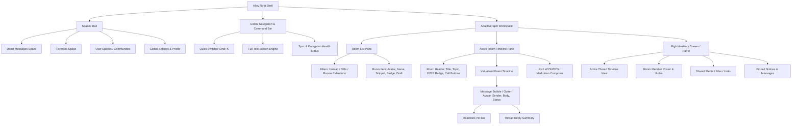

# Alloy UX & Product Design Specification

## 1. Summary & Recommendation

Alloy is designed as a next-generation, high-performance Matrix chat client engineered in Rust. The user experience balances the power, speed, and keyboard ergonomics of Discord and Slack with the privacy, autonomy, and security of Matrix 2.0 (MSC4108 QR onboarding, MSC3861 OIDC, sliding sync, and zero-compromise E2EE). 

### Primary Recommendation
Adopt an **Adaptive Tri-Pane Architecture** that collapses fluidly from a multi-pane desktop command center (Spaces Rail -> Room List -> Timeline -> Contextual Inspector/Thread Drawer) down to a focused single-pane mobile stack. Standardize on a **token-driven design system** modeled after modern design token specifications (W3C Design Tokens Community Group format), exposing a JSON-driven styling contract for user theming and plugin customization. Onboarding and crypto verification must replace legacy Matrix cryptographic terror (e.g., cryptic key cross-signing alerts) with standard consumer-grade primitives: QR-rendezvous login (MSC4108), automatic cross-signing gossiping, and cloud passphrase recovery styled as familiar account protection.

---

## 2. Product Differentiators & Design Philosophy

1. **Sub-16ms Frame Budget (Native 120 FPS Rendering):** Pure Rust UI pipeline eliminating Electron webview micro-stutters, IPC serialization lag, and bloated runtime memory footprints.
2. **First-Class Extensibility Without Compromising Core Security:** Modular plugin UI extension points isolated through strict manifest-declared capabilities and sandbox boundaries.
3. **Ergonomic "Keyboard-First" Navigation:** Global Command Palette (`Cmd+K` / `Ctrl+K`), Vim-style room hopping, roving tabindex, and instant message actions for power users.
4. **Humanized End-to-End Cryptography:** Frictionless device verification using animated SAS emojis and seamless QR pairing without intimidating security jargon.
5. **Radical Visual Customization:** Native support for 3 layout densities, custom font loading, CSS-like token overrides, AMOLED true black, and community theme packs.

---

## 3. Prior Art Analysis

| Client / App | Key Strengths to Adopt | Critical Pitfalls to Avoid |
| :--- | :--- | :--- |
| **Element X** | Sliding sync responsiveness; Compound design tokens; modern clean message bubble aesthetics; QR code login. | Sluggish desktop release trajectory; rigid layout options; limited community theme customization; complex multi-account switching. |
| **Cinny** | Elegant, clutter-free 3-column desktop layout; lightweight feel; intuitive channel vs. DM separation. | Lacks mobile-native UI paradigms; absent plugin ecosystem; limited thread support; no offline-first optimistic editing. |
| **FluffyChat** | Friendly consumer-facing tone; accessible settings; smooth cross-platform Flutter UX. | High memory consumption under heavy room loads; lack of dense desktop power-user ergonomics; non-native keyboard navigation. |
| **Beeper** | Unified inbox model; universal quick switcher (`Cmd+K`); frictionless onboarding flow; inbox zero philosophy. | Closed-source backend components; bridge-centric reliance; opaque data boundaries; locked down UI. |
| **Discord** | Guild/Space hierarchy rail; contextual thread panels; voice overlay; rich markdown/emoji autocomplete; frictionless roles. | Bloated Electron shell (500MB+ RAM); telemetry; ads/nitro upselling; aggressive unread badge noise; no E2EE. |
| **Slack** | Best-in-class multi-column thread navigation; quick switcher; message draft indicators; canvas/details sidebars. | Severe memory bloat; corporate design sterility; slow startup; enterprise pricing locks; proprietary protocol. |
| **Telegram** | Instantaneous optimistic sends; silky 120fps animations; fluid waveform voice messages; comprehensive theme editor. | Non-E2EE by default (cloud chats); siloed proprietary protocol; lack of nested spaces/guild structures for large teams. |
| **Nheko** | Ultra-low memory C++/Qt client; fast startup; power-user keybinds; native desktop integration. | Antiquated visual aesthetics; awkward mobile touch experience; complex manual key verification UX. |
| **Fractal** | Beautiful adherence to GNOME Human Interface Guidelines; GTK4/libadwaita polish; clean Rust architecture. | Confined strictly to Linux desktop paradigms; unsuitable for Windows/macOS/mobile ergonomics; missing voice notes/polls. |
| **Commet** | Fast modern lightweight Matrix experimentation; minimalist timeline layout. | Incomplete Matrix spec support; unstable state persistence; lacking active plugin architecture. |
| **SchildiChat** | Traditional dual-view tabbed messenger layout (separate DMs / Rooms list); power-user message metadata display. | Maintenance trailing upstream Element; cluttered visual hierarchy; confusing redundant settings menus. |

---

## 4. Information Architecture & Navigation

### 4.1 System Information Architecture Diagram



### 4.2 Comprehensive Screen Inventory

| Screen ID | Surface Name | Purpose & Primary Actions |
| :--- | :--- | :--- |
| **SCR-01** | **App Shell / Main Stage** | Primary 3-column navigation container housing Spaces, Rooms, and Active Timeline. |
| **SCR-02** | **Onboarding: Welcome & Discovery** | Server discovery via `.well-known`, custom homeserver URI validation, ping latency indicator. |
| **SCR-03** | **Onboarding: OIDC / MAS Auth** | Browser-mediated Single Sign-On (SSO) or native Matrix Authentication Service web flow. |
| **SCR-04** | **Onboarding: QR Cross-Device Login** | MSC4108 rendezvous flow display or camera scanner to pair with an active trusted session. |
| **SCR-05** | **Security: Key Verification Modal** | Interactive 7-emoji SAS visual matching or decimal string confirmation prompt. |
| **SCR-06** | **Security: Recovery Key Setup** | 12-word passphrase generation or secure file download for Secret Storage (4S). |
| **SCR-07** | **Command Palette (`Cmd+K`)** | Universal keyboard modal for jumping to rooms, people, commands, and workspace settings. |
| **SCR-08** | **Thread Drawer** | Split right-hand sidebar for reading and replying to MSC3440 / MSC2836 message threads. |
| **SCR-09** | **Room Info & Member Roster** | Details sheet displaying room encryption state, user roster, permissions, and aliases. |
| **SCR-10** | **Shared Media & File Gallery** | Filterable grid of images, videos, audio clips, documents, and bookmarked URLs. |
| **SCR-11** | **User Profile & Presence Modal** | Avatar, custom status text, Matrix ID (`@user:server`), public keys, and mutual rooms. |
| **SCR-12** | **Rich Media Lightbox** | Full-screen interactive viewer with zoom/pan, EXIF viewer, and download controls. |
| **SCR-13** | **Settings: General & Layout** | Language selector, layout density (Compact/Normal/Cozy), window chrome preferences. |
| **SCR-14** | **Settings: Appearance & Theme** | Theme selector (Light/Dark/OLED), custom CSS/token editor, accent color picker, font loader. |
| **SCR-15** | **Settings: Security & Encryption** | Active sessions list, cross-signing management, backup phrase rotation, cryptographic logs. |
| **SCR-16** | **Settings: Notifications** | Keyword alerts, sound bundles, per-room notification tiers, desktop push testing. |
| **SCR-17** | **Settings: Plugin Manager** | Installed plugins, permission auditing, extension slot toggles, community repository browsing. |

---

## 5. Responsive Layout Engine

Alloy adapts smoothly between three distinct screen categories using dynamic layout breakpoints:

```
[ Desktop: >= 1100px ]
+------+-------------+------------------------------------+--------------------+
| Space|  Room List  |          Timeline Stream           | Context / Thread   |
| Rail |  (Filtered) |  (Header, Virtual List, Composer)  | (Pinned / Members) |
| 64px |    260px    |               1fr                  | 320px (collapsible)|
+------+-------------+------------------------------------+--------------------+

[ Tablet / Split Window: 680px - 1099px ]
+------+-------------+---------------------------------------------------------+
| Space|  Room List  |                     Timeline Stream                     |
| Rail |  (240px)    |                     (Thread pushes to                   |
| 56px |             |                      full-height modal)                 |
+------+-------------+---------------------------------------------------------+

[ Mobile: < 680px ]
+-----------------------------------------------------------------------------+
| Single-pane stack with bottom navigation bar & gesture back navigation      |
| [ Home / Rooms ]  <---->  [ Active Room Timeline ]  <----> [ Thread View ]  |
+-----------------------------------------------------------------------------+
```

### 5.1 Layout Mechanics
1. **Desktop ($W \ge 1100\text{px}$):** Persistent 64px Spaces Rail; 260px collapsible Room List; flexible timeline; 320px collapsible Right Panel for threads, member info, or plugin panels.
2. **Tablet / Medium Desktop ($680\text{px} \le W < 1100\text{px}$):** Persistent compact Spaces Rail (56px); Room List collapses to an off-canvas drawer or toggleable pane; Threads overlay over the timeline as a slide-over panel.
3. **Mobile ($W < 680\text{px}$):** Pure single-pane stack navigation. Bottom navigation bar hosts Spaces/DMs/Mentions/Settings. Entering a room pushes the Timeline onto the view stack with edge-swipe-to-back gestures.

---

## 6. Seamless Interaction Engine

### 6.1 Optimistic Local Echo & Send Pipeline
- **Immediate Ingestion:** Upon clicking "Send" or pressing `Enter`, a temporary transaction ID (`txn_id`) is generated. The message is rendered immediately in the virtual timeline with an opacity tint (e.g. 70%) and a pending status indicator.
- **Background Dispatch:** The core Rust engine encrypts (via Megolm) and queues the event to the homeserver via `PUT /_matrix/client/v3/rooms/{roomId}/send/m.room.message/{txnId}`.
- **Reconciliation:** When the homeserver responds with the permanent `event_id`, the timeline item reconciles smoothly without triggering layout re-measures.
- **Error Handling:** If sending fails (network offline or rate-limited), the message persists in local storage with a red warning badge and an interactive retry/delete context menu.

### 6.2 Virtualized Scroll Physics & Jump-to-Unread
- **Bi-Directional Infinite Virtualization:** The timeline renders strictly visible DOM/widget nodes plus an overscan buffer of 5 screen heights above and below.
- **Anchor Retention:** When prepending historical messages fetched via back-pagination, the current view scroll offset is locked to the top-visible event anchor, preventing content jumps.
- **Stick-to-Bottom State:** If the user is within 64px of the latest message, incoming events smoothly advance the scroll position; if scrolled up, a floating "New Messages Below" pill appears displaying the count of unread incoming events and sender avatars.
- **Jump to First Unread:** Entering a room with unread messages centers the timeline on the first unread marker with an explicit red horizontal divider.

### 6.3 Rich Composer & Media Pipeline
- **Syntax & Autocomplete:** Real-time markdown parser supporting code fences with syntax highlighting, math blocks (`$x^2$`), spoiler tags (`||spoiler||`), and autocompletion popovers triggered by `@` (members), `#` (room aliases), `:` (emojis), and `/` (slash commands).
- **Drag-and-Drop / Clipboard Pipeline:** Dropping an image or document onto the composer opens an inline staging preview modal. The UI displays client-side compressed thumbnails, image dimensions, byte sizes, and an optional caption input prior to encryption and upload.
- **Voice Messages (MSC3245):** Audio recording with real-time audio waveform visualization, pause/resume, playback scrubbing, and playback speed toggles (1x, 1.25x, 1.5x, 2x).
- **Interactive Polls (MSC3381 / MSC3997):** Native poll creation modal with multi-choice or single-choice constraints, real-time vote tallying, and winner highlighting.
- **Reactions & Hover Toolbar:** Hovering a message displays a floating quick-action toolbar (Add Reaction, Reply in Thread, Quote, Edit, More). Quick emoji reaction picker displays the user's top 6 frequently used emojis, plus full Unicode picker.

---

## 7. Onboarding, Auth & Non-Scary Cryptography

### 7.1 Server Discovery & Authentication Flow
1. **Smart Server Resolution:** User enters their Matrix handle (`@alice:domain.tld`) or server domain (`domain.tld`). Client queries `https://domain.tld/.well-known/matrix/client` in the background.
2. **OIDC Native SSO (MSC3861):** If the homeserver advertises Matrix Authentication Service (MAS), Alloy initiates a secure PKCE OAuth 2.0 authorization code flow via system browser or loopback handler, bypassing manual password input.
3. **Cross-Device QR Code Login (MSC4108):**
   - New device renders an animated QR code containing an ephemeral rendezvous channel URL and public key.
   - User scans the QR code using their active mobile client (Element X or Alloy Mobile).
   - Devices establish an authenticated curve25519 channel, exchange credentials, and transfer cross-signing trust automatically.

### 7.2 Humanized End-to-End Cryptography UX
- **The Problem:** Traditional Matrix clients overwhelm users with alerts like *"Verify Session 4B3A9F"*, *"Cross-signing keys unverified"*, or *"Unable to decrypt: OLM error"*.
- **The Alloy Paradigm:**
  - **Visual Verification (SAS):** Verification presents seven friendly, recognizable emojis (e.g., 🐱 Cat, 🚀 Rocket, 🎸 Guitar) or a simple 4-digit code.
  - **Secret Storage (4S):** Styled as "Account Backup". User configures an encrypted vault with a user-friendly master passphrase or downloadable 12-word recovery paper key.
  - **Silent Key Gossip:** When new devices join, key gossip requests occur autonomously over encrypted device-to-device channels without blocking message reading.
  - **Degraded Security Banner:** If a room has unverified devices, instead of modal blocks, a subtle amber shield appears in the room header with a one-click "Review Participants" drawer.

---

## 8. Design System, Tokens & Customization Surface

### 8.1 Design Tokens Architecture
Tokens follow a multi-tier hierarchy: Global Base Tokens -> Semantic Theme Tokens -> Component Tokens.

```json
{
  "color": {
    "brand": {
      "primary": "oklch(0.65 0.22 260)",
      "secondary": "oklch(0.70 0.18 190)"
    },
    "surface": {
      "canvas": "var(--alloy-surface-canvas)",
      "subtle": "var(--alloy-surface-subtle)",
      "panel": "var(--alloy-surface-panel)",
      "bubble_self": "var(--alloy-bubble-self)",
      "bubble_other": "var(--alloy-bubble-other)"
    }
  },
  "spacing": {
    "1": "4px",
    "2": "8px",
    "3": "12px",
    "4": "16px",
    "6": "24px"
  },
  "typography": {
    "font_family_sans": "Inter, -apple-system, BlinkMacSystemFont, 'Segoe UI', Roboto, sans-serif",
    "font_family_mono": "JetBrains Mono, 'Fira Code', monospace"
  }
}
```

### 8.2 User Customization Matrix

| Customization Aspect | Available Options | Default | Storage / Persistence |
| :--- | :--- | :--- | :--- |
| **Theme Mode** | Light, Dark, AMOLED Pure Black, System Auto | System Auto | Local storage & synced account data |
| **Accent Color** | Indigo, Emerald, Ruby, Amber, Violet, Cyan, Custom Hex | Indigo (`#5865F2`) | `alloy-theme` config |
| **Layout Density** | Compact (4px paddings, hidden bubbles, 13px font)<br>Normal (8px paddings, subtle bubbles, 14px font)<br>Cozy (12px paddings, chat bubbles, 15px font) | Normal | Local preference |
| **Message Style** | Modern Bubbles (Telegram/iMessage)<br>IRC / Gutter Style (Slack/Discord)<br>Compact Matrix | Modern Bubbles | Local preference |
| **Sidebar Order** | Custom drag-and-drop sort, alphabetical, unread-first | Unread-first | Synced account data |
| **Keybindings** | Default (Discord/Slack standard), Vim-navigation mode, Custom JSON map | Default | Local keymap config file |
| **Font Customization** | System Default, Custom Local Font Family, Dynamic Sizing (12px-22px) | Inter / System UI | Local preference |
| **Custom Overrides** | Token override file (`~/.config/alloy/theme.json`) | None | Local filesystem |

---

## 9. Plugin UI Extension Points

Plugins cannot inject arbitrary unconstrained web views into the application core. Instead, they register structured declarative UI manifests binding to explicit **Named Extension Points**:

```
+-----------------------------------------------------------------------------------+
| [EP-01: spaces_rail.bottom]                                                      |
+-----------------------------------------------------------------------------------+
| [EP-02: room_list.header_action]      | [EP-04: room_header.action_menu]          |
| [EP-03: room_list.item_badge]         | [EP-05: timeline.banner_top]              |
|                                       |-------------------------------------------|
|                                       | [EP-06: timeline.message_action]          |
|                                       | [EP-07: timeline.message_embed]           |
|                                       |-------------------------------------------|
|                                       | [EP-08: composer.toolbar_action]          |
|                                       | [EP-09: composer.slash_command]           |
+---------------------------------------+-------------------------------------------|
| [EP-12: status_bar.item]              | [EP-10: details_panel.tab]                |
|                                       | [EP-11: command_palette.provider]         |
+-----------------------------------------------------------------------------------+
```

### Complete Catalog of Extension Slots

1. `spaces_rail.bottom_action`: Adds an action icon button to the lower utility segment of the Spaces Rail (e.g., custom bridge status, RSS feeds).
2. `room_list.header_action`: Adds an icon or dropdown button to the Room List header bar.
3. `room_list.item_badge`: Injects custom metadata chips onto room list rows (e.g., Jira ticket counters, bridge protocol indicator).
4. `room_header.action_menu`: Adds contextual room-level actions (e.g., "Start Jitsi Call", "Export Room Chat").
5. `timeline.banner_top`: Displays a persistent or dismissible warning/announcement banner above the message stream.
6. `timeline.message_action`: Injects an item into the message hover toolbar and context menu (e.g., "Translate Message", "Save to Notes").
7. `timeline.message_embed`: Renders structured sandboxed custom cards below supported event types or URL embeds (e.g., GitHub PR previews, Figma cards).
8. `composer.toolbar_action`: Adds an action button to the bottom composer tray (e.g., GIF picker, code snippet generator, voice note).
9. `composer.slash_command`: Registers custom autocomplete commands prefixed with `/` (e.g., `/shrug`, `/poll`, `/remind`).
10. `details_panel.tab`: Appends a dedicated tab view to the right-hand inspection drawer (e.g., "Room KanBan", "Notes").
11. `command_palette.provider`: Supplies searchable action items and navigation targets to `Cmd+K`.
12. `status_bar.item`: Injects small status items into the window footer (e.g., bandwidth monitor, encryption key sync progress).

---

## 10. Accessibility (a11y) & Internationalization (i18n)

### 10.1 Accessibility Standards
- **Screen Reader Navigation:** Full WAI-ARIA role tree (`role="feed"` for timeline, `role="article"` for messages, `role="toolbar"` for message actions). Incoming messages announce sender and text politely (`aria-live="polite"`).
- **Keyboard Navigation & Focus Trapping:** Roving `tabindex` across list items. Pressing `Up Arrow` in an empty composer immediately enters edit mode for the user's last sent message. Pressing `Escape` closes the active modal, thread drawer, or clears search focus.
- **Motion Reduction:** Honor OS-level `prefers-reduced-motion` flags. When enabled, spring physics and smooth timeline scrolling collapse to instantaneous frame swaps.
- **High Contrast & Vision Support:** All core themes satisfy WCAG 2.2 Level AAA color contrast ratios (minimum 7:1 for normal text). Support for OS dynamic type scaling up to 200% without label clipping or horizontal scroll breakage.

### 10.2 Internationalization with Mozilla Fluent
- **Crate Choice:** Standardize on `fluent-bundle` and `unic-langid` (official Rust Fluent implementation: `https://github.com/projectfluent/fluent-rs`).
- **Asymmetric Localization:** Fluent handles pluralization, grammatical gender, and dynamic argument formatting without awkward hardcoded string concatenations.
- **Bidirectional (RTL) Layouts:** Dynamic mirroring for Arabic, Hebrew, and Persian. Spaces rail and room lists mirror to the right edge, scrollbars flip, and message directionality follows unicode bidirectional markers.

---

## 11. MVP vs. Later Feature Cut

```
+-------------------------------------------------------------------------------+
| PHASE 1: MVP FOUNDATION                                                       |
| - Adaptive 3-Pane / Single-Pane Shell (Desktop & Mobile)                      |
| - Server Discovery & OIDC / Password Login                                    |
| - Bi-Directional Virtualized Timeline with Smooth Local Echo                  |
| - Markdown Composer with Basic Mentions (@) & Emoji Autocomplete (:)          |
| - Read Receipts, Typing Indicators, and Emoji Reactions                       |
| - SAS Emoji Verification & 4S Recovery Passphrase Setup                       |
| - Design Tokens: Light, Dark, AMOLED + Compact/Normal Density                 |
| - Command Palette (`Cmd+K`) Room Switcher                                     |
+-------------------------------------------------------------------------------+
                                      |
                                      v
+-------------------------------------------------------------------------------+
| PHASE 2: ADVANCED CHAT & MULTIMEDIA                                           |
| - MSC4108 Cross-Device QR Code Login                                          |
| - Full MSC3440 / MSC2836 Message Threads Drawer                              |
| - MSC3245 In-line Voice Messages & Waveform Scrubber                          |
| - MSC3381 Live Polls Creation & Voting                                        |
| - Client-side Image Compression & Drag-Drop Media Gallery                     |
| - Custom Accent Colors & CSS Token Override File Loading                      |
| - RTL Mirroring & Mozilla Fluent i18n Foundation                              |
+-------------------------------------------------------------------------------+
                                      |
                                      v
+-------------------------------------------------------------------------------+
| PHASE 3: EXTENSIBILITY & ADVANCED POWER TOOLS                                 |
| - Sandboxed Plugin UI Extension Host (all 12 named slots)                     |
| - Custom Keybinding Re-mapping Engine                                         |
| - In-App Plugin Directory & One-Click Installation                            |
| - Native VoIP Audio/Video Room Integration (MatrixRTC)                        |
| - WebAssembly Web Shell Compilation Target                                    |
+-------------------------------------------------------------------------------+
```

---

## 12. Options Compared

| Feature Area | Option A | Option B | Option C | Selected Option & Rationale |
| :--- | :--- | :--- | :--- | :--- | :--- |
| **Design Token System** | Hardcoded CSS / Styling Classes | W3C Design Token JSON Hierarchy | Ad-hoc Theme Structs | **Option B:** Enables seamless theming, user overrides, and plugin styling contracts without compile-time coupling. |
| **Localization Stack** | `gettext` / `.po` files | Custom JSON dictionaries | Mozilla Fluent (`fluent-rs`) | **Option C:** Fluent handles complex grammatical pluralization and dynamic gender variations cleanly in Rust. |
| **Message Layout Mode** | Bubbles Only (Mobile style) | Gutter Only (IRC/Slack style) | Adaptive User-Selectable Mode | **Option C:** Providing Modern Bubbles, IRC Gutter, and Compact density satisfies both general users and IRC/Discord veterans. |
| **Thread Navigation** | In-line expansion in main timeline | Right-hand Contextual Split Drawer | Separate Room Navigation | **Option B:** Retains main timeline context while isolating deep thread discussions, mirroring Slack/Discord best practices. |
| **Authentication Flow** | Legacy Matrix Password Only | Webview Form Injection | Native OIDC (MSC3861) + QR (MSC4108) | **Option C:** Modern Matrix 2.0 standards drastically reduce onboarding failure rates and password fatigue. |

---

## 13. Evidence & Citations

1. **Matrix 2.0 & MSC4108 QR Login:** Defined in MSC4108 (*"Mechanism to allow OAuth 2.0 API sign in and E2EE set up via QR code"*, merged PR: `https://github.com/matrix-org/matrix-spec-proposals/pull/4108`) utilizing RFC 8628 Device Authorization.
2. **Matrix Authentication Service (MAS):** Native OIDC specifications specified under MSC3861 (`https://github.com/matrix-org/matrix-spec-proposals/pull/3861`).
3. **Sliding Sync Architecture:** MSC3575 Sliding Sync implementation details verified via `matrix-rust-sdk` documentation (`https://github.com/matrix-org/matrix-rust-sdk`).
4. **Matrix Rich Media & Threads:** Voice messages defined in MSC3245 (`https://github.com/matrix-org/matrix-spec-proposals/pull/3245`); Polls in MSC3381 (`https://github.com/matrix-org/matrix-spec-proposals/pull/3381`); Threads in MSC3440 (`https://github.com/matrix-org/matrix-spec-proposals/pull/3440`).
5. **Project Fluent in Rust:** Official `fluent-rs` crate repository (`https://github.com/projectfluent/fluent-rs`) and docs (`https://docs.rs/fluent/latest/fluent/`).
6. **W3C Design Tokens:** Specifications by the Design Tokens Community Group (`https://design-tokens.github.io/community-group/format/`).

---

## 14. Risks & Mitigations

1. **Risk: Virtualized Timeline Scroll Drift on Prepend.** Back-paginating long historical logs can cause jarring scroll jumping or missing messages.
   * *Mitigation:* Employ absolute anchor event tracking: lock viewport position to the topmost stable rendered event ID during DOM/layout reflows.
2. **Risk: User Confusion with E2EE Verification.** Users abandoning the client during cryptographic key verification prompts.
   * *Mitigation:* Default to non-blocking background verification; prioritize automated QR code scanning (MSC4108) over manual key exchange; eliminate security jargon.
3. **Risk: Plugin Styling Breakages.** User themes or plugins breaking timeline layout or introducing visual regressions.
   * *Mitigation:* Restrict plugins to tokenized CSS variables; enforce strict declarative layout slot bounds; reject arbitrary style sheet injections.
4. **Risk: High Memory Footprint from Unbounded Image Caching.** Loading full-resolution camera uploads in rooms with thousands of images.
   * *Mitigation:* Strict disk-backed media caching with LRU eviction; decode downscaled thumbnails on background worker threads based on the active viewport size.

---

## 15. Concrete Decisions

1. **Layout Strategy:** 3-pane responsive desktop shell (Spaces Rail, Room List, Timeline + Context Drawer) collapsing to a 1-pane gesture stack on mobile (`< 680px`).
2. **Density Defaults:** Three presets (Compact, Normal, Cozy) controlling font ramps, margins, and avatar visibility via centralized CSS/UI tokens.
3. **Token Schema:** Single source of truth JSON theme tokens supporting Dark, Light, and AMOLED modes with user override capability (`theme.json`).
4. **Authentication:** Prioritize OIDC (MSC3861) and QR Code rendezvous (MSC4108) with fallback to legacy password authentication.
5. **Extensibility Boundary:** Exactly 12 named declarative UI extension slots; plugins provide declarative view schemas, never raw rendering handles.
6. **Internationalization:** Adopt Mozilla Fluent (`fluent-bundle` 0.17+) for all user-facing strings, including bidirectional layout mirroring.

---

## 16. Open Questions for the User

1. **Default Room Density:** Should the out-of-the-box default lean towards "Modern Bubbles" (similar to Telegram/iMessage) or "Compact Gutter" (similar to Discord/Slack)? *(Recommendation: Default to Normal with Modern Bubbles for DMs and Gutter for public channels).*
2. **Voice Message Transcription:** Should Alloy include local on-device whisper/speech-to-text models for voice notes, or rely solely on server-advertised transcription APIs?
3. **Mobile Bottom Navigation Items:** On mobile screens, should the bottom bar feature 4 tabs (Spaces, DMs, Mentions, Settings) or a simplified 3-tab layout?

---

## 17. Work Breakdown & Task Estimation

| Task ID | Task Description | Scope | Size | Parallelizable? |
| :--- | :--- | :--- | :---: | :---: |
| **UX-01** | Define Design Tokens JSON schema (colors, typography, spacing, radii) in `alloy-theme` | Architecture | **S** | Yes |
| **UX-02** | Implement Light, Dark, and AMOLED theme token palettes with WCAG AAA contrast validation | Visual Design | **S** | Yes (with UX-01) |
| **UX-03** | Scaffold responsive Shell layout container (Spaces Rail, Room List, Timeline, Drawer) | UI Engine | **M** | No (requires UX-01) |
| **UX-04** | Build Bi-directional Virtualized Event Timeline component with anchor stabilization | Core UI | **L** | No (requires UX-03) |
| **UX-05** | Implement Optimistic Local Echo pipeline with retry states and delivery receipt ticks | Core UI | **M** | Yes (with UX-04) |
| **UX-06** | Develop Rich Markdown Composer with autocomplete (@, #, :, /) and paste staging | Input UX | **L** | Yes |
| **UX-07** | Implement Universal Command Palette (`Cmd+K`) and Quick Switcher modal | Navigation | **M** | Yes (with UX-03) |
| **UX-08** | Build Onboarding Flow: Server Discovery (.well-known) & OIDC Login screens | Onboarding | **M** | Yes |
| **UX-09** | Build MSC4108 QR Code Rendezvous Pairing & SAS Emoji Verification modal | Cryptography UX | **L** | No (requires UX-08) |
| **UX-10** | Implement Message Thread Drawer (MSC3440 / MSC2836) with contextual back-links | Core UI | **M** | No (requires UX-04) |
| **UX-11** | Develop In-line Voice Player (MSC3245) and Live Poll (MSC3381) widget renderers | Media UX | **M** | Yes |
| **UX-12** | Wire Mozilla Fluent (`fluent-rs`) i18n bundle with RTL layout mirroring support | a11y & i18n | **M** | Yes |
| **UX-13** | Implement Declarative UI Extension Point registry (EP-01 through EP-12) for plugins | Extensibility | **L** | No (requires UX-03) |
| **UX-14** | Build User Customization Settings screen (themes, keybinds, layout density, fonts) | Settings | **M** | No (requires UX-02) |
