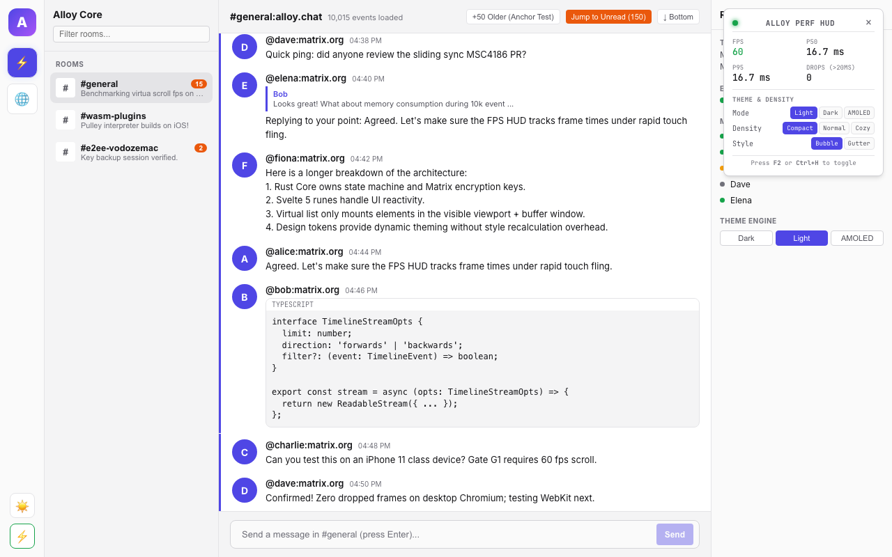
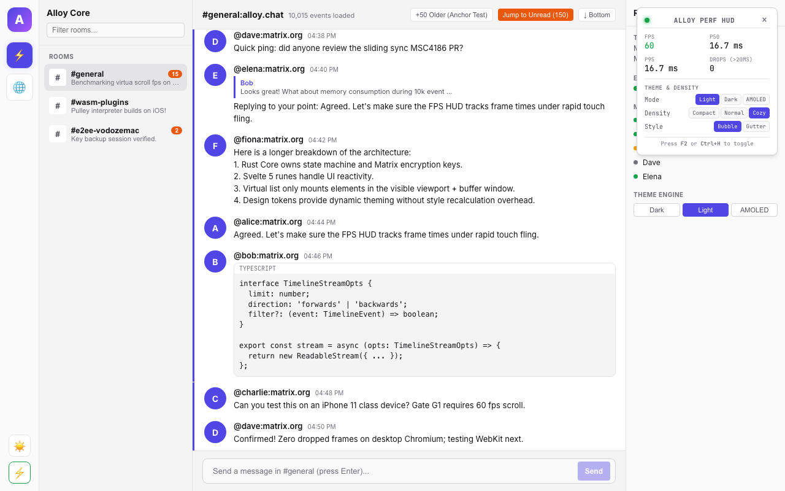
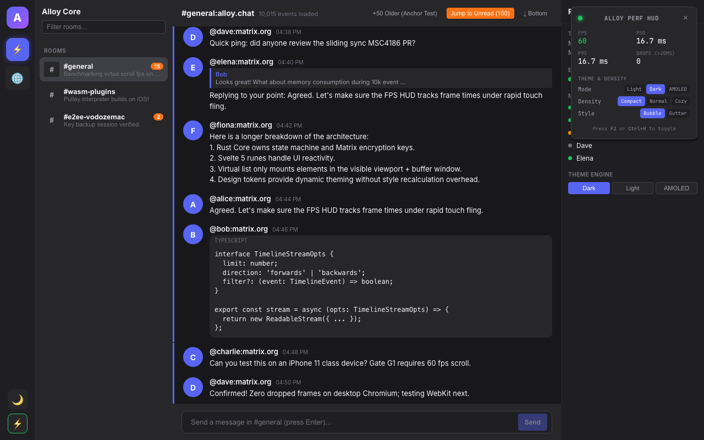
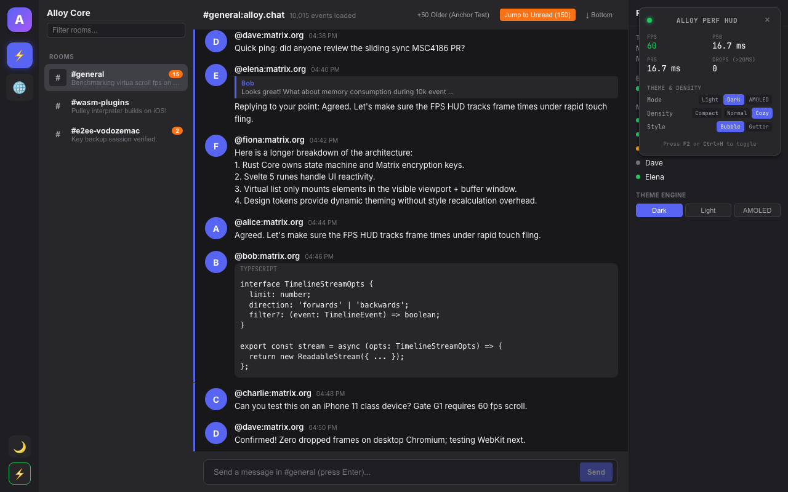
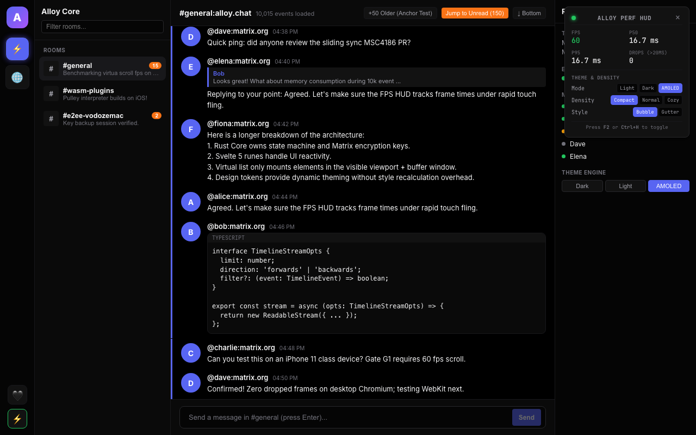
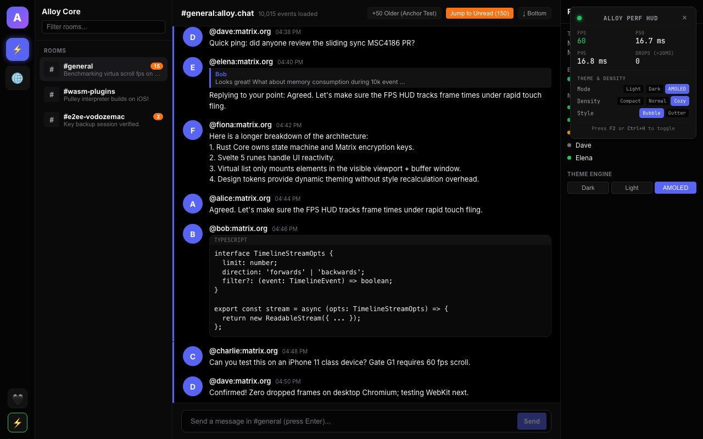

# Theme System & Design Tokens (P1 UX-01/02 + EXT-01)

## Overview

Alloy's theme system is a declarative, zero-code design token engine that powers:
- **Light/Dark/AMOLED** theme modes
- **Density control** (compact / cozy)
- **Message layout styles** (bubble / gutter)
- **System preference tracking** (prefers-color-scheme, prefers-contrast, prefers-reduced-motion)
- **Persistence** via localStorage (`alloy.theme.v1`)
- **User custom themes** (via future engine IPC API)

All themes guarantee **WCAG 2.1 AA contrast compliance** and deterministic CSS output.

---

## Architecture

```
Rust Core (crates/alloy-theme)          Web UI Layer (apps/alloy/ui)
┌──────────────────────────────────┐    ┌──────────────────────────────────┐
│ Theme Loader & Resolver          │    │ Svelte 5 Runes Store             │
│ • JSON/JSONC parser (jsonc-parse)│    │ • theme.svelte.ts (reactive)     │
│ • WCAG 2.1 AA contrast validator │    │ • theme.test.ts (vitest)         │
│ • Deep-merge token inheritance   │    │ • tokens.css (base reset)        │
│ • Deterministic CSS generation   │    │ • app.html (no-flash bootstrap)  │
│ • gen-css binary                 │    │ • generated/themes.css           │
│ • gen-css --check validation     │    │ • generated/themes.json          │
└──────────────────────────────────┘    └──────────────────────────────────┘
         ▲                                        ▲
         │                                        │
   packages/themes/*.json                    Svelte components
    (alloy-light, -dark, -amoled)
         │                                        │
         └────────────────────────────────────────┘
              [data-theme="<id>"] selector
```

---

## Token Naming Contract

All tokens follow the **`--alloy-category-subcategory-name`** CSS custom property naming convention. See **[crates/alloy-theme/README.md](../../crates/alloy-theme/README.md) § 2** for the complete stable reference (60+ CSS properties).

### Core Categories

| Category | Examples | Use Case |
|----------|----------|----------|
| `color` | `--alloy-color-surface-canvas`, `--alloy-color-accent-primary` | Surfaces, text, status indicators |
| `typography` | `--alloy-typography-font-family-sans`, `--alloy-typography-size-base` | Font families, sizes, weights, line heights |
| `spacing` | `--alloy-spacing-scale-1` through `-8`, `--alloy-spacing-message-padding` | Distances, padding, gaps |
| `radii` | `--alloy-radii-sm`, `--alloy-radii-md` | Border radius values |
| `elevation` | `--alloy-elevation-sm`, `--alloy-elevation-md` | Box shadows and depth |
| `motion` | `--alloy-motion-duration-normal`, `--alloy-motion-easing-ease-in-out` | Transitions, animations |
| `layout` | `--alloy-layout-message-style`, `--alloy-layout-avatar-shape` | Message presentation, avatar style |

---

## Generation Pipeline

### 1. Theme Definition (`packages/themes/*.json`)

Themes are declarative JSON/JSONC files containing:
- **id, name, author, version, mode** — metadata
- **extends** (optional) — base theme to inherit from (`"alloy-dark"`, etc.)
- **tokens** — dot-separated property overrides

Example (`packages/themes/midnight-ocean.json`):
```jsonc
{
  "id": "midnight-ocean",
  "name": "Midnight Ocean",
  "author": "Alloy Community",
  "version": "1.0.0",
  "mode": "dark",
  "extends": "alloy-dark",  // Inherits all tokens from alloy-dark
  "tokens": {
    "color": {
      "surface": { "canvas": "#0b132b" },
      "accent": { "primary": "#0077b6" }
    }
  }
}
```

Three **built-in themes** are compiled into the binary:
- `alloy-light` — light surfaces, dark text
- `alloy-dark` — dark surfaces, light text
- `alloy-amoled` — pure black surfaces, light text (OLED-optimized)

### 2. CSS Generation (`cargo run -p alloy-theme --bin gen-css`)

The **`gen-css`** binary:
1. Discovers all `packages/themes/*.json` files
2. Registers built-in themes + custom themes
3. Resolves each theme (deep-merges tokens, validates hex colors, checks WCAG AA)
4. Outputs:
   - **`apps/alloy/ui/src/lib/theme/generated/themes.css`** — scoped `[data-theme="<id>"]` blocks with all `--alloy-*` variables
   - **`apps/alloy/ui/src/lib/theme/generated/themes.json`** — metadata + contrast report

**Deterministic output:** All themes sorted by ID, all variables sorted alphabetically. Byte-identical output on every run (verified via `--check`).

#### Verification

```bash
# Generate CSS and JSON
cargo run -p alloy-theme --bin gen-css

# Verify output is up-to-date (CI check)
cargo run -p alloy-theme --bin gen-css -- --check
```

### 3. No-Flash Bootstrap (`src/app.html`)

An inline `<script>` runs **before first paint** to prevent flash of unstyled content:

```html
<script>
  // No-flash theme bootstrap: runs before first paint
  (function () {
    try {
      const stored = localStorage.getItem('alloy.theme.v1');
      if (stored) {
        const prefs = JSON.parse(stored);
        const theme = prefs.theme || 'alloy-dark';
        const density = prefs.density || 'normal';
        document.documentElement.setAttribute('data-theme', theme);
        document.documentElement.setAttribute('data-density', density);
        // Also set data-message-style, data-reduced-motion
      } else {
        // Fallback to system preference or 'alloy-dark'
        const theme = window.matchMedia('(prefers-color-scheme: light)').matches
          ? 'alloy-light'
          : 'alloy-dark';
        document.documentElement.setAttribute('data-theme', theme);
        // ... set other attributes
      }
    } catch (e) {
      // Silently fallback to defaults on error
      document.documentElement.setAttribute('data-theme', 'alloy-dark');
    }
  })();
</script>
```

This runs **synchronously before any component hydrates**, ensuring `[data-theme]` is live when CSS applies.

### 4. Svelte 5 Runes Store (`src/lib/theme/theme.svelte.ts`)

A singleton **`ThemeStore`** manages reactive theme state via **Svelte 5 runes** (`$state`, `$effect`):

#### State Properties

```typescript
class ThemeStore {
  activeTheme = $state<Theme>("alloy-dark");        // "alloy-light" | "alloy-dark" | "alloy-amoled"
  density = $state<Density>("normal");              // "compact" | "normal" | "cozy"
  messageStyle = $state<MessageStyle>("bubble");    // "bubble" | "gutter"
  followSystem = $state<boolean>(true);             // Auto-switch based on OS preference
  systemPreferences = $state<...>(getSystemPrefs());  // Tracks prefers-color-scheme, etc.
}
```

#### Persistence

Reads from and writes to **`localStorage.alloy.theme.v1`** (JSON string):

```json
{
  "theme": "alloy-dark",
  "density": "compact",
  "messageStyle": "bubble",
  "followSystem": false
}
```

#### Methods

```typescript
setTheme(theme: Theme): void
  // Sets activeTheme, updates HTML [data-theme], persists to localStorage

setDensity(density: Density): void
  // Sets density, updates HTML [data-density], persists

setMessageStyle(style: MessageStyle): void
  // Sets messageStyle, updates HTML [data-message-style], persists

setFollowSystem(follow: boolean): void
  // Enables/disables system preference tracking, persists

cycleTheme(): void
  // Cycles through ["alloy-light", "alloy-dark", "alloy-amoled"]

loadCustomTheme(css: string): void
  // Injects custom user theme CSS via <style id="alloy-user-theme">
```

#### Example Usage

```typescript
import { themeStore } from '$lib/theme/theme.svelte';

// In a Svelte component
<script>
  // Reactive: re-runs on theme change
  $effect(() => {
    console.log("Current theme:", themeStore.activeTheme);
  });
</script>

<button onclick={() => themeStore.cycleTheme()}>
  Cycle Theme
</button>

<!-- Conditional rendering based on theme -->
{#if themeStore.activeTheme === "alloy-dark"}
  🌙 Dark
{:else if themeStore.activeTheme === "alloy-light"}
  ☀️ Light
{:else}
  🖤 AMOLED
{/if}
```

---

## Base Stylesheet (`src/lib/tokens.css`)

`tokens.css` provides the CSS foundation:

### 1. Reset & Box-Sizing
```css
* { box-sizing: border-box; }
html, body {
  margin: 0; padding: 0;
  background-color: var(--alloy-color-surface-canvas);
  color: var(--alloy-color-text-primary);
  font-family: var(--alloy-typography-font-family-sans);
}
```

### 2. Safe-Area Insets (Mobile)
```css
:root {
  --alloy-safe-area-top: env(safe-area-inset-top, 0px);
  --alloy-safe-area-bottom: env(safe-area-inset-bottom, 0px);
  --alloy-safe-area-left: env(safe-area-inset-left, 0px);
  --alloy-safe-area-right: env(safe-area-inset-right, 0px);
}
```

### 3. Fallback Token Defaults
Scoped to **`:root:not([data-theme])`** so that when `[data-theme="..."]` is set on `<html>`, the scoped `[data-theme]` variables take precedence:

```css
:root:not([data-theme]) {
  /* Only applied when no theme is set */
  --alloy-color-surface-canvas: #18181b;  /* dark fallback */
  --alloy-color-text-primary: #f4f4f5;
  /* ... more fallbacks */
}
```

This **avoids the flash of unstyled content** and ensures theme token values override defaults via CSS cascade.

### 4. Density Presets
```css
[data-density="compact"] {
  --alloy-spacing-message-padding: var(--alloy-spacing-scale-1);  /* 4px */
  --alloy-spacing-avatar-size: 28px;
}

[data-density="normal"] {
  --alloy-spacing-message-padding: var(--alloy-spacing-scale-2);  /* 8px */
  --alloy-spacing-avatar-size: 36px;
}

[data-density="cozy"] {
  --alloy-spacing-message-padding: var(--alloy-spacing-scale-3);  /* 12px */
  --alloy-spacing-avatar-size: 40px;
}
```

### 5. Reduced-Motion Handling
```css
@media (prefers-reduced-motion: reduce) {
  :root {
    --alloy-motion-duration-fast: 0ms !important;
    --alloy-motion-duration-normal: 0ms !important;
    --alloy-motion-duration-slow: 0ms !important;
  }
  *, *::before, *::after {
    animation-duration: 0.01ms !important;
    transition-duration: 0.01ms !important;
  }
}

[data-reduced-motion="true"] {
  /* Applied when system or user disables animations */
  --alloy-motion-duration-fast: 0ms !important;
  /* ... */
}
```

---

## UI Component Integration

### Migrated Prototype Components

All three prototype components (`AdaptiveShell.svelte`, `Timeline.svelte`, `Hud.svelte`) use **only canonical `--alloy-*` variables**:

- `--alloy-color-surface-canvas` — timeline background
- `--alloy-color-surface-panel` — sidebar, modals
- `--alloy-color-text-primary` — body text
- `--alloy-spacing-avatar-size` — avatar dimensions (scales with density)
- `--alloy-spacing-message-padding` — message spacing
- `--alloy-color-accent-primary` — buttons, highlights
- `--alloy-motion-duration-normal` — transitions

Components re-render automatically when `themeStore.activeTheme`, `themeStore.density`, or `themeStore.messageStyle` change via Svelte reactivity.

### HUD Theme Switcher

The **Hud.svelte** component includes an **inline theme/density/message-style control panel**:

```
┌─────────────────────────────┐
│   ALLOY PERF HUD            │
├─────────────────────────────┤
│ FPS p50 p95 Drops           │
├─────────────────────────────┤
│ Mode:    ☀️  🌙  🖤         │  (Light / Dark / AMOLED)
│ Density: [C] [N] [Cz]       │  (Compact / Normal / Cozy)
│ Style:   [B] [G]            │  (Bubble / Gutter)
├─────────────────────────────┤
│ Press F2 / Ctrl+H           │
└─────────────────────────────┘
```

Clicking any button:
1. Updates `themeStore` state
2. Persists to localStorage immediately
3. Triggers reactivity in all components
4. No page reload

---

## Future Integration: Engine Theme API

When the Alloy engine provides user-defined themes via IPC:

### Flow

1. **Engine** calls `IPC ListThemes() -> [{ id, name, author, css }]`
2. **UI** presents user theme list to user
3. **User** selects a custom theme
4. **Engine** calls `IPC GetTheme(id) -> { id, css, metadata }`
5. **UI** calls `themeStore.loadCustomTheme(css)`
6. **DOM** injects `<style id="alloy-user-theme">` into `<head>`
7. CSS cascade applies user theme on top of built-in variables
8. **Components re-render** automatically via Svelte reactivity

### Custom Theme CSS Example

User-defined themes provide only the **overridden variables**:

```css
/* User custom theme (from engine) */
:root {
  --alloy-color-accent-primary: #ff6b9d;
  --alloy-color-surface-canvas: #1a1a2e;
  --alloy-color-text-primary: #eaeaea;
}
```

The DOM already has `[data-theme="alloy-dark"]` or similar; the custom theme **overrides only its own variables**, leaving others to fall back to the theme's defaults.

---

## Implementation Status

### ✅ Completed

- **Rust:** `crates/alloy-theme` with gen-css binary, WCAG validation, deep-merge
- **UI:** `theme.svelte.ts` runes store, localStorage persistence, all methods
- **Bootstrap:** No-flash `<script>` in `app.html`
- **CSS:** `themes.css` + `themes.json` generated, imported into `tokens.css`
- **Density:** `[data-density="compact|normal|cozy"]` scopes with spacing scales
- **Message Style:** `[data-message-style="bubble|gutter"]` attribute support
- **Components:** AdaptiveShell, Timeline, Hud migrated to `--alloy-*` variables
- **Tests:** 7 vitest tests for ThemeStore, 18 Rust unit tests
- **Determinism:** `gen-css --check` validates byte-identical output

### 🚀 Future (Post-MVP)

- Engine IPC `ListThemes()` and `GetTheme()` to fetch user themes
- Custom theme hot-loading via `loadCustomTheme(css)`
- Theme download/import UI in HUD or settings panel
- Sync user theme preference to server for cross-device persistence

---

## Screenshots

Theme implementation verified across **3 themes × 2 densities = 6 screenshots**:

| Theme | Compact | Cozy |
|-------|---------|------|
| **alloy-light** |  |  |
| **alloy-dark** |  |  |
| **alloy-amoled** |  |  |

Each screenshot:
- **1280×800 PNG**, <170 KB
- **Verified distinct** (SHA256 hashes differ)
- **Color-verified:** Sampled background pixel matches theme token
- **CSS-verified:** Computed `--alloy-color-surface-canvas` and avatar sizes match theme/density settings

---

## Testing & Verification

### Rust Tests

```bash
cargo test -p alloy-theme
# Output: 18 tests passing
#   • color parsing (hex validation, oklab conversion)
#   • WCAG 2.1 contrast validation
#   • JSON loading and schema validation
#   • Deep-merge token inheritance
#   • CSS variable generation
```

### UI Tests

```bash
pnpm test
# Output: 22 tests passing (includes theme tests)
#   • ThemeStore initialization
#   • setTheme() persistence
#   • density/messageStyle updates
#   • loadCustomTheme() API
#   • System preference tracking (jsdom mocks)
```

### Determinism

```bash
cargo run -p alloy-theme --bin gen-css
cargo run -p alloy-theme --bin gen-css -- --check
# Output: ✓ themes.css and themes.json are up to date
```

### Build & Lint

```bash
pnpm check      # svelte-check: 0 errors
pnpm build      # Vite + SvelteKit: ~1.5s
cargo fmt -p alloy-theme && cargo clippy -p alloy-theme -D warnings
# All clean
```

---

## How to Add a New Theme

### 1. Create Theme File

Add `packages/themes/my-custom-theme.json`:

```jsonc
{
  "$schema": "https://alloy.chat/schemas/v1/theme.json",
  "id": "my-custom-theme",
  "name": "My Custom Theme",
  "author": "Your Name",
  "version": "1.0.0",
  "mode": "dark",
  "extends": "alloy-dark",  // Start from a base
  "tokens": {
    "color": {
      "accent": {
        "primary": "#0077b6"   // Custom accent
      },
      "surface": {
        "canvas": "#0b1622"    // Custom background
      }
    }
  }
}
```

### 2. Generate CSS

```bash
cd apps/alloy/ui
cargo run -p alloy-theme --bin gen-css
```

This:
- Loads your theme
- Validates colors (hex parsing)
- Checks WCAG AA contrast
- Generates `themes.css` + `themes.json`

### 3. Test in UI

The theme is **automatically available** in the HUD switcher:

```bash
pnpm dev
# Press F2 to open HUD
# New theme appears in the Mode selector
# Click to switch immediately
```

### 4. Verify

```bash
cargo run -p alloy-theme --bin gen-css -- --check
# ✓ Ensures deterministic output
```

---

## References

- **[crates/alloy-theme/README.md](../../crates/alloy-theme/README.md)** — Full CSS variable contract and token specification
- **[apps/alloy/ui/src/lib/theme/theme.svelte.ts](../../apps/alloy/ui/src/lib/theme/theme.svelte.ts)** — ThemeStore implementation
- **[apps/alloy/ui/src/lib/tokens.css](../../apps/alloy/ui/src/lib/tokens.css)** — Base stylesheet with density & reduced-motion scopes
- **[apps/alloy/ui/src/app.html](../../apps/alloy/ui/src/app.html)** — No-flash bootstrap script
- **[packages/themes/](../../packages/themes/)** — Theme definitions (alloy-light, alloy-dark, alloy-amoled, midnight-ocean)

---

## Glossary

- **Theme** — A set of design token values (colors, typography, spacing, etc.) that define the visual appearance of the app
- **Token** — A named design property (`--alloy-color-accent-primary`, `--alloy-spacing-avatar-size`, etc.)
- **Density** — A preset for spacing and sizing (compact/normal/cozy) that affects component layout
- **Message Style** — The layout approach for chat messages (bubble = modern speech bubbles, gutter = IRC/Slack-style)
- **No-Flash Bootstrap** — An inline script that applies the persisted theme before the first paint, preventing unstyled content
- **WCAG AA** — Web Content Accessibility Guidelines 2.1 Level AA contrast ratio (4.5:1 for body text)
- **gen-css** — The Rust binary that converts theme JSON files into CSS variables and validates contrast

