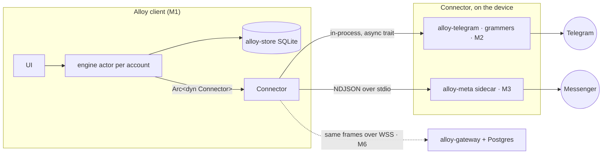
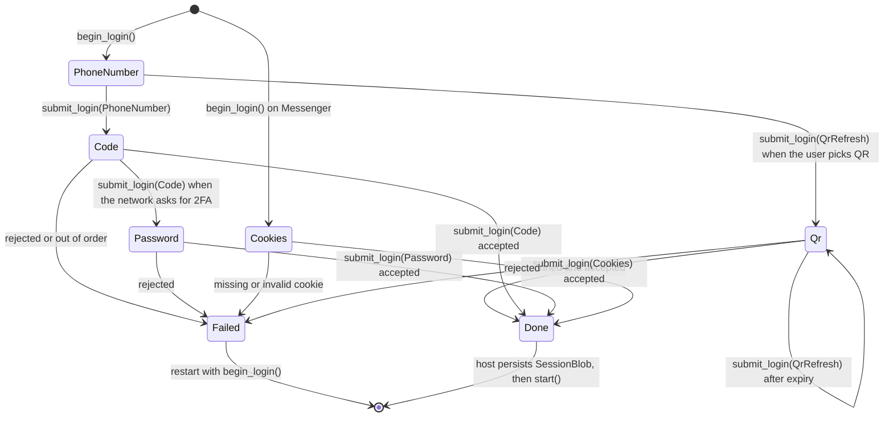
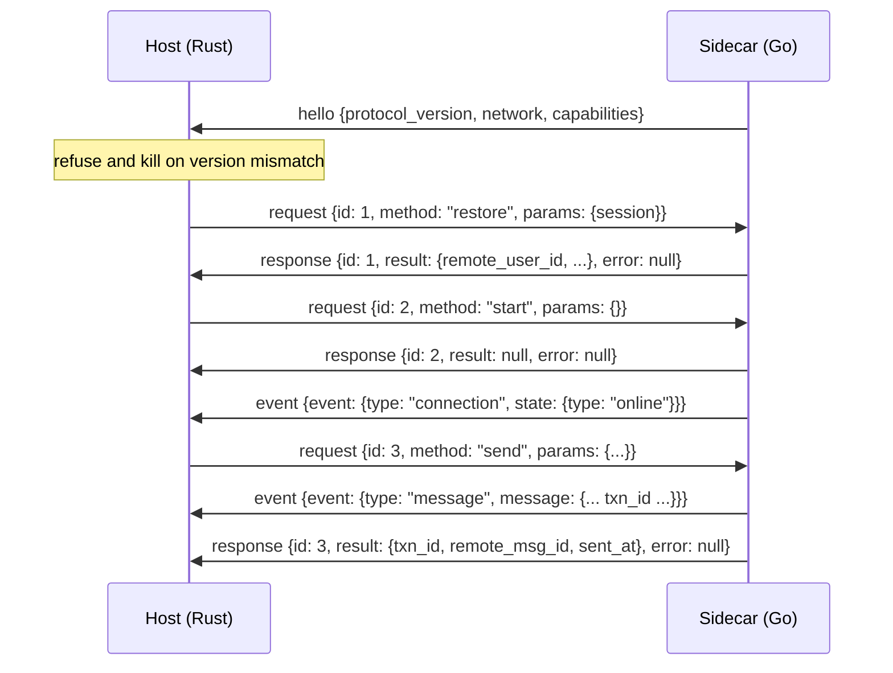

# 10 — Connector Protocol (M0 contract)

Status: implemented by `crates/alloy-connector` (issue #128, epic #125). Decision record:
[ADR 0016](../decisions/0016-on-device-connectors.md).

This document specifies the contract between Alloy's engine and a **connector**: the component
that talks to one network (Telegram, Messenger, or the test fake) on behalf of one personal
account. The crate contains no network code, no database code and no engine code, so the same
contract can be driven in-process, across a process boundary, or by the optional M6 gateway.

- `alloy-connector` and `alloy-store` do not depend on each other; the M1 engine maps between them.
- Nothing in the engine, protocol or UI changes in M0. This wave freezes the contract only.



## 1. Wire primitives

| Primitive | Representation |
|---|---|
| Network name | `"telegram"`, `"messenger"` (tests: `"fake"`), lowercase everywhere: wire, SQLite, capabilities |
| `account_id` | locally generated opaque TEXT (UUID v4); never produced by a connector |
| Remote ids (`remote_chat_id`, `remote_msg_id`, `remote_user_id`) | opaque TEXT exactly as the network gives it; no parsing, no concatenation |
| Local message id | UUID string owned by the store |
| `txn_id` | client-generated UUID string; reconciles the outbox with the remote echo |
| Timestamps | `i64` milliseconds since the Unix epoch, UTC (including `Qr::expires_at`) |
| Session material | `SessionBlob`: opaque bytes, base64 (standard, padded) on the wire, redacted in `Debug`, encrypted at rest by the host |

Unit-only enums serialize as bare strings (`"telegram"`, `"image"`). Data-carrying enums are
internally tagged with `"type"` (`{"type":"rate_limited","retry_after_ms":1500}`).

## 2. Domain values

```text
RemoteChat    { remote_chat_id, kind: direct|group|channel, title, avatar: Option<MediaRef>,
                last_activity_at, unread_count, is_pinned, is_archived, is_muted }
RemoteUser    { remote_user_id, display_name, avatar: Option<MediaRef> }
RemoteMessage { remote_chat_id, remote_msg_id, txn_id: Option<String>, sender_remote_id, is_own,
                sent_at, edited_at: Option<i64>,
                kind: text|image|video|audio|voice|file|sticker|location|system,
                body: Option<String>, formatted: Option<String>,
                reply_to_remote_msg_id: Option<String>, media: Option<MediaRef> }
MediaRef      { remote_ref (opaque), mime, size_bytes?, width?, height?, duration_ms?, file_name? }
```

`unread_count` is the network's notification count, not a message count (muted Telegram chats
still count notifications, and the flag `is_muted` lets the UI decide what to badge). `body` is
absent for media-only messages; `formatted` carries network markup when the network supplies it.

## 3. Capabilities

Every connector declares its own [`Capabilities`](../../crates/alloy-connector/src/capabilities.rs);
there is no shared default that pretends support. A `false` flag promises the matching method
fails with `NotSupported`, and the UI hides the action instead of offering one that fails.

| Field | Meaning |
|---|---|
| `edit`, `edit_window_secs` | editing allowed; `None` window = connector knows of no limit |
| `delete_for_everyone` | network deletes for all participants |
| `reactions`, `max_reactions_per_user` | reaction support and per-user limit per message |
| `replies`, `threads` | reply-to-message and thread support |
| `typing` | typing indicators can be sent |
| `read_receipts`, `delivered_receipts` | receipts from other participants are reported |
| `voice`, `polls`, `location` | message kinds the network accepts |
| `max_upload_bytes` | largest attachment accepted; `None` when unknown |
| `formatted_text` | network renders markup in `RemoteMessage::formatted` |

Expected values (Telegram and Messenger are fixed by their M2/M3 connectors; the fake's values are
final):

| Network | edit | delete all | reactions | threads | polls | voice | formatted |
|---|---|---|---|---|---|---|---|
| telegram | yes (48 h) | yes | yes (1/user) | no | no | yes | yes |
| messenger | yes | yes | yes | no | yes | yes | no |
| fake | yes (no window) | yes | yes (3/user) | no | no | yes | no |

### 3.1 Network readiness and setup

`ListNetworks` reports `NetworkInfoDto { network, ready, setup }`, not a bare network name, so the
UI can tell "this build does not ship the network" from "this network needs a setting first".

| Field | Meaning |
|---|---|
| `network` | `telegram`, `messenger` (tests: `fake`) |
| `ready` | `BeginLogin` can start now; `false` means `setup` explains what is missing |
| `setup` | `NetworkSetupDto { kind, app_url, fields }`, or `null` when ready |

- **Telegram** is always listed. It is `ready: false` with `setup.kind = telegram_app`,
  `app_url = "https://my.telegram.org/apps"` and fields `api_id` (visible) and `api_hash`
  (`secret: true`) until the user enters the application pair. `BeginLogin` on that state fails
  with `not_supported`, reason `telegram application credentials`.
- **Messenger** is listed only when the sidecar executable exists, and is always `ready: true`
  with `setup: null`: no application-level configuration is involved.

The pair is the *application's*, not the account's. It is entered once and sealed in the OS keyring
under `alloy.telegram.app.v1` as `{"api_id":<i32>,"api_hash":"<hex>"}`; the engine resolves it per
call (sealed value, then `ALLOY_TELEGRAM_API_ID`/`ALLOY_TELEGRAM_API_HASH` for development, then
none), so a saved pair takes effect without a restart. `SetTelegramApp` validates `api_id > 0` and
a 32-character hex `api_hash` (`invalid_argument` otherwise), `ClearTelegramApp` deletes it, and
`GetTelegramApp` returns `{ configured, api_id, source }` with `source` one of `runtime`,
`environment`, `none`. No response ever carries the `api_hash`.

## 4. Login

Login is a total state machine owned by the connector. The host never sequences credentials
itself: it shows the step it is given and submits the user's answer.

- `begin_login() -> LoginStep` — starts an attempt and returns the first step. It may contact the
  network (a Telegram QR token needs a round-trip), so transport failure is a `Failed` step, not
  an `Err`.
- `submit_login(LoginInput) -> LoginStep` — consumes the answer and returns the next step. Wrong,
  expired or out-of-order input is a `Failed` step.
- `Failed` is **terminal** for that attempt: the host restarts with `begin_login()`.
- `LoginFailure` distinguishes rejected input (with the offending `field`), expired steps, rate
  limits, transport failures, an unsupported login method, and a network-locked account.
- `Done { remote_user_id, display_name, session }` — the host persists `session` before calling
  `start()`. The connector never sees the database.
- Secrets live only in `LoginInput`, whose `Debug` prints `<redacted>` for codes, passwords and
  cookie values (cookie *names* stay visible for diagnostics). `SessionBlob` prints only a byte
  count.

| Step | Input | Notes |
|---|---|---|
| `PhoneNumber` | `PhoneNumber { phone }` | international format |
| `Code { via, length }` | `Code { code }` | `via`: `app`, `sms`, `email`, `other`; `length` when the network says so |
| `Password { hint }` | `Password { password }` | two-step verification; hint is network text, never the password |
| `Qr { payload, expires_at }` | `QrRefresh` | refresh when expired, or when the user chooses QR login |
| `Cookies { fields, help_url }` | `Cookies { values }` | `values` keyed by `CookieField::name`; `required` marks mandatory cookies |
| `Credentials { username_label }` | `Credentials { username, password }` | networks that log in with a handle |
| `Done { … }` | — | terminal |
| `Failed { reason }` | — | terminal |



## 5. Trait surface

`Connector: Send + Sync`, object-safe, all methods take `&self` (the engine holds one
`Arc<dyn Connector>` per account; implementations use interior mutability). Method names below are
also the RPC method names.

| Method | Semantics |
|---|---|
| `network()` | `Network` the connector speaks |
| `capabilities()` | section 3 |
| `begin_login()`, `submit_login(input)` | section 4 |
| `restore(session)` | rebuild a session from a stored blob; `Unauthorized` when invalid/expired |
| `start(events)` | begin live updates: `Connecting`, then `Online`; replaces any previous sender |
| `stop()` | stop live updates, drop the sender, keep the session; idempotent |
| `list_chats(cursor, limit)` | newest activity first, archived included, stable order; opaque cursor |
| `backfill(chat, before, limit)` | newest first, `before` exclusive, `next_cursor` = oldest returned id or `None` |
| `send(OutgoingMessage)` | returns `SendAck { txn_id, remote_msg_id, sent_at }` after the network accepts |
| `edit(chat, msg, body, formatted)` | `NotSupported` when `edit` is false or the window passed |
| `delete(chat, msg, for_everyone)` | `for_everyone` requires the capability |
| `react(chat, msg, emoji)` / `unreact(...)` | enforces `max_reactions_per_user`; unknown message is `InvalidInput` |
| `mark_read(chat, up_to_msg)` | idempotent; connectors must actually report it (Telegram terms §1.4) |
| `set_typing(chat, typing)` | send or stop a typing indicator |
| `fetch_media(media, dest_path)` | writes the file, returns bytes written |
| `logout()` | best-effort remote revocation, then wipe local credentials; idempotent |

`Page<T> { items, next_cursor }` is the return of both paged calls. `limit == 0` is
`InvalidInput`. Cursors and `before` anchors are connector-issued opaque strings; an unknown
anchor is `InvalidInput`.

Sending is reconciled by `txn_id`: the host writes the outbox row, the connector returns the ack
with the same `txn_id`, and the live echo (`ConnectorEvent::Message`) carries it as well. The echo
may arrive before or after the ack; both must agree on `remote_msg_id` and `sent_at`.

## 6. Events

Events are pushed only after `start()`; the host applies them in order and never polls. Events are
not replayed — history comes from `backfill`.

| Event | Meaning |
|---|---|
| `Connection { state }` | `connecting`, `online`, `offline { reason }`, `needs_relogin` |
| `ChatUpserted { chat }` | chat appeared or its metadata changed |
| `ChatRemoved { remote_chat_id }` | chat no longer visible to the account |
| `Message { message }` | new message, including the echo of a local send (`txn_id` set) |
| `MessageEdited { chat, msg, body, formatted, edited_at }` | full replacement body |
| `MessageDeleted { chat, msg }` | removed locally or for everyone |
| `Reaction { chat, msg, sender, emoji, added }` | reaction added or removed |
| `ReadMarker { chat, user, up_to_msg }` | another participant read up to a message |
| `Typing { chat, user, typing }` | typing indicator started or stopped |
| `SessionUpdated { session }` | connector rotated credentials; the host must persist the blob |

`needs_relogin` and `Unauthorized` mean the same thing on two channels: the stored session is dead
and only a new login helps. No automatic retry follows either.

## 7. Errors

| Variant | Retryable | Meaning |
|---|---|---|
| `Unauthorized` | no | session dead; run login again |
| `RateLimited { retry_after_ms }` | yes | wait, then retry (`FLOOD_WAIT` maps here) |
| `NotSupported { feature }` | no | capability is `false`, or the connector lacks the method |
| `Network { message }` | yes | transport failure (offline, TLS, DNS, closed socket) |
| `Protocol { message }` | no | peer violated the contract; recreate the transport (restart the sidecar) |
| `InvalidInput { message }` | no | caller bug or invalid path/cursor/target |

`ConnectorError::is_retryable()` is the single place this classification lives.

## 8. NDJSON sidecar framing

Out-of-process connectors speak newline-delimited JSON over stdin/stdout, exactly one object per
line, no pretty printing. `PROTOCOL_VERSION` is `1`; a host **must refuse** a sidecar announcing
any other version and terminate it.



Frames:

```json
{"type":"hello","protocol_version":1,"network":"messenger","capabilities":{"edit":true,"edit_window_secs":null,"delete_for_everyone":true,"reactions":true,"max_reactions_per_user":1,"replies":true,"threads":false,"typing":true,"read_receipts":true,"delivered_receipts":false,"voice":true,"polls":true,"location":true,"max_upload_bytes":26214400,"formatted_text":false}}
{"type":"request","id":7,"method":"list_chats","params":{"cursor":null,"limit":50}}
{"type":"response","id":7,"result":{"items":[],"next_cursor":null},"error":null}
{"type":"event","event":{"type":"typing","remote_chat_id":"t_1","remote_user_id":"u_1","typing":true}}
```

Rules:

1. The sidecar writes `hello` first and sends no other frame until the host has accepted the
   version and capabilities.
2. `id` is chosen by the host, unique for the life of the process; the sidecar only echoes it.
   Exactly one `response` per `request`, with exactly one of `result`/`error` set. `result` is the
   method's return value (`null` for `()`-returning methods).
3. `method` is the trait method name in snake_case; `params` is an object keyed by argument name.
   `fetch_media` passes a path string; `restore` passes the base64 session blob.
4. Events may be interleaved between any two requests/responses. The host must apply them in
   arrival order.
5. `decode_frame` rejects empty lines, non-JSON, unknown tags and unknown error variants as
   `Protocol` errors; a host that sees one should restart the sidecar rather than guess.
6. The sidecar is a separate executable (AGPL-3.0, M3) and is never linked into Alloy.

## 9. Deployment modes

| Mode | Milestone | Transport | Notes |
|---|---|---|---|
| In-process | M2 | `Arc<dyn Connector>` over the trait | `alloy-telegram` on grammers; no serialization on the hot path, but every value is still `Serialize` so M6 can reuse it |
| Sidecar | M3 | NDJSON over stdio, host supervises the process | `alloy-meta` on `messagix`; licence review gate before release; crash = `Protocol` + restart |
| Gateway | M6 (optional) | the same frames over WSS | connectors hosted server-side on Postgres; clients resume from `event_log.seq`; Web Push becomes available again |

The contract is deliberately transport-agnostic: the trait is the in-process API, the frames are
its JSON encoding, and the M6 gateway replays stored events with the same shapes.

The deterministic fake connector (feature `testing`, `alloy_connector::fake`) implements this
contract end to end and is what the contract tests drive:
`cargo test -p alloy-connector --features testing`. Its login accepts any non-empty phone number
and the code `12345`, and it seeds three chats with history.

## 10. Non-goals

- No engine, protocol v2 or UI changes in M0; the fake connector is exercised through the trait and
  the frames only.
- No process spawning in this crate: supervising the M3 sidecar belongs to the connector that owns
  it.
- No database access: persistence, encryption and `account_id` assignment belong to `alloy-store`
  and the engine.
